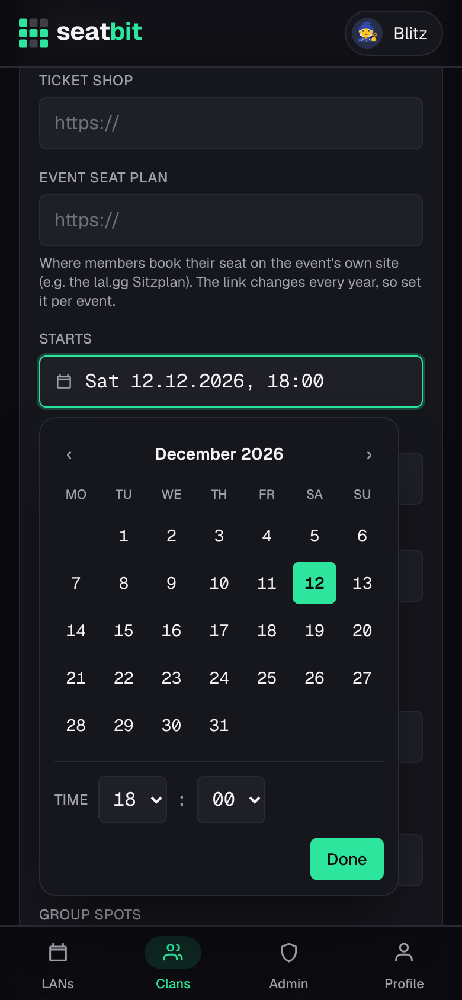
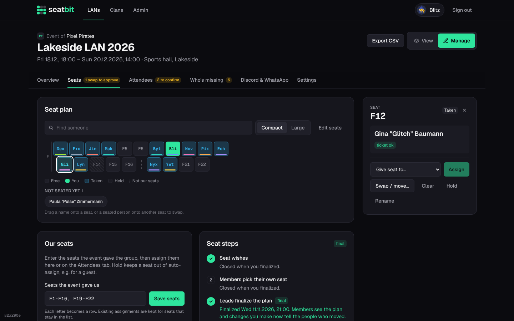

# Seatbit

Seatbit helps a clan or group of friends coordinate going to LAN parties run by others (think SwitzerLAN or Lock&Load with 30+ people): who's coming, who has bought a ticket, and who sits where in the group's seat block.

- **LANs**: each event the group goes to, with dates, location, event website, ticket shop link, ticket price and the number of group spots.
- **Orgas per LAN**: the members who coordinate the group for that event. Only they (and global admins) can edit the LAN, the seat block and attendance. Any orga can add co-orgas.
- **Attendance**: members answer *going / maybe / can't make it*. When the group's spots are full, new sign-ups go on a **waitlist** and move up automatically (with an email) when someone drops out.
- **Member checklist per LAN**: sign up, set nickname, buy ticket (members tick it off, orgas confirm), claim a seat. Progress shows on the LAN list.
- **Status at a glance**: no answer, attending, seat claimed (with seat number), waitlist/full, maybe, not going, plus free seats left.
- **Due dates and email reminders**: an answer deadline and a buy-ticket deadline per LAN. Reminders go out automatically N days before each (to undecided members and to attendees without a ticket) and one day before the LAN (to everyone going). Each one goes out once per person; orgas can also nudge manually; members can opt out.
- **Seat plan**: a compact grid of the seats the group has (seat label or the first letters of the nick), so even a big block fits on a phone. Tap a seat to see who sits there in a details pane (side panel on desktop, bottom sheet on phones); switch to *Large* to show whole nicks (remembered per device), and use *Find someone* to highlight people.
  - **Orgas edit seats right in the map**: tap a seat to assign or give it to someone, swap or move people, clear it, hold it for a guest or rename it to match the event's numbering. People without a seat are listed under *Not seated yet*: tap one and then a seat, or drag names and seated people around on desktop. *Edit seats* adds and removes single seats for aisles; the Seats tab also fills/clears rows, auto-assigns by seat wishes and publishes the plan.
  - **Seat picking** (optional): orgas can let members choose their own free seat before the plan is published. Members with a ticket tap a free seat and *Take this seat* (or *Move here* / *Give up my seat*).
  - **Booking on the event site**: put the event's own seat plan link (e.g. the lal.gg Sitzplan, new every year) on the event. Once the plan is published, each member gets a checklist step and a DM with an *I booked it* button to book the same seat there. Orgas see who booked, can remind the rest, and a seat change clears the tick.
  - **Seat swaps**: after the plan is out, a member asks another to swap; they accept, an orga approves on the Seats tab and both get told.
- **Games** (event page, Games tab): suggest games with download size, vote, tick off what you installed. Everyone coming gets an "install your games" reminder 2 days before the LAN.
- **Live Discord post**: the pinned announcement also shows tickets, seat bookings and the next deadline (pinning needs the bot's *Pin Messages* permission).
- **Travel** (event page, Travel tab): members offer or ask for rides and places to sleep, grouped by town. Others join an offer with free places; a driver can take a person who asked along with one tap, which also clears their request.
- **Packing list** (event page, Packing list tab): each member gets a private packing list with the usual items (PC, screen, cables, headset, ticket, sleeping bag, ...), adds their own items and ticks them off.
- **CSV export** of the group (seat, nick, name, email, status, ticket) to hand to the event's organisers.
- **Dates and times** are always 24h, Swiss style ("Sat 14.11.2026, 18:00"), with a Monday-first date picker.
- **Nicknames**: several nicks per user, a primary default, and separate nicks per LAN.
- **Login with Discord.** The Discord login asks for the account's email, which is used for reminders. On first login members give their first name, surname and nickname (gamer tag). The first user to sign up becomes global admin. Google and email/password login are switched off for now; turn them back on in `LOGIN_METHODS` in `src/lib/auth.ts`. `ALLOW_EMAIL_LOGIN=1` enables email login for local development and tests.

Brand assets and guidelines are in `brand/` (see `brand/BRAND.md`).

## Screenshots

Phone (390 px) and desktop (1440 px) shots of the main pages are in [`docs/screenshots/`](docs/screenshots/). Regenerate them after UI changes so they stay current.

| LANs | Event | Seat plan | Seat picking |
| --- | --- | --- | --- |
|  |  |  |  |

| Travel | Packing list | Date picker | Orga: seats |
| --- | --- | --- | --- |
|  |  |  |  |

**Desktop:** seat plan with orga tools and the details panel.



More: [LAN list](docs/screenshots/desktop-lans.png) · [event page](docs/screenshots/desktop-event.png) · [attendees](docs/screenshots/desktop-manage-attendees.png) · [clan](docs/screenshots/desktop-clan.png) · [admin](docs/screenshots/desktop-admin.png) · [clan (phone)](docs/screenshots/phone-clan.png) · [profile (phone)](docs/screenshots/phone-profile.png)

## Platform settings

Global admins can configure the platform under **Admin → Platform settings** (`/admin/settings`) without touching the server: SMTP mail relay (with a "send test mail" button), Discord login and bot credentials (with a "check bot & register slash commands" button), sign-up on/off, admin emails, the reminder interval and the cron secret.

- A value saved there wins over the matching environment variable. Clearing it falls back to the env var, then to the default. Each field shows where its current value comes from.
- Passwords, client secrets and tokens are encrypted (AES-256-GCM) before they are stored, and are never shown again; the page only shows whether one is set and its last four characters.
- The encryption key is `SETTINGS_ENCRYPTION_KEY`, or derived from `BETTER_AUTH_SECRET` if that isn't set. If the key changes, saved secrets can't be read any more and have to be entered again (the page says so).
- `BETTER_AUTH_URL`, `BETTER_AUTH_SECRET`, `DATABASE_PATH` and `TZ` are needed at startup, so they stay env-only.

### First start (bootstrap)

Login is Discord-only, so nobody can reach the settings page until Discord login works:

1. Create a Discord application (see below) and start Seatbit with `DISCORD_CLIENT_ID` and `DISCORD_CLIENT_SECRET` set as env vars (plus `BETTER_AUTH_URL` and `BETTER_AUTH_SECRET`).
2. Sign in. **The first account becomes platform admin.** To pick admins up front instead, set `ADMIN_EMAILS` (the emails of their Discord accounts).
3. Everything else (bot token, public key, SMTP, ...) can then be set in the platform settings. Keep the two login env vars in place: if a wrong client ID or secret is ever saved on the settings page, nobody can sign in, and `node scripts/admin.mjs reset-setting discord.clientSecret` (and `discord.clientId`) brings back the env values.

### Admin CLI

`scripts/admin.mjs` manages platform admins straight on the database, also while the app runs (it's in the container image):

```sh
kubectl exec deploy/seatbit -- node scripts/admin.mjs list                    # platform admins
kubectl exec deploy/seatbit -- node scripts/admin.mjs users mike              # find users
kubectl exec deploy/seatbit -- node scripts/admin.mjs grant mike@example.com  # make admin
kubectl exec deploy/seatbit -- node scripts/admin.mjs revoke 123456789012345678
kubectl exec deploy/seatbit -- node scripts/admin.mjs reset-setting discord.clientSecret
```

A user can be given by email, Discord user ID, Seatbit user ID, name or nickname. `grant` with an email nobody has signed in with yet adds it to the admin emails, so that person becomes admin on first sign-in. Locally: `npm run admin -- list`.

## Stack

Next.js 16 (App Router, server actions) · Better Auth · SQLite via Drizzle ORM · Tailwind CSS · Nodemailer.

## Getting started

```bash
npm install
cp .env.example .env.local   # then fill in the values
npm run dev
```

Open http://localhost:3000 and register; the first account is the admin. The database is created in `./data/lan.db` and migrations run automatically on start.

Without an SMTP host (platform settings or env), emails are printed to the server console, so you can try reminders locally.

### Discord / Google login

Buttons only appear when the matching client ID and secret are set.

- **Discord**: create an app at https://discord.com/developers/applications, OAuth2 redirect: `<BETTER_AUTH_URL>/api/auth/callback/discord`
- **Google**: create an OAuth client at https://console.cloud.google.com/apis/credentials, redirect: `<BETTER_AUTH_URL>/api/auth/callback/google`

### Discord bot

The bot uses the same Discord application as the login. It runs inside the app (Discord sends button clicks and slash commands to Seatbit over HTTPS), so there is no extra process to host.

1. In the Discord developer portal, open your app:
   - **Bot**: reset/copy the token into `DISCORD_BOT_TOKEN`.
   - **General Information**: copy the public key into `DISCORD_PUBLIC_KEY`, and set **Interactions Endpoint URL** to `<BETTER_AUTH_URL>/api/discord/interactions` (the app must be running and reachable for Discord to accept it).
2. Click **Check bot & register slash commands** in **Admin → Platform settings → Discord** (or run `npm run discord:register`) once. It registers the slash commands.
3. Any clan can now add the bot: a clan admin opens **Clan settings → Discord & WhatsApp**, invites the bot to their server, and runs `/seatbit here` in the channel it should post in (needs "Manage Server" on Discord and a linked Discord account in Seatbit). A Discord server belongs to one clan; `/seatbit here clan:<name>` picks the clan if you admin several.

What it does, per clan:

- Posts each new LAN of the clan as an announcement with **Coming / Unsure / Not coming** buttons. The attendee list on the post updates live, also when people answer on the website. Only clan members can answer. `/seatbit announce` posts the clan's upcoming LANs in a channel.
- Posts the answer, ticket and "starts tomorrow" reminders in the clan's channels when they're due (same schedule as the emails), pinging the clan members they apply to.
- `/lans` shows the server's clan's upcoming LANs and your status, privately, with answer buttons (in DMs: all your clans).
- Orgas can re-post or post reminders by hand on the LAN's manage page; clan admins can unlink channels in clan settings.

Clan members who aren't on the clan's Discord server see a "Join our Discord" button on the clan page (and get the link when their join request is approved). The bot creates the invite in the linked channel if it has "Create Invite" (included in the invite link from `npm run discord:register`); admins can paste their own under Clan settings → Discord & WhatsApp.

Members are matched by their linked Discord account. Everyone signs in with Discord, so every member is matched automatically.

### WhatsApp

WhatsApp's official API can't post into regular groups or communities, so there is no bot. Instead the LAN's manage page has ready-made announcement and reminder texts with a copy button and a "Share via WhatsApp" link, to paste into the community.

### Reminders

The server checks for due reminders every `REMINDER_INTERVAL_MINUTES` (default 60). If you host somewhere without a long-running process, set it to `0` and call the endpoint from a cron job instead:

```bash
curl -H "Authorization: Bearer $CRON_SECRET" https://your-host/api/cron/reminders
```

## Production

```bash
npm run build
npm start
```

Keep the `data/` directory (or `DATABASE_PATH`) on persistent storage, and set `TZ` to your timezone so dates in forms and emails are right.

## Database changes

Edit `src/db/schema.ts`, then run `npm run db:generate` to create a migration in `drizzle/`. It is applied on the next start.

## Container image

GitHub Actions builds a multi-arch image (amd64 + arm64) on every push to `main` and pushes it to `ghcr.io/bitsandbricks-ch/seatbit` as `:main`, `:sha-<short sha>` and `:main-<UTC timestamp>-<short sha>` (sortable, for automatic updates) (tags `v1.2.3` also give `:1.2.3`).

```sh
docker run -p 3000:3000 -v seatbit-data:/data \
  -e BETTER_AUTH_URL=https://seatbit.ch -e BETTER_AUTH_SECRET=$(openssl rand -base64 32) \
  -e DISCORD_CLIENT_ID=... -e DISCORD_CLIENT_SECRET=... \
  ghcr.io/bitsandbricks-ch/seatbit:main
```

- Runs as uid/gid 1001; the SQLite database is `/data/seatbit.db` (keep `/data` on a volume, one instance only).
- Health check: `GET /api/health`. Migrations run on startup.
- Admin CLI: `docker exec <container> node scripts/admin.mjs help` (see "Admin CLI").
- Online backup while running: `node scripts/backup.mjs` (writes to `BACKUP_DIR`, default `/backups`, keeps `BACKUP_KEEP_DAYS`, default 14).
- Works with a read-only root filesystem if `/tmp` and `/app/.next/cache` are writable.
