<p align="center">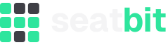</p>

<p align="center">
  <a href="https://github.com/bitsandbricks-ch/seatbit/actions/workflows/ci.yml"></a>
  <a href="https://bitsandbricks-ch.github.io/seatbit/"></a>
  <a href="LICENSE"></a>
</p>

Seatbit helps a clan or group of friends go to LAN parties run by others (think SwitzerLAN or Lock & Load, with 30+ people): who's coming, who has bought a ticket, who sits where in the group's seat block, who drives whom and what to install before you leave. Self-host it with one container.

**📖 Documentation: [bitsandbricks-ch.github.io/seatbit](https://bitsandbricks-ch.github.io/seatbit/)** · [for members](docs/members/index.md) · [for orgas](docs/orgas/index.md) · [self-hosting](docs/self-hosting/index.md)

## Features

- **Event lifecycle:** drafts, publish now or at a set time, an optional **interest check** before dates are fixed, orga news, cancel, "copy for next year" and check-in on the day.
- **Attendance** with *coming / unsure / not coming*, answer deadlines and an automatic **waitlist** when the group's spots are full.
- **Tickets:** members tick off their ticket, orgas confirm; buy-by deadline with reminders.
- **Seat plan** of the group's block (e.g. `F1-F16, F19-F22`): seat wishes, optional self pick, orgas edit right in the map (assign, swap, hold, drag & drop, auto-assign), finalize, then everyone books their seat on the event's own site. Seat swaps with orga approval.
- **Travel** (rides and places to sleep), private **packing lists**, **games** with votes and install tracking, and **food orders** at the LAN (everyone adds their pizza, one person orders and ticks who paid).
- **Who's missing** for orgas: who still owes an answer, a ticket, a nick or a seat booking, with one-tap nudges by Discord DM or mail.
- **Clans** with admins, join modes (open, approval, invite links), **guests** for people without an account, LAN types as templates for yearly events, and clan stats.
- **Discord bot:** announcements with answer buttons and a live attendee list, reminders, DMs, `/lans`. **WhatsApp:** ready-to-paste texts.
- **Email reminders** with admin-editable templates. **Login with Discord.**
- **Self-hosting:** all settings (SMTP, Discord, operator details for the privacy policy and terms) in the browser, single container, SQLite.
- Mobile-first with a good desktop layout; 24h dates ("Sat 14.11.2026, 18:00").

## Screenshots

Generated from demo data on every UI change (see [docs/development/screenshots.md](docs/development/screenshots.md)).

| LANs | Event | Seat plan | Seat picking |
| --- | --- | --- | --- |
| 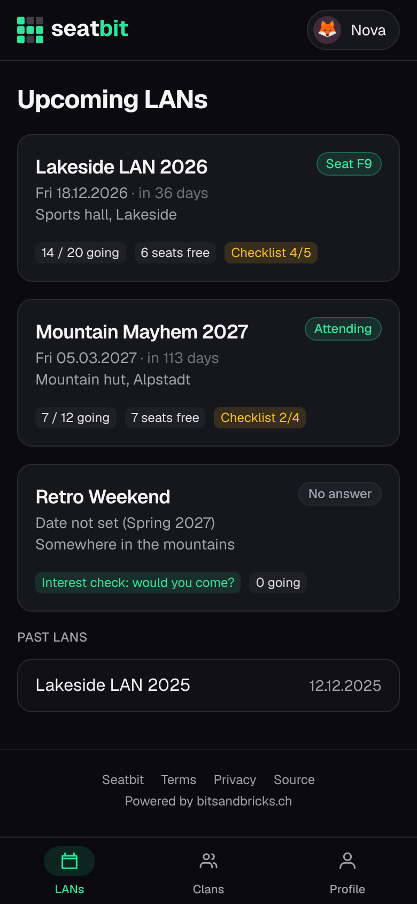 | 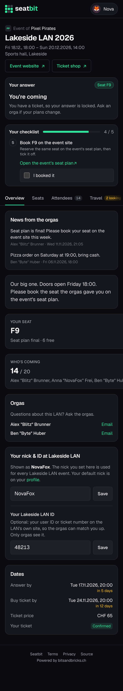 | 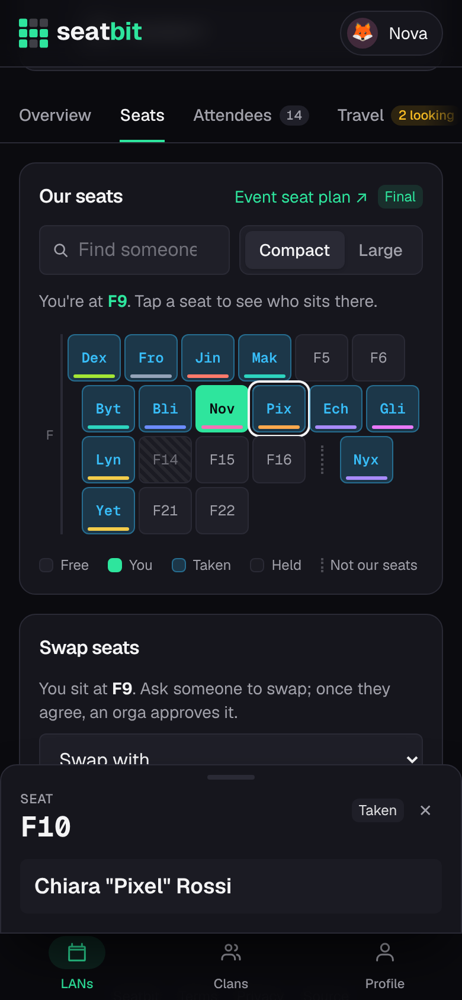 | 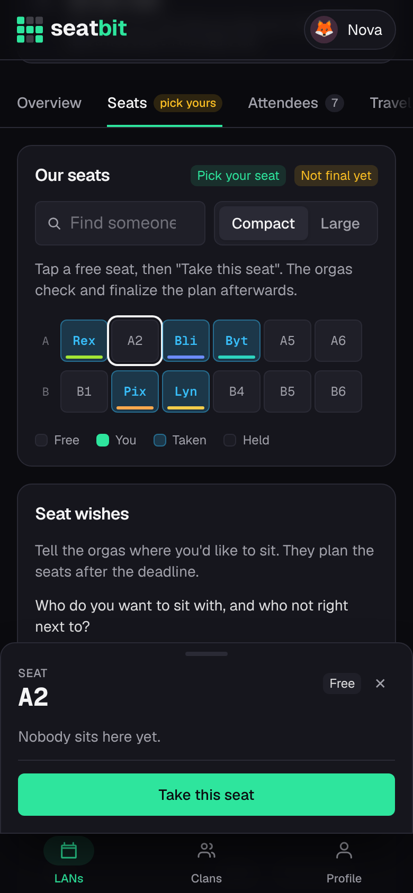 |

| Travel | Packing list | Games | Orga: seats |
| --- | --- | --- | --- |
| 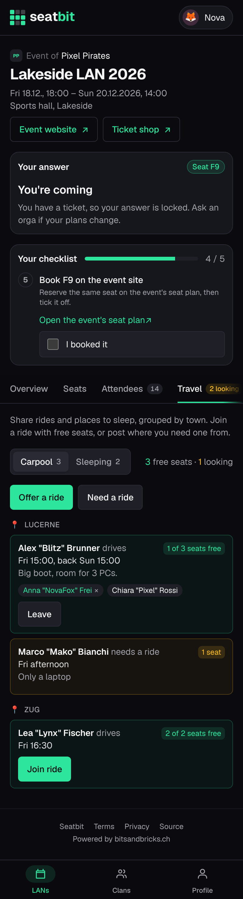 | 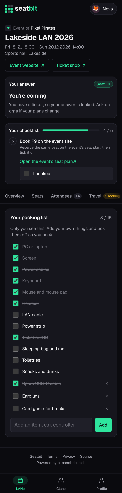 | 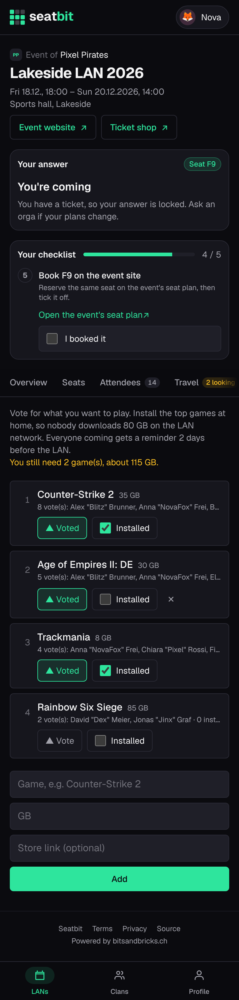 | 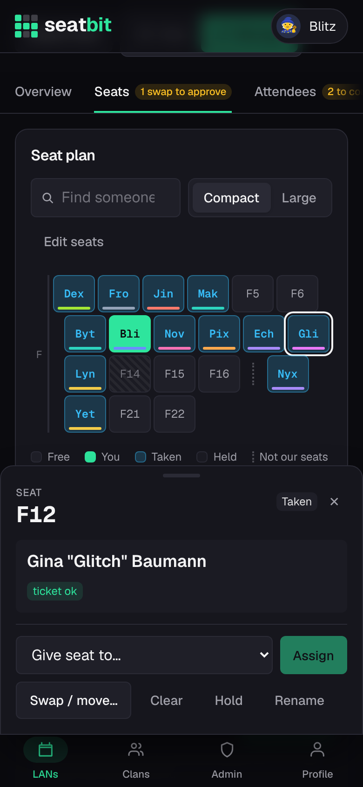 |

| Food orders | Orga: who's missing |
| --- | --- |
| 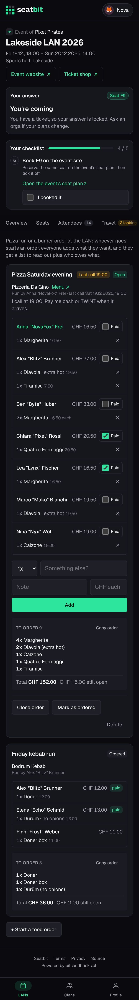 | 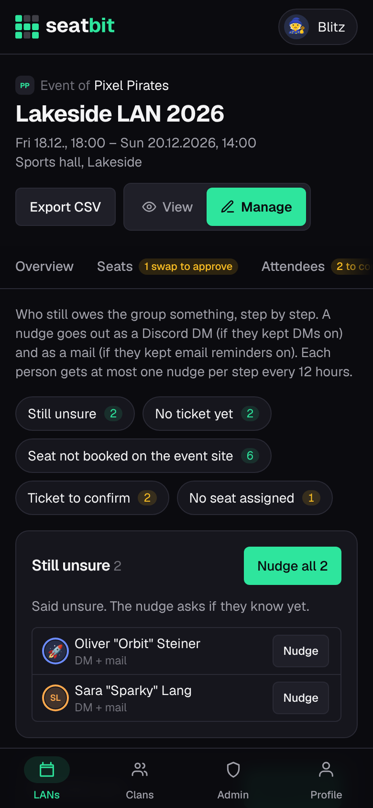 |

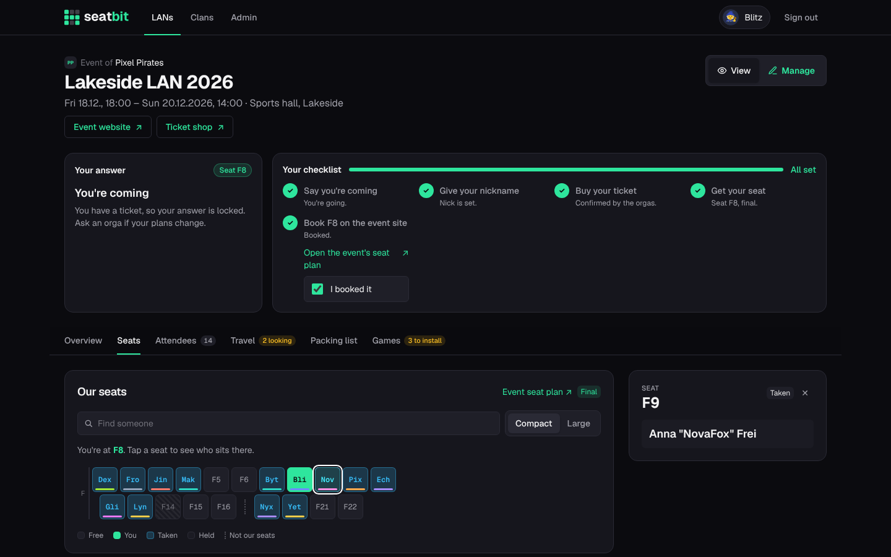

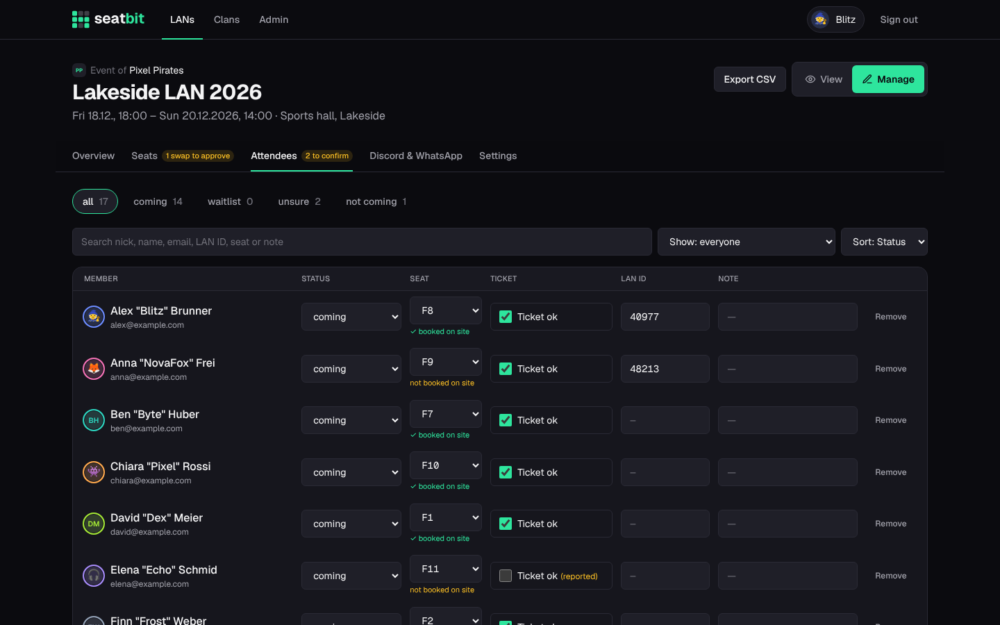

More in [`docs/screenshots/`](docs/screenshots/).

## Quick start (self-hosting)

```sh
docker run -d -p 3000:3000 -v seatbit-data:/data \
  -e BETTER_AUTH_URL=https://seatbit.example.com \
  -e BETTER_AUTH_SECRET="$(openssl rand -base64 32)" \
  -e DISCORD_CLIENT_ID=... -e DISCORD_CLIENT_SECRET=... \
  ghcr.io/bitsandbricks-ch/seatbit:main
```

Sign in with Discord (the first account becomes admin), then set up email, the Discord bot and your operator details under **Admin → Platform settings**. Full guide: [Self-hosting](docs/self-hosting/index.md) · [Configuration](docs/self-hosting/configuration.md) · [Discord app and bot](docs/self-hosting/discord.md) · [Operator, privacy and terms](docs/self-hosting/legal.md).

## Development

```sh
npm install
cp .env.example .env.local   # set ALLOW_EMAIL_LOGIN=1
npm run seed                 # demo data: alex@example.com / anna@example.com, password seatbit-demo
npm run dev
```

Stack: Next.js (App Router) · Better Auth · SQLite with Drizzle · Tailwind CSS · Nodemailer. See [CONTRIBUTING.md](CONTRIBUTING.md); AI coding agents follow [AGENTS.md](AGENTS.md). Security issues: [SECURITY.md](SECURITY.md).

## License

Seatbit is free software under the [GNU Affero General Public License v3.0](LICENSE), with [additional terms](NOTICE.md): keep the "Powered by bitsandbricks.ch" and "Source" links when you run it for others. Brand assets and guidelines are in [`brand/`](brand/BRAND.md).
