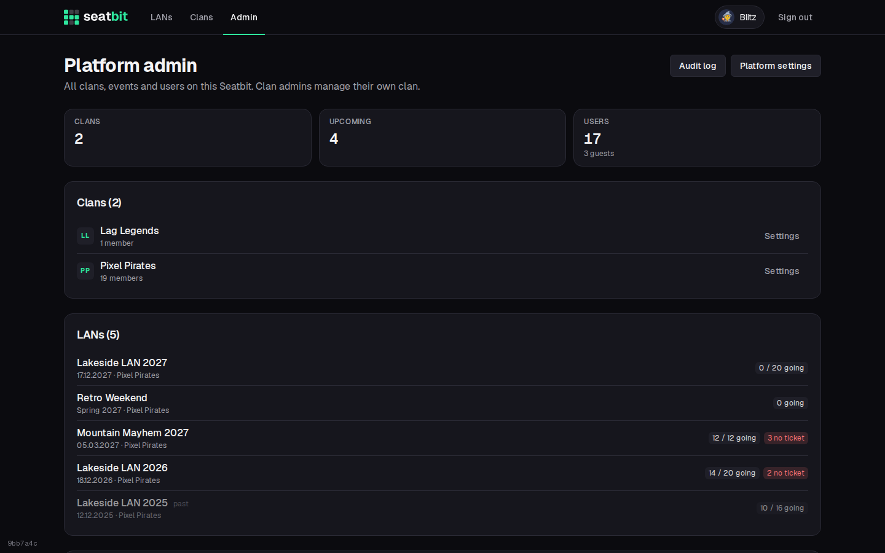

# Platform admin

Platform admins run the instance: they see all clans, events and users, and change the platform settings. The first account is always admin; more can be added with the **Admin emails** setting or the admin CLI.

{ .shot }

The **Admin** page lists all clans, events and users. Make someone admin or take it away in the user list. Deleted accounts don't show up there (only their count). **Audit log** shows the log of every clan plus platform changes (settings by name, never their values, platform roles, mail templates, deleted accounts); filter by clan or kind of change. **Platform settings** has the tabs Email, Discord, Sign-up & admins, Reminders, Operator & legal, Supporters ([Supporter payments](../self-hosting/supporters.md)), Mail templates and Server (see [Configuration](../self-hosting/configuration.md)).

## Admin CLI

`scripts/admin.mjs` manages platform admins straight on the database, also while the app runs. It is in the container image:

```sh
docker exec seatbit node scripts/admin.mjs list                     # platform admins
docker exec seatbit node scripts/admin.mjs users anna               # find users
docker exec seatbit node scripts/admin.mjs grant anna@example.com   # make admin
docker exec seatbit node scripts/admin.mjs revoke 123456789012345678
docker exec seatbit node scripts/admin.mjs reset-setting discord.clientSecret
```

A user can be given by email, Discord user ID, Seatbit user ID, name or nickname. `grant` with an email nobody has signed in with yet adds it to the admin emails, so that person becomes admin on first sign-in. On Kubernetes use `kubectl exec deploy/seatbit -- node scripts/admin.mjs ...`; locally `npm run admin -- list`.
