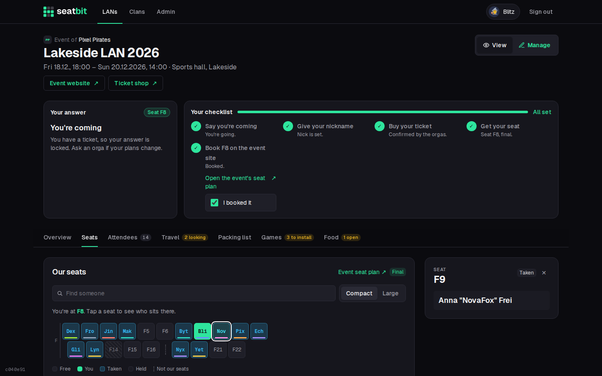
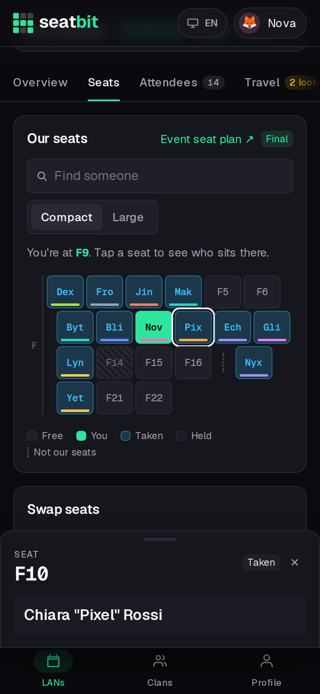
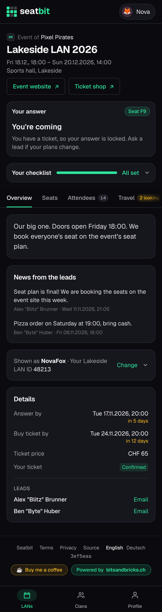

# Writing docs

This site is built with [MkDocs Material](https://squidfunk.github.io/mkdocs-material/) from `docs/` and `mkdocs.yml`.

## Preview

```sh
pip install -r docs/requirements.txt
mkdocs serve          # http://localhost:8000
mkdocs build --strict # what CI runs: broken links and missing images fail
```

## Structure

| Section | Folder | Put here |
| --- | --- | --- |
| **Features** | `docs/features/` | One page per feature: what it does, who uses it, where it is, with screenshots. |
| **Installation** | `docs/installation/` | Running an instance: deployment, configuration, integrations, operations. |
| **Development** | `docs/development/` | Local setup, architecture, database, screenshots, CI. |
| **Contributing** | `docs/contributing/` | How to get a change merged. |

A new page needs an entry in `nav` in `mkdocs.yml`. When you move a page, add the old path to the `redirects` plugin so links keep working.

## Which page to update

| Change | Update |
| --- | --- |
| New or changed feature | Its page in `features/`, and the table in `features/index.md` for a new one. |
| New setting | `installation/configuration.md` (and the integration page, if any). |
| New env var, port, volume | `installation/configuration.md`, `docker.md`, `kubernetes.md`. |
| New script or workflow | `development/index.md` or `development/ci.md`. |

## Style

- **Reference, not marketing.** Short sentences, tables for fields and options, bold for UI labels.
- Start a feature page with one sentence on what it does, then `**Who:** ... · **Where:** ...`.
- Use the app's words: *Coming / Unsure / Not coming*, *Manage*, *lead*.
- Dates as the app shows them: *Sat 14.11.2026, 18:00*.
- Example values only: `seatbit.example.com`, `1234567890123456789`.

## Screenshots

Screenshots are [generated](../development/screenshots.md), never edited by hand. Use them with the `shot` class:

```markdown
{ .shot }
{ .shot width="300" }
```

Several phone shots side by side:

```markdown
<div class="phones" markdown>
<figure markdown>

{ .shot }

<figcaption>Event</figcaption>
</figure>
</div>
```

If you add a page or a tab to the app, add a shot to `scripts/screenshots.ts` and use it here. Commit the new shot, but not re-rendered existing ones: those are updated by the bot pull request after the merge (see [Screenshots in pull requests](../development/screenshots.md#screenshots-in-pull-requests)).
