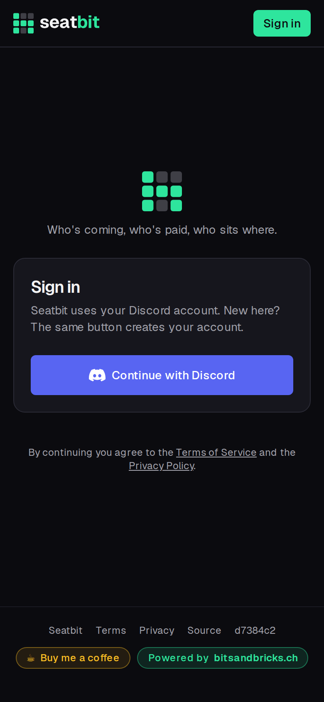
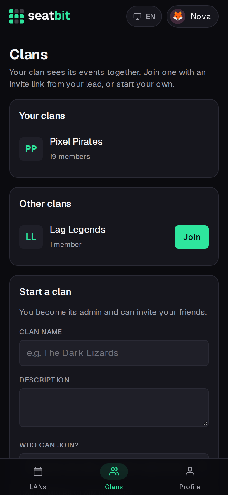
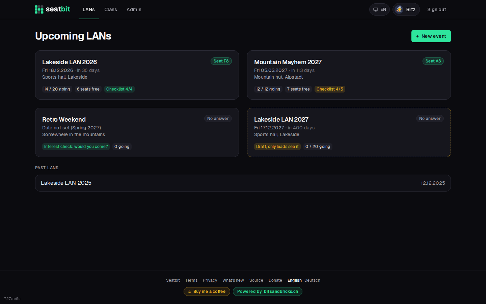
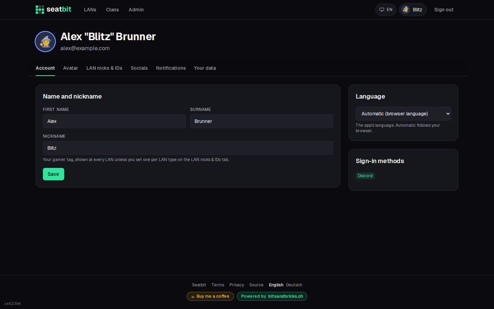
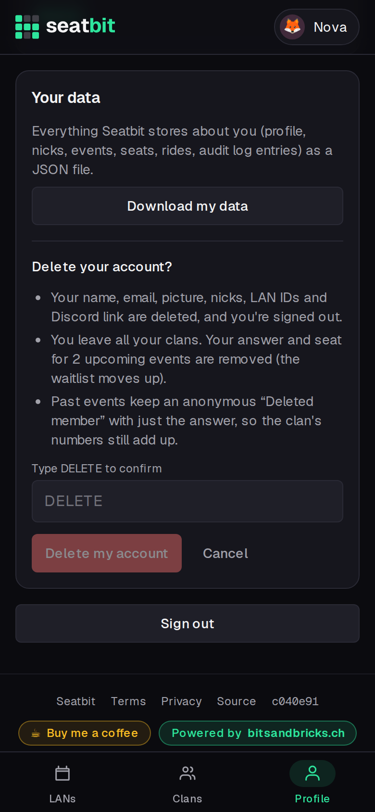

# Accounts and profile

Sign in with Discord, set your names and nicks, choose how Seatbit reaches you, and export or delete your data.

**Who:** everyone · **Where:** *Profile* (your avatar on desktop, the tab bar on phones)

## Sign in

Open your clan's Seatbit and click **Continue with Discord**. The same button creates your account the first time. Seatbit gets your Discord name, picture and email address; the email is used for reminders.

{ .shot width="300" }

On first sign-in Seatbit asks for your **first name, surname and nickname** (gamer tag). The clan uses your real name to match tickets and seats; everyone else mostly sees your nick. People are shown as *Anna "Nova" Frei*.

The first account on an instance becomes [platform admin](admin.md).

## Join a clan

Everything belongs to a clan. Depending on the clan's [join mode](clans.md#clan-settings) you:

- open an **invite link** and you're in;
- click **Join** on the clan's page (*Clans* tab): you're in, or an admin approves you first;
- were **added by an orga** as a guest and take it over by email, claim link or *That's me*. See [Guests](members-guests.md#guests).

{ .shot width="300" }

The **LANs** tab lists the upcoming events of all your clans, with the date, how many are coming, free seats and your checklist progress.

{ .shot }

## Profile

{ .shot }

| Section | |
| --- | --- |
| **Account** | First name, surname and your default **nickname**. |
| **Email reminders**, **Discord DMs** | Switch either off. DMs need a linked Discord account. |
| **Events I hear about** | Per clan: all new events, or only certain LAN types. One-off events always count. |
| **Avatar and colour** | Discord picture, uploaded picture, emoji or initials. The colour is the ring around your avatar and your seat on the plan. |
| **Nicks and IDs per LAN type** | A nick for every event of a LAN type (e.g. your name on the event's own site) and your user ID or ticket number there. Only orgas see the ID. |
| **Sign-in methods** | Link Discord if you signed in another way. |

**Nick priority:** event nick, then LAN type nick, then your default nick.

## Your data

- **Download my data** gives you a JSON file with everything Seatbit stores about you: profile, sign-in methods, nicks, LAN IDs, clans, every event answer with seat and seat wishes, rides, packing lists, games, swap requests and the audit log entries about you.
- **Delete my account** (type `DELETE` to confirm) signs you out and deletes your name, email, picture, Discord link, nicks, LAN IDs, clan memberships, orga roles, rides and packing lists, plus answers and seats for upcoming events (the waitlist moves up). Past events keep an anonymous *Deleted member* with only the answer, so history and stats still add up.

{ .shot width="300" }

If you're the only admin of a clan that has other members, make someone else admin first. A clan with nobody else with a login left is deleted with your account; the confirmation tells you before.
