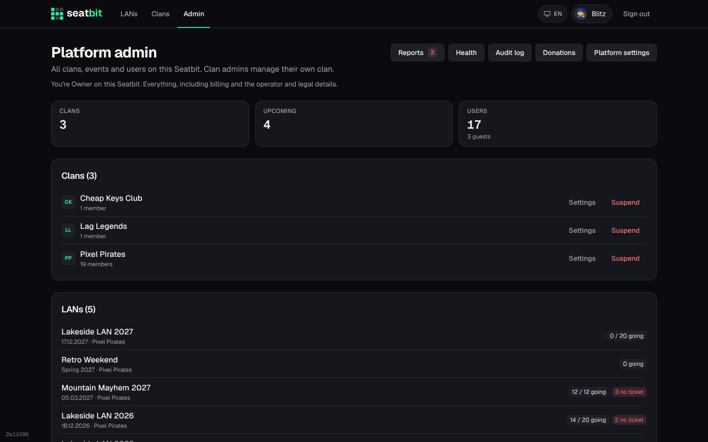
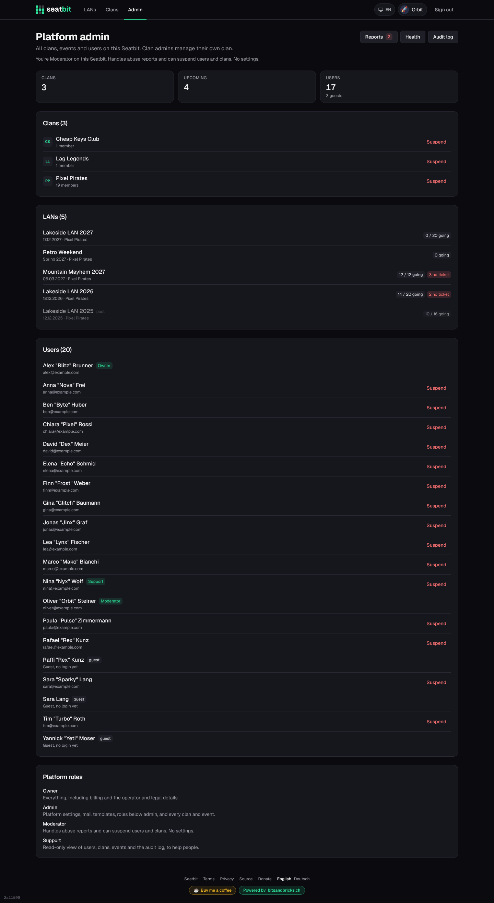
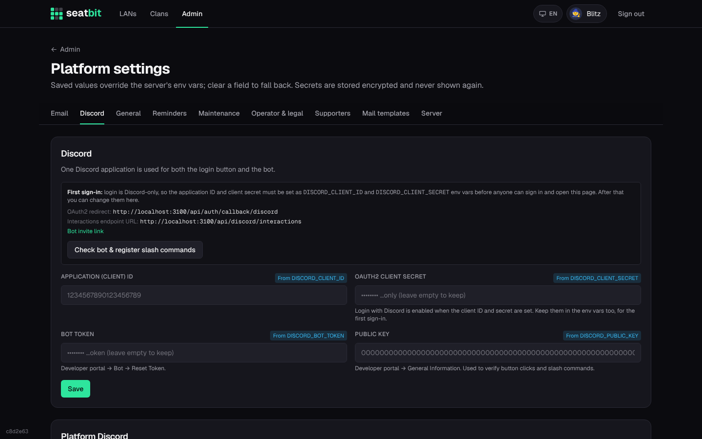
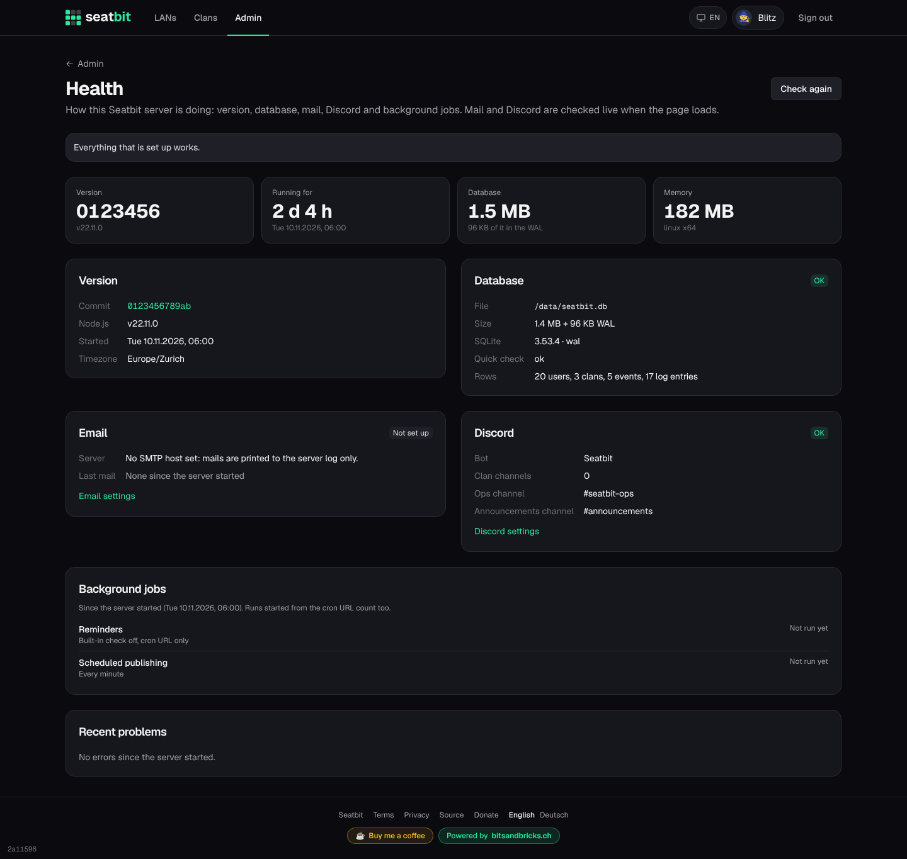
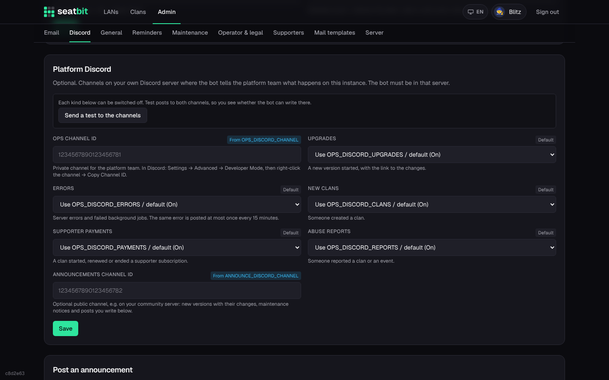
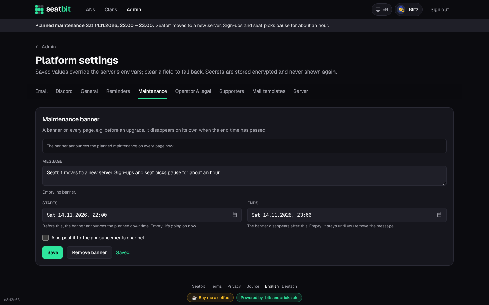
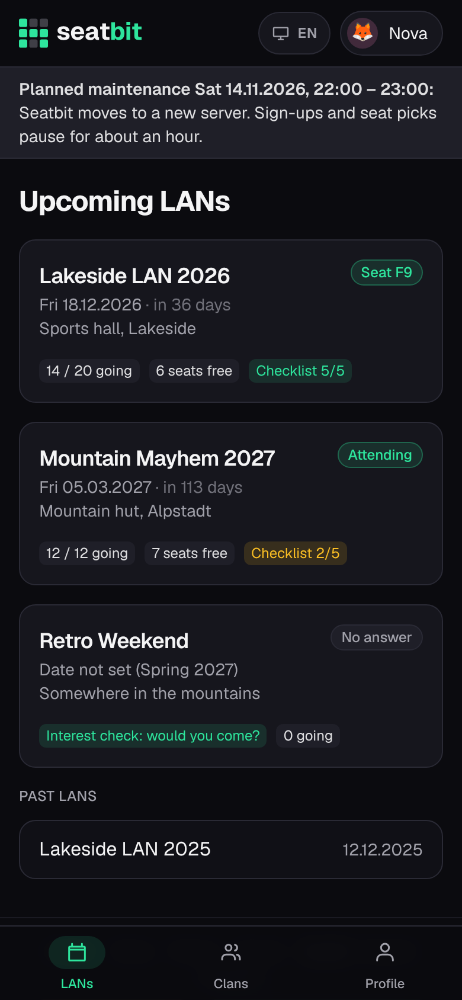

# Platform admin

Platform staff run the instance: they see all clans, events and users, change the platform settings and handle abuse reports. What each person may do depends on their platform role.

**Who:** platform owners, admins, moderators and support · **Where:** *Admin*

{ .shot }

## Platform roles

| Role | Can |
| --- | --- |
| **Owner** | Everything, including the *Supporters* (billing) and *Operator & legal* settings and giving the owner role. |
| **Admin** | Platform settings and mail templates, manage every clan and event like their admins, give and take the moderator and support roles, reports and suspensions. |
| **Moderator** | The [report queue](moderation.md), suspending and restoring users and clans. No settings. |
| **Support** | Read-only: the admin page, every clan and event, the audit log. To help people, without changing anything. |

The first account is always owner, as is anyone in the **Admin emails** setting. Give roles in the user list on the admin page or with the [admin CLI](../installation/operations.md#admin-cli). Nobody changes their own role, and admins can't touch owners or other admins, so there is always an owner. The last owner can't delete their account.

!!! note "Upgrading"
    Instances from before platform roles had one admin flag. The upgrade turns every existing admin into an owner, so nobody loses rights.

## Admin page

| Section | |
| --- | --- |
| **Clans, events, users** | Everything on the instance. Give platform roles and suspend users or clans from the lists. Deleted accounts only show as a count. |
| **Reports** | Abuse reports from members. See [Reports and suspensions](moderation.md). |
| **Health** | Version, database, mail, Discord and background jobs at a glance. All platform staff. See [Health](#health). |
| **Audit log** | Every clan's log plus platform changes. See [Audit log](audit-log.md#platform-audit-log). |
| **Platform settings** | Instance configuration, see below. Owners and admins only. |

A moderator sees the same page without the settings, and support without any buttons:

{ .shot }

## Platform settings

| Tab | | Docs |
| --- | --- | --- |
| **Email** | SMTP server, sender, test mail. | [Email](../installation/email.md) |
| **Discord** | Login app, bot token, slash commands, bot invite link; the platform team's ops and announcements channels. | [Discord app and bot](../installation/discord.md), [Platform Discord](#platform-discord) |
| **Sign-up & admins** | Allow new accounts, admin emails. | [Configuration](../installation/configuration.md) |
| **Reminders** | Check interval, cron secret. | [Configuration](../installation/configuration.md#reminders-without-a-long-running-process) |
| **Maintenance** | Banner on every page for planned or ongoing downtime. | [Maintenance banner](#maintenance-banner) |
| **Operator & legal** | Operator details, own terms and privacy URLs, source URL. Owners only. | [Operator, privacy and terms](../installation/legal.md) |
| **Supporters** | Stripe keys and prices, donations and their suggested amounts. Owners only. | [Stripe](../installation/stripe.md), [Donations](donations.md) |
| **Mail templates** | The wording of every email. | [Email](../installation/email.md#mail-templates) |
| **Server** | Startup values (read-only). | [Configuration](../installation/configuration.md#startup-environment-only) |

{ .shot }

## Health

*Admin → Health* shows how the server is doing. All platform staff see it, support included. Mail and Discord are checked live each time the page loads (with a 5 second limit), the rest comes from the running server:

- **Version:** the commit the image was built from (linked to the source), Node.js, when the server started, timezone, memory.
- **Database:** file, size (and how much of it is still in the WAL), SQLite version, a quick integrity check and row counts.
- **Email:** the SMTP server, whether the login works, and the last mail sent or failed.
- **Discord:** the bot's name, how many clan channels are linked, and whether the bot can see the ops and announcements channels.
- **Background jobs:** reminders and scheduled publishing, when they last ran and their last error.
- **Recent problems:** the last 30 server errors, mail and Discord failures.

Jobs and problems are kept in memory, so they start empty after a restart. For a load balancer or Kubernetes probe use `GET /api/health` instead (see [Operations](../installation/operations.md#logs-and-health)).

{ .shot }

## Platform Discord

The bot can tell the team running the instance what happens, in a private **ops channel** on your own Discord server. Each kind can be switched off:

| Kind | Posted when |
| --- | --- |
| **Upgrades** | A new version started, with the link to the changes and whether the slash commands were re-registered. The announcements channel gets the version with the titles of the merged pull requests (GitHub sources only) or the link. |
| **Errors** | A page, action or background job fails. The same error is posted at most once every 15 minutes; query strings and token-like parts of the path are left out. |
| **New clans** | Someone creates a clan. |
| **Supporter payments** | A clan starts, renews or ends a supporter subscription, or someone donates (or gets a donation refunded). |
| **Abuse reports** | Someone reports a clan or an event. |

An optional public **announcements channel** (for example on your community server) gets new versions with their changes, maintenance notices you choose to post, and announcements you write under *Post an announcement* on the same tab.

To set it up, add the bot to your server with the invite link on the Discord tab, turn on Developer Mode in Discord (*Settings → Advanced*), right-click each channel → *Copy Channel ID*, paste the IDs and save. **Send a test to the channels** checks that the bot can post there; it needs *View Channel*, *Send Messages* and *Embed Links* in those channels.

{ .shot }

## Maintenance banner

The *Maintenance* tab puts a banner under the top bar on every page, also for people who aren't signed in. Write a message and optionally pick a start and an end:

- Before the start, the banner announces the planned maintenance with its time.
- From the start (or right away without one), it says maintenance is going on.
- After the end, it disappears by itself. Without an end it stays until you click **Remove banner**.

Tick **Also post it to the announcements channel** to post the same notice on Discord. Saving and removing the banner shows in the platform audit log. The message can also come from the `MAINTENANCE_MESSAGE` environment variable, e.g. set during a deploy.

{ .shot }

{ .shot width="300" }
