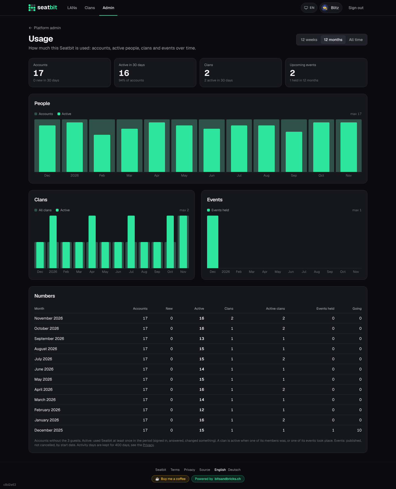

# Platform admin

Platform admins run the instance: they see all clans, events and users and change the platform settings.

**Who:** platform admins · **Where:** *Admin*

The first account is always admin. Add more with the **Admin emails** setting, in the user list, or with the [admin CLI](../installation/operations.md#admin-cli).

{ .shot }

## Admin page

| Section | |
| --- | --- |
| **Clans, events, users** | Everything on the instance. Make someone admin or take it away in the user list. Deleted accounts only show as a count. |
| **Usage** | Accounts, active people, clans and events over time. See [Usage](#usage). |
| **Backups** | Database backups: schedule, back up now, download. See [Backups](../installation/operations.md#backups). |
| **Audit log** | Every clan's log plus platform changes. See [Audit log](audit-log.md#platform-audit-log). |
| **Platform settings** | Instance configuration, see below. |

## Platform settings

| Tab | | Docs |
| --- | --- | --- |
| **Email** | SMTP server, sender, test mail. | [Email](../installation/email.md) |
| **Discord** | Login app, bot token, slash commands, bot invite link. | [Discord app and bot](../installation/discord.md) |
| **Sign-up & admins** | Allow new accounts, admin emails. | [Configuration](../installation/configuration.md) |
| **Reminders** | Check interval, cron secret. | [Configuration](../installation/configuration.md#reminders-without-a-long-running-process) |
| **Operator & legal** | Operator details, own terms and privacy URLs, source URL. | [Operator, privacy and terms](../installation/legal.md) |
| **Supporters** | Stripe keys and prices. | [Stripe](../installation/stripe.md) |
| **Mail templates** | The wording of every email. | [Email](../installation/email.md#mail-templates) |
| **Server** | Startup values (read-only). | [Configuration](../installation/configuration.md#startup-environment-only) |

{ .shot }

## Usage

*Admin → Usage* shows how much the instance is used, for the last 12 weeks, the last 12 months or all time:

- **People:** accounts (without guests) and how many of them were **active**, i.e. used Seatbit at least once in that week or month (signed in, answered, changed something).
- **Clans:** all clans and the active ones: a member was active, or one of the clan's events took place.
- **Events:** published, not cancelled events by start date, with how many people were going.

The tiles on top show the totals and the last 30 days, the table below has every number.

{ .shot }

To count active people, Seatbit notes the **days** someone used it (just the date, once a day, no pages or times) and deletes them after 400 days; the privacy policy says so. For the time before that existed, it also counts answers, sign-ins and changes that were already stored, so the charts aren't empty after an update.

## Backups

*Admin → Backups* lists the database backups Seatbit makes by itself, with **Back up now**, download and delete, and the backup settings. Setup, where to store them and how to restore: [Backups](../installation/operations.md#backups).
