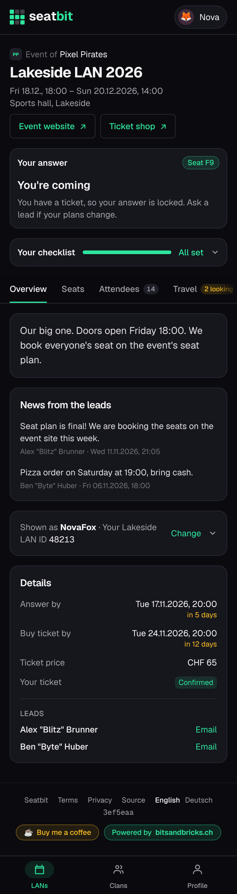
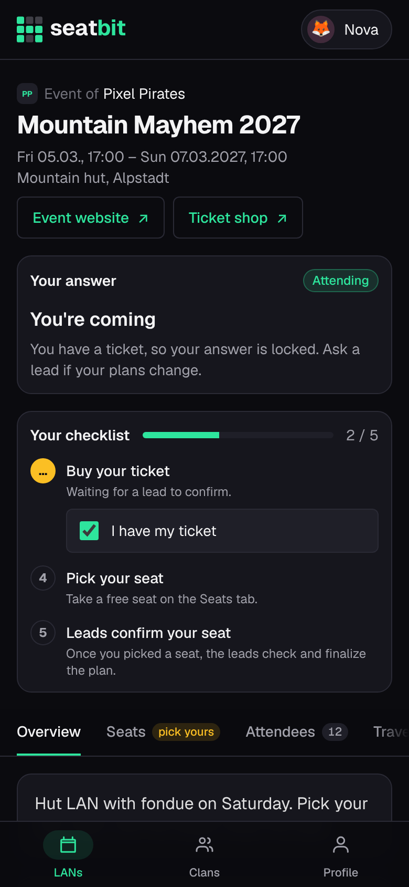
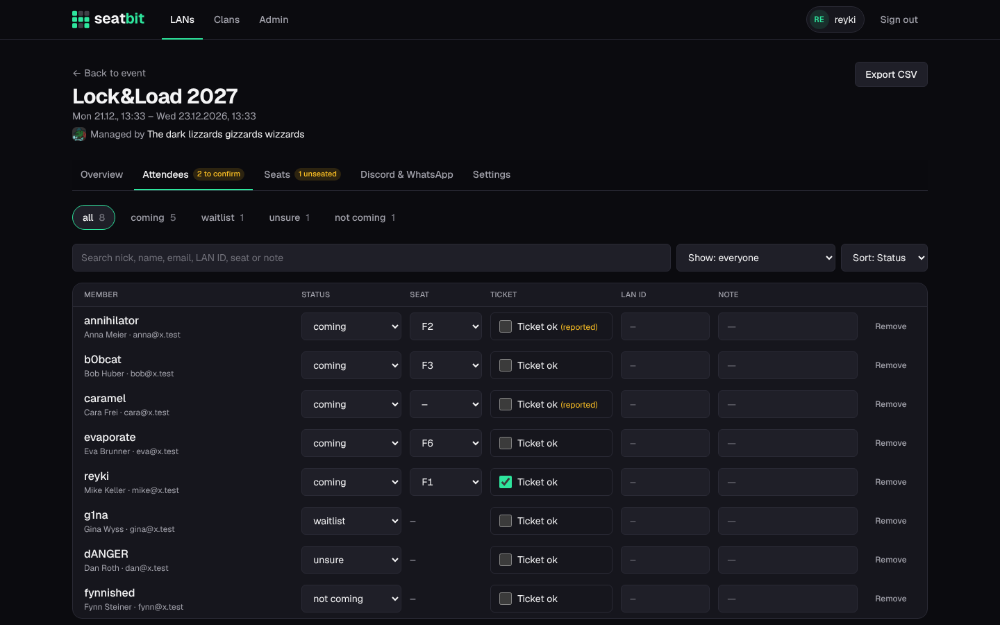

# Attendance and tickets

Members answer whether they come, work through their checklist and report their ticket; leads see everyone in one list.

**Who:** members answer and tick off their ticket; leads can change any answer · **Where:** the event page (top card); *Manage → Attendees*

<figure markdown>

{ .shot }

<figcaption>Answer and checklist</figcaption>
</figure>
<figure markdown>

{ .shot }

<figcaption>Attendees tab</figcaption>
</figure>

The event page shows your answer and checklist at the top, then the tabs **Overview**, **Seats**, **Attendees**, **Travel**, **Packing list**, **Games** and **Food**. The Overview has the event's description, the leads' news and a **Details** card with the deadlines, the ticket price, your ticket and the leads to contact.

## Answer

**Coming**, **Unsure** or **Not coming**, before the *answer by* date. Also possible with the buttons on the clan's Discord announcement or with `/coming`, `/unsure`, `/not-coming` and `/lans` in Discord. `/status` and `/ticket` work there too (see [Discord commands](discord.md#commands)).

- Once you have a ticket, your answer is **locked**. Leads can still change it. The answer card then shrinks to a small badge with a lock next to *Your checklist* (tap it for the hint); it comes back on the event days for the check-in.
- During an [interest check](events.md#interest-check) the answers are *I'd come / Maybe / Not this time* instead, and the *Attendees* tab (then called *Interest*) lists who answered what.

### Waitlist

When the group's spots (*Spots* on the event) are full, new *Coming* answers go on the **waitlist**. It's a line: whoever answered first is first. People waiting see their place (*You're #2 on the waitlist*) on the event page, in their checklist and in the bot's reply on Discord. The Attendees tab and the Discord announcement list the waitlist in order.

{ .shot width="300" }

When someone stops coming (or a lead raises the spots), what happens depends on the event's setting under *Manage → Attendees → Waitlist*:

| Setting | When a spot opens |
| --- | --- |
| **Next in line moves up** (default) | The first person in line moves to *Coming* by themselves and gets an email and a Discord DM ("You're in"). |
| **Leads pick** | Nobody moves on their own. The leads get an email and a DM, and the event's overview says how many spots are free. A lead moves someone up by hand, e.g. after asking who still has time. |

Turning *Next in line moves up* back on fills the free spots right away.

People on the waitlist get no ticket reminders or nudges, and their checklist says to wait with buying one until they move up: without a spot in the group's block a ticket may be wasted money. If they already bought one, they can still tick it off.

While people are waiting, a new *Coming* answer always queues up behind them, even when a spot is free, so nobody jumps the line.

**For leads**, the *Waitlist* card on *Manage → Attendees* shows the line with each person's place, how long they've waited and whether they already have a ticket:

- **↑ / ↓** move someone one place up or down.
- **Move to coming** takes them off the waitlist now and tells them. This also works when the group is full: the lead goes over the limit on purpose.
- Changing someone's answer in the attendee list works too. Setting someone to *waitlist* puts them at the end of the line.

Every move is in the [audit log](audit-log.md).

{ .shot }

## Checklist

Your checklist sits above the tabs on every tab of the event, on the LANs list (*Checklist 3/5*) and in `/status` on Discord. Steps only show when they apply to you and the event.

<figure markdown>

{ .shot }

<figcaption>Self pick: steps 4 and 5</figcaption>
</figure>

| Step | Done when |
| --- | --- |
| 1. **Say you're coming** | You answered *Coming*. On the waitlist it shows your place (*You're #2 on the waitlist*). |
| 2. **Give your nickname** | You have a nick (default, LAN type or event). |
| 3. **Buy your ticket** | You ticked *I have my ticket* before the *buy ticket by* date. That's enough: the leads trust it and don't confirm it. |
| 4. **Pick your seat** | Only when the leads turned on [self pick](seats.md#seat-steps): you took a free seat (the step then reads *Seat F8 picked*). Needs your ticket first. While self pick is on, the Seats tab shows *pick yours* in yellow until you have a seat, then your seat in green. |
| 4. **Send seat wishes** (optional) | Instead of *Pick your seat* when self pick is off: you sent [seat wishes](seats.md#seat-steps). Hidden once the plan is final if you sent none. |
| 5. **Leads confirm your seat** | The leads finalized the seat plan and you have a seat. Until then it waits on them (also after you picked your own seat). With an event seat plan, the hint says whether the leads already [booked it there](seats.md#book-on-the-event-site). |
| **Install the games** (optional) | After step 5, when someone voted for [games](games.md): you marked every voted game as installed. |
| **Check in at the venue** | After step 5, only on the day: you tapped *I'm here*. |

The leads have their own [lead checklist](events.md#lead-checklist).

Optional steps don't hold back *All set* and only count towards the progress once done. Once everything is done, the checklist folds into one line (*Your checklist · All set*); tap it to see the steps again.

## Nick and LAN ID

At the bottom of the Overview tab, one line shows the nick and LAN ID you have at this event; tap **Change** to set a nick for this LAN type (used for every event of that type) and your **user ID or ticket number** on the event's own site, so leads can match you up. Only leads see the ID, unless the event has a [profile link](clans.md#profile-links): then the attendee list links your profile on the event's site. The same values are on your [profile](accounts.md#profile).

## Tickets

Tickets are trust based: when a member ticks **I have my ticket** (on the event page or with `/ticket` on Discord), it counts. Leads don't confirm it.

A lead can tick **Ticket ok** on the Attendees tab for someone, e.g. a guest without a login. That counts the same and keeps the member from unticking it.

Reminders go to people coming without a ticket before the *buy ticket by* date. See [Reminders](reminders.md).

## Attendee list

*Manage → Attendees*: one row per person with answer, seat, ticket, LAN ID and a note. Filter by status, search and sort. Leads can change anyone's answer, also once it's locked.

{ .shot }

**Export CSV** downloads the group (seat, nick, name, email, status, ticket, LAN ID, and the profile link when the event has one) for the event's organisers. It opens in Excel and Numbers with umlauts and accents intact.
