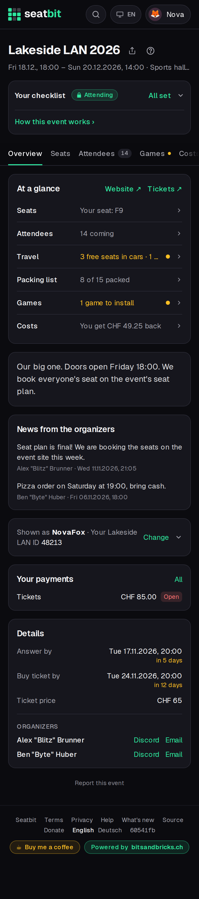
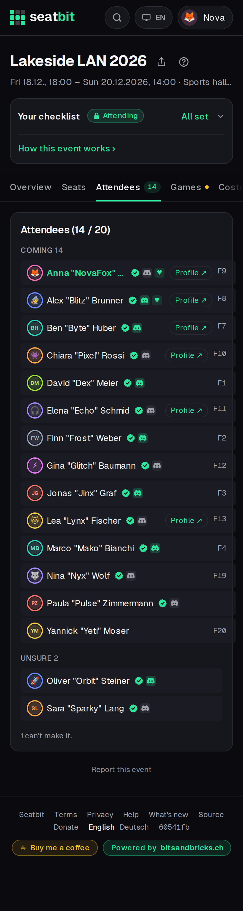
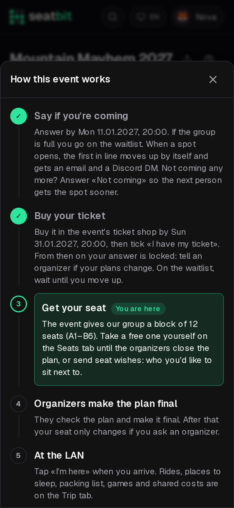
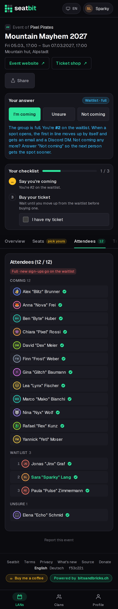
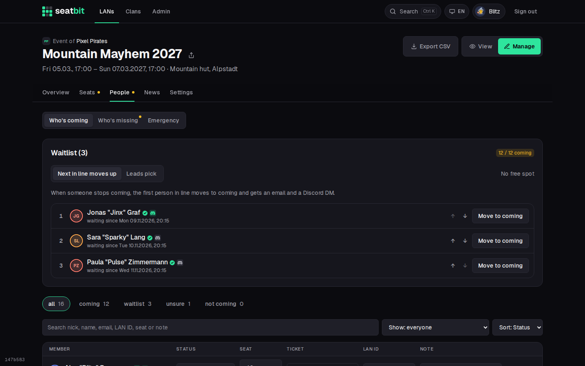
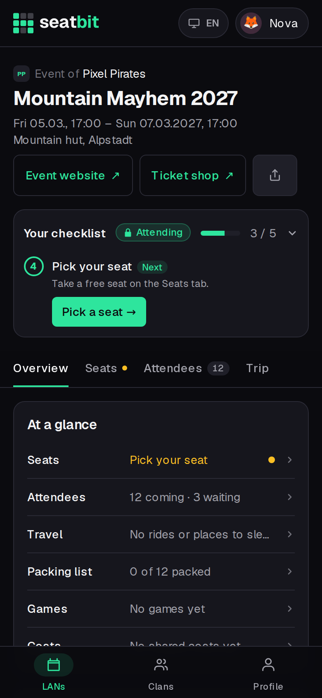
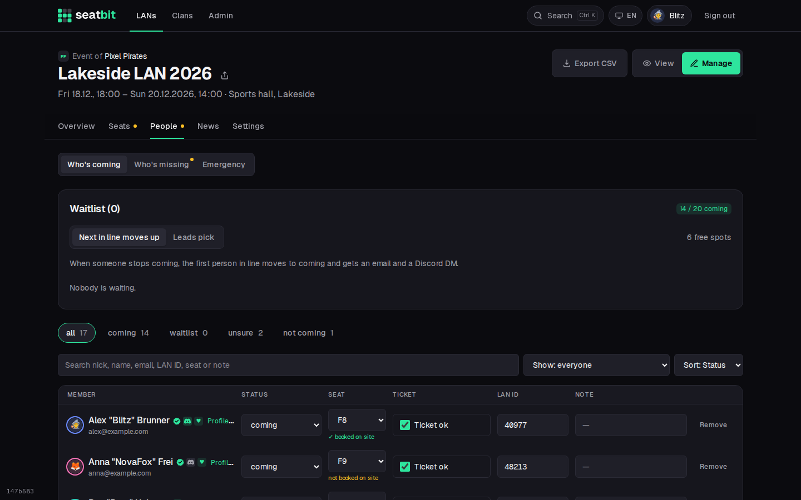

# Attendance and tickets

Members answer whether they come, work through their checklist and report their ticket; organizers see everyone in one list.

**Who:** members answer and tick off their ticket; organizers can change any answer · **Where:** the event page (top card); *Manage → People*

<figure markdown>

{ .shot }

<figcaption>Answer and checklist</figcaption>
</figure>
<figure markdown>

{ .shot }

<figcaption>Attendees tab</figcaption>
</figure>

The event page has a few tabs: **Overview**, **Seats**, **Attendees**, **Games**, **Costs** and **Trip**, plus **Orders** while the event runs. Switching tabs is instant, and the address follows (`?tab=seats`), so reloading, bookmarks and the back button land on the same tab. A yellow dot on a tab means something waits for you there.

**Trip** groups getting there: **Travel** and the **Packing list**, behind a small switch at the top of the tab. So the page starts simple, members only get it **30 days before the start** (setting *Trip tab opens*, see [configuration](../installation/configuration.md)), or earlier as soon as someone posted a ride or packed something. Until then the *At a glance* card says when it opens. **Games** and **Costs** are tabs of their own and always there.

Organizers always see *Trip* and *Orders*. While members don't see them yet, they show muted with a crossed-out eye, so it's clear they are hidden from the others.

## How this event works

*How this event works* under the checklist (and the **?** next to the share icon) opens a panel with the whole flow in five steps: answer, ticket, seat, organizers make the plan final (and book), at the LAN. The steps use the event's own deadlines and settings (waitlist rule, self pick or seat wishes, booking on the event's site), ticks the ones you're past and marks where you are. Below it, *Who are the organizers?* says what organizers do and lists the event's organizers with Discord and email. The other explanations on the page are kept short and point here instead of repeating it.

{ .shot width="300" }

For everything else there's the [help page](help.md) (*Help* in the footer).

The overview starts with your answer and checklist, then an **At a glance** card: one line per tab with why you'd open it, and the same yellow dot:

| Line | It says |
| --- | --- |
| **Seats** | *Free seats to pick*, your seat, or whether the plan is final. |
| **Attendees** | How many are coming and waiting. |
| **Travel** | Free seats in cars and how many are looking (dot: others need a [ride](travel-packing.md), until the event starts). |
| **Packing list** | How much of your [packing list](travel-packing.md#packing-list) is packed (dot: in the last week, until all is packed). |
| **Games** | Games you voted for and still have to install, or how many there are ([games](games.md)). |
| **Costs** | *You owe …*, *You get … back* or *You're even* ([shared costs](shared-costs.md)). |
| **Orders** | Open [orders](food.md) (food, supermarket). Only while the event runs, then right at the top; organizers see the tab before that, to prepare an order. |

Below it, the overview has the event's description, the organizers' news and a **Details** card with the deadlines, the ticket price and the organizers to contact (your own ticket is in the checklist). The header stays short: the title with a small share icon, date and place in one line, and for organizers a View / Manage switch (two small icons on phones). The event website and ticket shop are links at the top of the *At a glance* card; while you still need a ticket, the checklist's *Buy your ticket* step has a button to the ticket shop too.

## Answer

**Coming**, **Unsure** or **Not coming**, before the *answer by* date. Also possible with the buttons on the clan's Discord announcement or with `/coming`, `/unsure`, `/not-coming` and `/lans` in Discord. `/status` and `/ticket` work there too (see [Discord commands](discord.md#commands)).

- Once you have a ticket, your answer is **locked**. Organizers can still change it. The answer card then shrinks to a small badge with a lock next to *Your checklist* (tap it for the hint); it comes back on the event days for the check-in.
- During an [interest check](events.md#interest-check) the same answers are non-binding, the rest of the event stays hidden, and *Who answered* lists everyone's answer. The answers carry over when sign-up opens.

### Waitlist

When the group's spots (*Spots* on the event) are full, new *Coming* answers go on the **waitlist**. It's a line: whoever answered first is first. People waiting see their place (*You're #2 on the waitlist*) on the event page, in their checklist and in the bot's reply on Discord. The Attendees tab and the Discord announcement list the waitlist in order.

{ .shot width="300" }

When someone stops coming (or an organizer raises the spots), what happens depends on the event's setting under *Manage → People → Waitlist*:

| Setting | When a spot opens |
| --- | --- |
| **Next in line moves up** (default) | The first person in line moves to *Coming* by themselves and gets an email and a Discord DM ("You're in"). |
| **Organizers pick** | Nobody moves on their own. The organizers get an email and a DM, and the event's overview says how many spots are free. An organizer moves someone up by hand, e.g. after asking who still has time. |

Turning *Next in line moves up* back on fills the free spots right away.

#### Spots from the seat plan

As soon as an event has seats in its [seat plan](seats.md), the seats are its spots: 20 seats means 20 people can come, and the number typed under *Spots* no longer counts (the field shows the seat count instead). Adding seats, under *Manage → Settings → Our seats* or in the seat editor, opens spots, so the waitlist moves up like when someone stops coming. Removing seats never sends anyone back to the waitlist; with more people coming than seats, new answers just wait. Held seats count too: they are the group's, kept for someone. Events without a seat plan keep the typed number, and empty *Spots* means no limit.

People on the waitlist get no ticket reminders or nudges, and their checklist says *Wait for a spot* instead of pointing to the ticket shop: without a spot in the group's block a ticket may be wasted money. If they already bought one, they can still tick it off.

While people are waiting, a new *Coming* answer always queues up behind them, even when a spot is free, so nobody jumps the line.

**For organizers**, the *Waitlist* card on *Manage → People* shows the line with each person's place, how long they've waited and whether they already have a ticket:

- **↑ / ↓** move someone one place up or down.
- **Move to coming** takes them off the waitlist now and tells them. This also works when the group is full: the organizer goes over the limit on purpose.
- Changing someone's answer in the attendee list works too. Setting someone to *waitlist* puts them at the end of the line.

Every move is in the [audit log](audit-log.md).

{ .shot }

## Checklist

Your checklist sits at the top of the event overview (on desktop above every section), on the LANs list (each card shows your next step, like *Next: Buy your ticket · by 24.11.2026*, or *All set*; while the LAN runs, the date says *happening now*) and in `/status` on Discord. Steps only show when they apply to you and the event.

On the event page it starts folded: the progress bar and one line with the step that matters now and a button that takes you there. Tap the bar to see every step; your choice is remembered on that device. Once everything is done, it folds into one *All set* line.

<figure markdown>

{ .shot }

<figcaption>Self pick: steps 4 and 5</figcaption>
</figure>

| Step | Done when |
| --- | --- |
| 1. **Say you're coming** | You answered *Coming*. On the waitlist it shows your place (*You're #2 on the waitlist*). |
| 2. **Give your nickname** | You have a nick (default, LAN type or event). |
| 3. **Buy your ticket** | You ticked *I have my ticket* before the *buy ticket by* date. That's enough: the organizers trust it and don't confirm it. |
| 4. **Pick your seat** | Only when the organizers turned on [self pick](seats.md#seat-steps): you took a free seat (the step then reads *Seat F8 picked*). Needs your ticket first. While self pick is on, the Seats tab has a yellow dot until you have a seat. |
| 4. **Send seat wishes** (optional) | Instead of *Pick your seat* when self pick is off: you sent [seat wishes](seats.md#seat-steps). Hidden once the plan is final if you sent none. |
| 5. **Organizers confirm your seat** | The organizers finalized the seat plan and you have a seat. Until then it waits on them (also after you picked your own seat). With an event seat plan, the hint says whether the organizers already [booked it there](seats.md#book-on-the-event-site). |
| **Install the games** (optional) | After step 5, when you voted for [games](games.md): you marked every game you voted for as installed. |
| **Check in at the venue** | After step 5, only on the day: you tapped *I'm here*. |

The organizers have their own [organizer checklist](events.md#lead-checklist).

### Next step

The checklist is also a guide. The first step you can do now is marked **Next** and has a button that takes you there (*Pick a seat →* opens Seats, *Set your nick →* opens the nick form). Optional steps get a smaller button.

Optional steps don't hold back *All set* and only count towards the progress once done. Once everything is done, the checklist folds into one line (*Your checklist · All set*); tap it to see the steps again.

## Nick and LAN ID

At the bottom of the Overview tab, one line shows the nick and LAN ID you have at this event; tap **Change** to set a nick for this LAN type (used for every event of that type) and your **user ID or ticket number** on the event's own site, so organizers can match you up. Only organizers see the ID, unless the event has a [profile link](clans.md#profile-links): then the attendee list links your profile on the event's site. The same values are on your [profile](accounts.md#profile).

## Tickets

Tickets are trust based: when a member ticks **I have my ticket** (on the event page or with `/ticket` on Discord), it counts. Organizers don't confirm it.

An organizer can tick **Ticket ok** on the Attendees tab for someone, e.g. a guest without a login. That counts the same and keeps the member from unticking it.

Reminders go to people coming without a ticket before the *buy ticket by* date. See [Reminders](reminders.md).

## Attendee list

*Manage → People*: one row per person with answer, seat, ticket, LAN ID and a note. Filter by status, search and sort. Organizers can change anyone's answer, also once it's locked.

### Status icons

Organizers see small icons next to names and on seats, the same everywhere: in the seat map on *Manage → Seats*, on the event's *Attendees* tab and on *Manage → People* (there only the ones the table has no column for).

| Icon | Means |
| --- | --- |
| Lock (amber) | Held seat: auto assign and re-plans leave it as it is. Everyone sees this one. |
| ! (red) | No ticket yet. |
| Arrows (blue) | A seat swap is waiting. |
| Person (grey) | Guest without an account yet. |
| Tick (green) | Seat booked on the event's site (once the plan is final and the event has a seat plan link). |

A compact seat shows only the most important one, in this order; *Large* shows up to three. The seat map's legend lists the icons on the map.

{ .shot }

**Export CSV** downloads the group (seat, nick, name, email, status, ticket, LAN ID, and the profile link when the event has one) for the event's organisers. It opens in Excel and Numbers with umlauts and accents intact.
