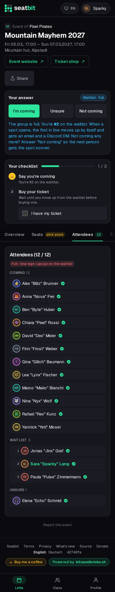
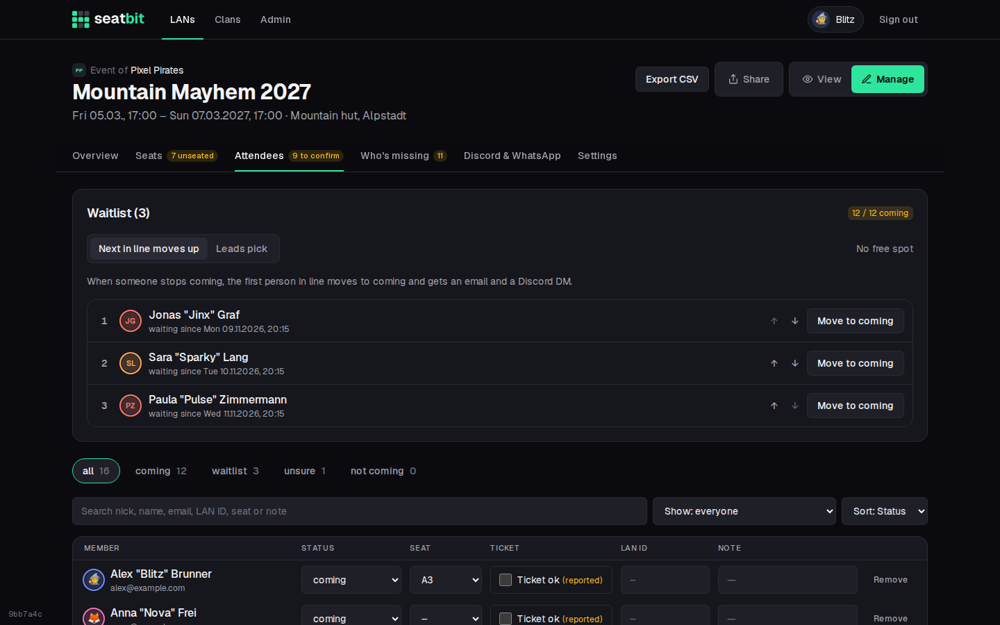

# Attendance and tickets

Members answer whether they come, work through their checklist and report their ticket; leads see everyone in one list.

**Who:** members answer; leads confirm tickets and can change any answer · **Where:** the event page (top card); *Manage → Attendees*

<figure markdown>

{ .shot }

<figcaption>Answer and checklist</figcaption>
</figure>
<figure markdown>

{ .shot }

<figcaption>Attendees tab</figcaption>
</figure>

The event page shows your answer and checklist at the top, then the tabs **Overview**, **Seats**, **Attendees**, **Travel**, **Packing list**, **Games** and **Food**.

## Answer

**Coming**, **Unsure** or **Not coming**, before the *answer by* date. Also possible with the buttons on the clan's Discord announcement or with `/coming`, `/unsure`, `/not-coming` and `/lans` in Discord. `/status` and `/ticket` work there too (see [Discord commands](discord.md#commands)).

- Once you have a ticket, your answer is **locked**. Leads can still change it.
- During an [interest check](events.md#interest-check) the answers are *I'd come / Maybe / Not this time* instead.

### Waitlist

When the group's spots (*Spots* on the event) are full, new *Coming* answers go on the **waitlist**. It's a line: whoever answered first is first. People waiting see their place (*You're #2 on the waitlist*) on the event page, in their checklist and in the bot's reply on Discord. The Attendees tab and the Discord announcement list the waitlist in order.

{ .shot width="300" }

When someone stops coming (or a lead raises the spots), what happens depends on the event's setting under *Manage → Attendees → Waitlist*:

| Setting | When a spot opens |
| --- | --- |
| **Next in line moves up** (default) | The first person in line moves to *Coming* by themselves and gets an email and a Discord DM ("You're in"). |
| **Leads pick** | Nobody moves on their own. The leads get an email and a DM, and the event's overview says how many spots are free. A lead moves someone up by hand, e.g. after asking who still has time. |

Turning *Next in line moves up* back on fills the free spots right away.

While people are waiting, a new *Coming* answer always queues up behind them, even when a spot is free, so nobody jumps the line.

**For leads**, the *Waitlist* card on *Manage → Attendees* shows the line with each person's place, how long they've waited and whether they already have a ticket:

- **↑ / ↓** move someone one place up or down.
- **Move to coming** takes them off the waitlist now and tells them. This also works when the group is full: the lead goes over the limit on purpose.
- Changing someone's answer in the attendee list works too. Setting someone to *waitlist* puts them at the end of the line.

Every move is in the [audit log](audit-log.md).

{ .shot }

## Checklist

| Step | Done when |
| --- | --- |
| 1. **Say you're coming** | You answered *Coming*. |
| 2. **Give your nickname** | You have a nick (default, LAN type or event). |
| 3. **Buy your ticket** | You ticked *I bought my ticket* before the *buy ticket by* date; a lead then confirms it. |
| 4. **Get your seat** | You have a seat. See [Seats](seats.md). |
| 5. **Book your seat on the event site** | Only when the event has its own seat plan: after the group's plan is final, you booked the same seat there and ticked *I booked it*. |

## Nick and LAN ID

On the Overview tab you can set a nick for this LAN type (used for every event of that type) and your **user ID or ticket number** on the event's own site, so leads can match you up. Only leads see the ID, unless the event has a [profile link](clans.md#profile-links): then the attendee list links your profile on the event's site. The same values are on your [profile](accounts.md#profile).

## Tickets

1. The member ticks **I bought my ticket**.
2. A lead confirms it with **Ticket ok** on the Attendees tab.

Reminders go to people coming without a ticket before the *buy ticket by* date. See [Reminders](reminders.md).

## Attendee list

*Manage → Attendees*: one row per person with answer, seat, ticket, LAN ID and a note. Filter by status, search and sort. Leads can change anyone's answer, also once it's locked.

{ .shot }

**Export CSV** downloads the group (seat, nick, name, email, status, ticket, LAN ID, and the profile link when the event has one) for the event's organisers. It opens in Excel and Numbers with umlauts and accents intact.
