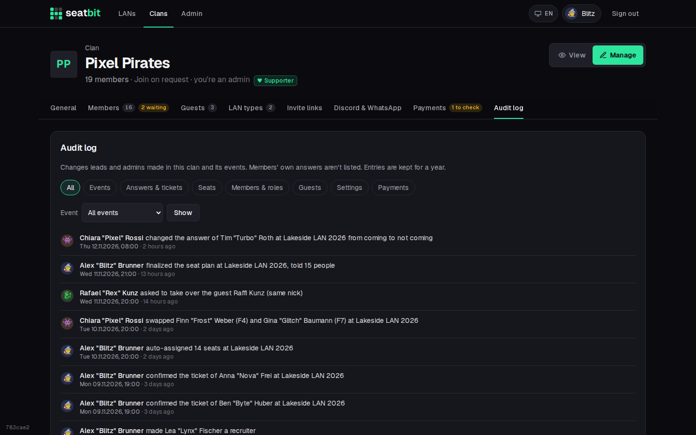
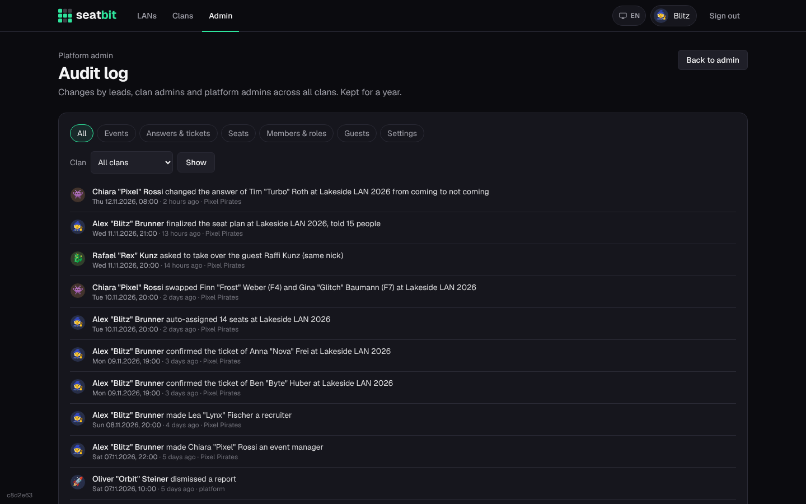

# Audit log

A log of what leads and admins changed in a clan and its events, so you can see who moved a seat or confirmed a ticket.

**Who:** clan admins, event managers and recruiters; platform staff for every clan · **Where:** clan *Manage → Audit log*; *Admin → Audit log*

{ .shot }

## What's logged

- Seats: moves, swaps, auto-assign, finalizing the plan
- Answers changed by leads, waitlist moves (moved up, reordered, auto or by hand), confirmed tickets
- Lead and clan roles, join approvals, guest edits and guest claims
- Publishing, cancelling and editing events
- Supporter status (when [supporter payments](supporters.md) are on)

Members' own answers aren't listed. Entries are kept for **one year**. Filter by kind of change or by event.

## Platform audit log

*Admin → Audit log* shows the log of every clan plus platform changes: settings (by name, never their values), platform roles, reports and how they were handled, suspensions, mail templates, deleted accounts and database backups (made by hand, downloaded or deleted). Filter by clan or kind of change.

{ .shot }

Members can download the audit entries about themselves with **Download my data** on their [profile](accounts.md#your-data).
