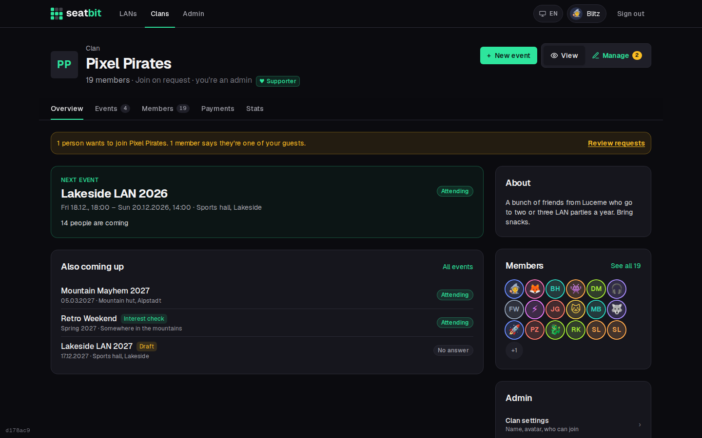
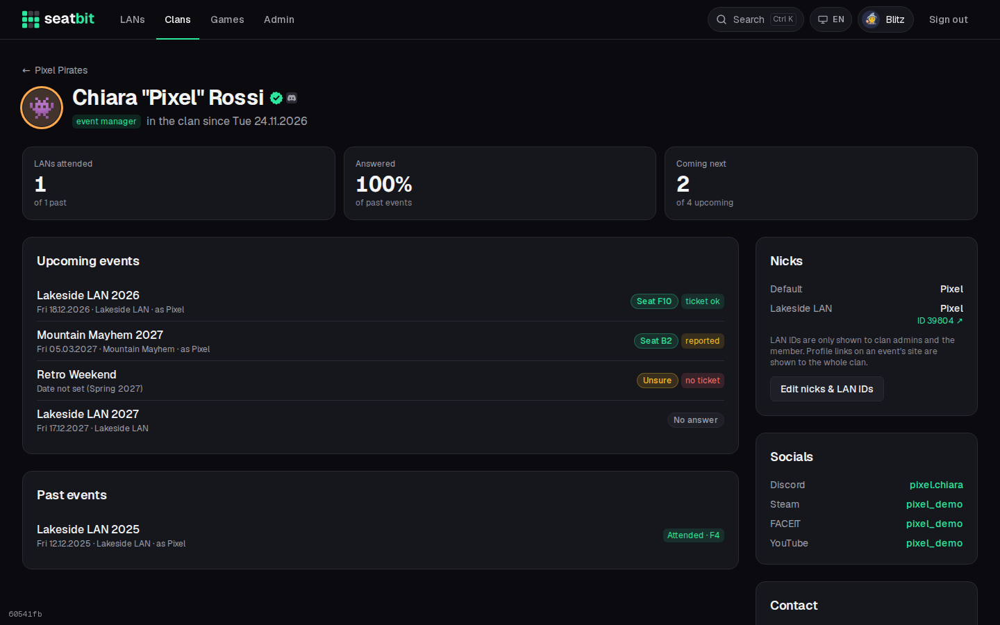
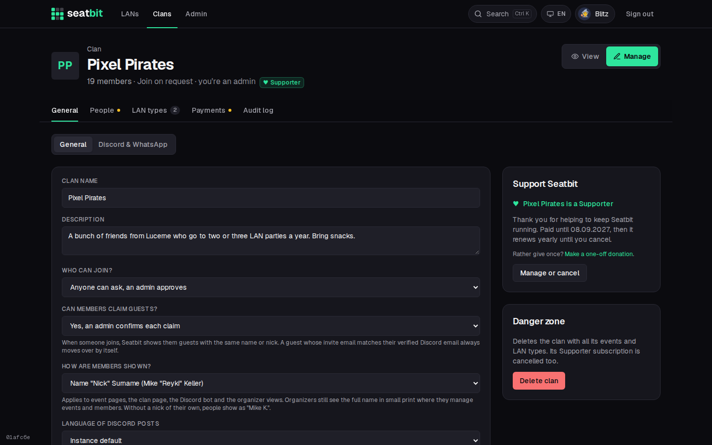
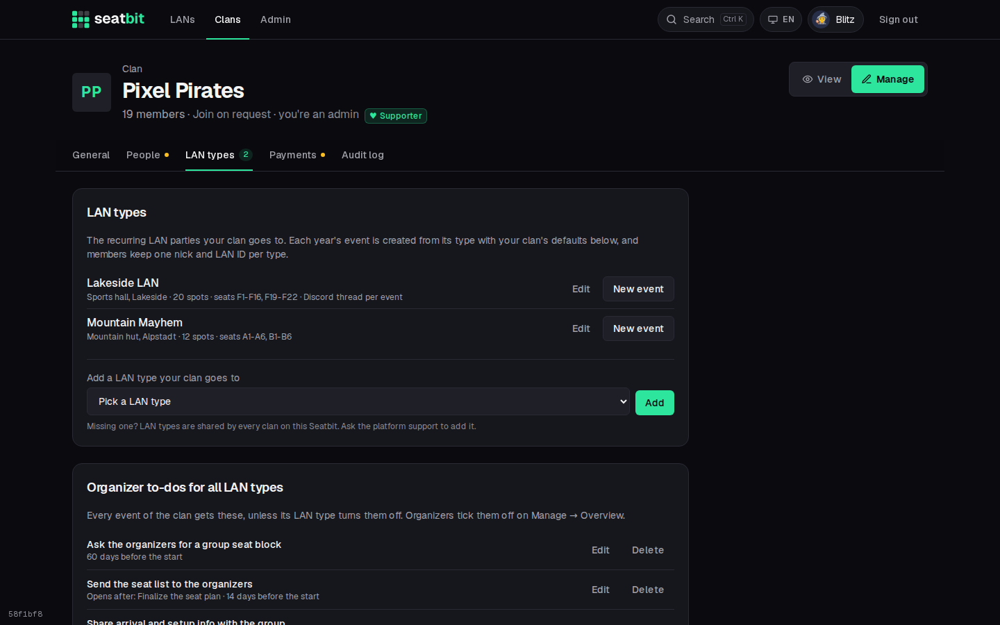
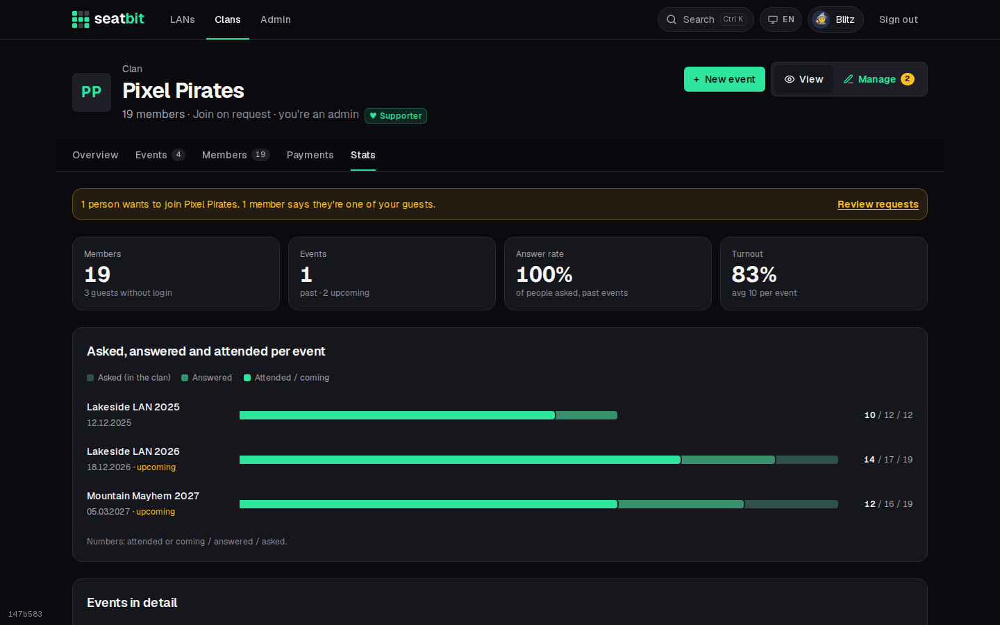

# Clans and roles

A **clan** is your group: its members, the LAN types you go to every year, the events and its Discord server. An instance hosts any number of clans; each clan only sees its own events.

**Who:** anyone can start a clan; clan admins configure it · **Where:** *Clans* tab → your clan → *Manage*

## Create a clan

Anyone signed in can start a clan on the **Clans** page (*Start a clan*) and becomes its first admin.

The clan page has **View** and **Manage** (for admins, event managers and recruiters, with the tabs their role allows). Tabs: **Overview**, **Events**, **Members**, **Payments** (once the clan charges you something), **Stats**. Tabs switch instantly; a yellow dot marks one where something waits for you.

{ .shot }

## Roles

Everyone in a clan has one **clan role**:

| | Admin | Event manager | Recruiter | Member |
|---|:-:|:-:|:-:|:-:|
| Clan settings, Discord, delete the clan | ✓ | | | |
| Give and take roles | ✓ | | | |
| Approve join requests, add and remove members, guests, invite links | ✓ | | ✓ | |
| Create events, run every clan event, LAN types | ✓ | ✓ | | |
| [Clan payments](payments.md): charges and who paid | ✓ | ✓ | | |
| Stats and [audit log](audit-log.md) | ✓ | ✓ | ✓ | |
| Answer for events | ✓ | ✓ | ✓ | ✓ |

- A clan always keeps at least one admin.
- Recruiters only remove plain members; people with a role are removed by an admin.
- **Leave clan** at the bottom of the clan page asks first. Whoever leaves or is removed loses access to the clan's events, so their answers on its upcoming events are withdrawn like a "not coming": the seat frees up and the waitlist moves up. Others' seat wishes that name them, their seat swaps, the rides and sleeping spots they offered or took and their teams on those events go too. Answers with a ticket or a payment stay, for the organizers to sort out: they may still go with their own ticket, and the event's *Manage* page marks them with a red "no longer in the clan" icon. Past events stay as they were. Their organizer roles on the clan's events end too: only clan members can organize an event. Removing a member asks first and says the same. Deleting a guest also takes them out of others' seat wishes. People who left before this cleanup existed are cleaned up the same way when the server starts.
- Admins change roles in the member list or on a member's profile under **Clan role**. The member gets a message.

{ .shot }

**Organizers** are set per event, on top of the clan role. They edit that event, its attendance and seats, and can add co-organizers. Any member can be an organizer of a single event. Whoever creates an event and all clan admins become its organizers; admins and event managers can always manage every event. When an event has no organizers of its own, its admins and event managers approve seat swaps and are listed as contacts.

## Clan settings

*Manage* on the clan page. Related tabs share one place in the tab bar; a switch below the bar moves between their parts. Tabs switch instantly; a yellow dot marks one where something waits (join requests, payments to check).

| Tab | Part | |
| --- | --- | --- |
| **General** | **General** | Name, description, avatar, join mode, guest claims, how names are shown, and the [Supporter](supporters.md) card when the instance has it on. |
| | **Discord & WhatsApp** | Connect the clan's Discord server. See [Discord and WhatsApp](discord.md). |
| **People** | **Members** | Join requests, guest claims, add existing users, roles. See [Members and guests](members-guests.md). |
| | **Guests** | People without an account yet. See [Guests](members-guests.md#guests). |
| | **Invite links** | Links that let anyone who has them join as a member, whatever the join mode. Delete a link to stop it. |
| **LAN types** | | Templates for LANs you go to regularly. See [below](#lan-types). |
| **Payments** | | See [Clan payments](payments.md). |
| **Audit log** | | See [Audit log](audit-log.md). |

{ .shot }

**Who can join:**

| Join mode | |
| --- | --- |
| *Approval* (default) | Anyone can ask to join, an admin or recruiter approves. |
| *Open* | Anyone joins directly. |
| *Invite only* | Only with an invite link. |

**Can members claim guests?** An admin confirms each claim (default), same name or nick moves over right away, or only with the guest's own link. See [Members claiming a guest](members-guests.md#members-claiming-a-guest).

**How are members shown?** Pick how people appear on event pages, the seat map, the clan page, in the Discord bot and where organizers manage the clan (event *Manage*, clan settings › *Members* and *Guests*, stats):

| Name display | Example |
| --- | --- |
| *Name "Nick" Surname* (default) | Mike "Reyki" Keller |
| *Name "Nick"* | Mike "Reyki" |
| *Nick only* | Reyki |

The nick is the one for that event or LAN type, as always. Someone without a nick of their own shows as *Mike K.* in the shorter modes. When the display leaves part of the name out, the attendee list in event *Manage*, the member and guest lists in clan settings and a member's profile (for admins, recruiters and the member themself) show the full name in small print below it, so ticket checks still work, and search finds people by their full name too. The audit log, exports, the guest claim list and the admin page always use the full name.

**Verified check mark:** a green check mark after a name means the person has their own Seatbit account (they signed in with Discord). [Guests](members-guests.md#guests) an organizer typed in don't have it until they take their guest over.

## LAN types

A **LAN type** describes a LAN party that happens regularly, e.g. *Lock & Load* or *SwitzerLAN*. LAN types are **shared by every clan** on the instance: [platform staff](admin.md#lan-types) add and edit them, so each LAN exists once and members keep one nick and LAN ID for it, whichever clan they go with.

Each clan picks the LAN types it goes to under *Clan settings → LAN types* (**Add a LAN type your clan goes to**). Creating an event of a type the clan doesn't have yet adds it too. A missing LAN? Ask the platform support to add it.

New events are created from a type and copy its values: the shared details, plus your clan's own defaults.

| Field | Who sets it | |
| --- | --- | --- |
| Location, website, ticket shop, price | Platform staff | Copied to each event. |
| Usual length | Platform staff | In hours, e.g. Fri 18:00 to Sun 16:00 = 46. Sets the event's end. |
| Member profile link | Platform staff | Optional. A member's profile on the event's own site, with `{id}` where their LAN ID goes, e.g. `https://example.com/user/?id={id}`. See [Profile links](#profile-links). |
| Spots | Your clan | How many people the group usually brings. Only used when the type has no seats: with seats, each seat is a spot. |
| Seats | Your clan | The seats you usually get, e.g. `F1-F20`. |
| Answer by | Your clan | Days before the start members must answer (default 30). |
| Reminders | Your clan | Days before the start the reminder goes out. |
| Discord | Your clan | Where the bot posts these events, their reminders and news: the linked channel, a thread per event or a channel per event. See [Discord](discord.md#thread-or-channel-per-event). |

The type's page in your clan also holds your clan's **event contacts** and **organizer to-dos** for it, see [Organizer to-dos and event contacts](lead-todos.md). Other clans don't see them. **Remove from your clan** takes the type off your list with your defaults, contacts and to-dos for it; events of that type stay as they are.

Members set a nick and their user ID **per LAN type**, so they enter their name for the event's own site once, not every year.

{ .shot }

### Profile links

Many LAN sites have a public page per participant, e.g. `https://example.com/user/?id=4039`. Put that link into the LAN type's **Member profile link** with `{id}` instead of the number: `https://example.com/user/?id={id}`. Seatbit then builds each member's link from the LAN ID they entered and shows a **Profile ↗** link:

- next to each name in the event's **Attendees** tab (all members see it),
- in *Manage → People*, in the seat plan's details and in the CSV export,
- on the member's clan profile and their own profile.

An event can have its own link (event *Settings*); empty means the LAN type's. Without a profile link, LAN IDs stay visible to organizers, admins and the member only.

## Stats

**Stats** on the clan page shows, per event, how many people were asked, answered and came, ticket and seat numbers, and the answer rate. Admins, event managers and recruiters see it.

{ .shot }
