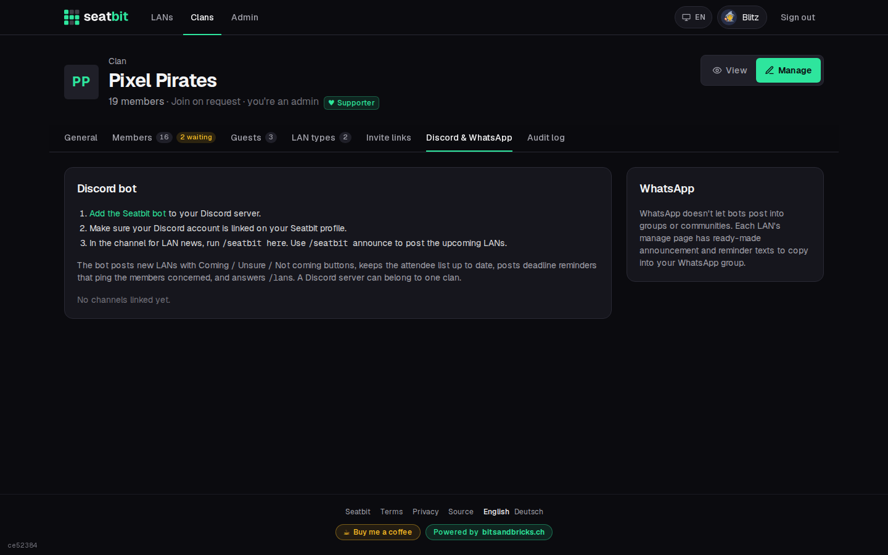
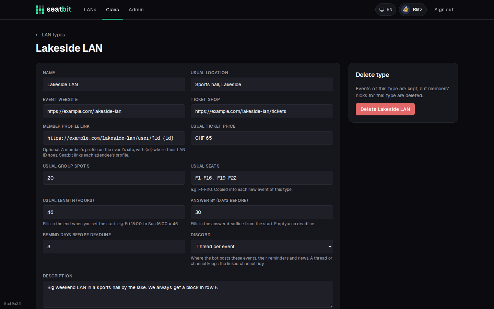
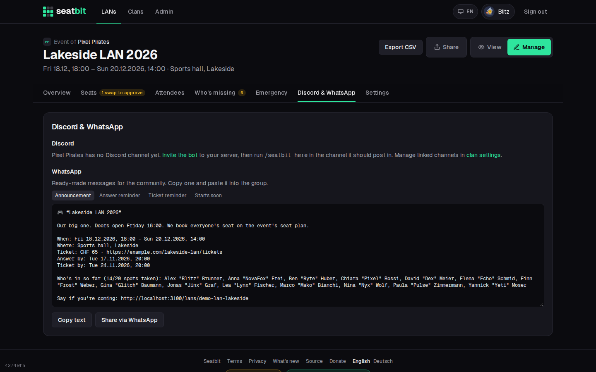

# Discord and WhatsApp

The Seatbit bot posts each event to the clan's Discord server with answer buttons, sends reminders and DMs, and has slash commands. For WhatsApp, Seatbit prepares texts to paste.

**Who:** clan admins connect the server; leads post per event; members answer and get DMs · **Where:** clan *Manage → Discord & WhatsApp*; event *Manage → Discord & WhatsApp*

!!! note "Instance setup"
    The bot needs a Discord application set up by the platform admin first. See [Discord app and bot](../installation/discord.md).

## Connect the clan's server

1. Open **Clan settings → Discord & WhatsApp** and click **Add the Seatbit bot** to invite it to your server.
2. In the channel the bot should post in, run `/seatbit here`. You need *Manage Server* on Discord and a Discord account linked in Seatbit. If you admin several clans, use `/seatbit here clan:<name>`.

{ .shot }

A Discord server belongs to one clan.

## What the bot does

| | |
| --- | --- |
| **Announcements** | Each published event is posted with **Coming / Unsure / Not coming** buttons. The attendee list on the post updates live, also for answers on the website, and shows tickets, seat bookings and the next deadline. Pinned if the bot has *Pin Messages*. Turns red when the event is cancelled. |
| **Reminders** | Answer, ticket and "starts soon" reminders as cards with the deadline, the ticket link and who's still open, pinging the members they apply to. |
| **News** | With a thread or a channel per event (see below), lead news is posted there too. |
| **DMs** | When something changes for a member (their seat, the final plan, moving up from the waitlist, reminders, nudges), with buttons like *I have my ticket*. Answering on Discord (buttons or `/coming`, `/unsure`, `/not-coming`) also sends a confirmation DM with the date, place and next step, since the reply in the channel is only visible for a while. Members can turn DMs off on their profile. |
| **Join requests** | Admins and recruiters get a DM when someone asks to join or claims a guest. |
| **Server invite** | Members who aren't on the server see **Join our Discord** on the clan page. The bot creates the invite if it has *Create Invite*; otherwise paste your own invite link in the clan settings. |

## Thread or channel per event

Each [LAN type](clans.md#lan-types) chooses where the bot puts its events, under **Discord** in the type's settings:

| Setting | Announcement | Reminders and news |
| --- | --- | --- |
| **In the linked channel** (default) | Linked channel | Linked channel (news only by DM and mail) |
| **Thread per event** | Linked channel | A thread on the announcement, named after the event |
| **Channel per event** | A new channel named after the event, in the linked channel's category | That channel. The linked channel gets a short pointer to it. |

{ .shot }

A thread needs the bot's *Create Public Threads* and *Send Messages in Threads* permissions, a channel per event needs *Manage Channels*. Without them the bot falls back to the linked channel. One-off events without a type use the linked channel. Changing the setting applies to events posted afterwards. Delete an event's channel on Discord when you no longer need it; the bot then uses the linked channel again.

## Commands

Members can do the everyday things straight from Discord, in the clan's server or in a DM with the bot. Answers are only visible to you. On a server linked to a clan, the commands work on that clan's events; in DMs on the events of all your clans. They need a Discord account linked in Seatbit.

| Command | What it does |
| --- | --- |
| `/coming`, `/unsure`, `/not-coming` | Answer for an event. During an interest check, this answers *Would you come?* instead. If several events are open, the bot asks which one with a button each, or pick one with `event:`. |
| `/status` | Your next events with your answer and the same checklist as on the event page (nick, ticket, seat pick or wishes, seat confirmed by the leads, games), your seat wishes and the next deadline. `/status event:<name>` shows one event with buttons like **Coming** and **I have my ticket**. |
| `/ticket` | Tick off that you bought your ticket. `bought:False` takes it back, unless a lead ticked it for you. |
| `/nick nick:<nick>` | Your default nick. With `event:` it's your nick for that event's LAN type (or that one event, if it has no type). |
| `/wish` | Shows your ranked seat wishes. `near:` (within 2 seats) and `avoid:` (not right next to; one person each time, suggested from the people who answered), `position:` (edge, middle; anywhere removes it) and `seat:` add a wish at the end of your list; reorder them and change distances on the website. `note:` sets the note, `clear:True` starts over. Closes when the seat plan is final. |
| `/lans` | Your upcoming LANs of this server's clan (in DMs: all your clans) with answer buttons. Only you see it. |
| `/claim` | Take over the guest profile the leads made for you. Lists the clan's guests with your name or nick; `/claim guest:<name>` picks one. See [Claiming a guest on Discord](members-guests.md#on-discord). |
| `/guest guest:<name> member:<name>` | Leads who manage members: say which Discord member a guest is. `member` suggests only people on the server who aren't in the clan on Seatbit yet. See [Linking a guest to a Discord member](members-guests.md#on-discord). |
| `/seatbit here` | Link this channel to your clan. |
| `/seatbit announce` | Post the clan's upcoming LANs in this channel. |
| `/seatbit stop` | Unlink this channel. |

The same rules apply as on the website: once you have a ticket, your answer is locked and only leads can change it; sign-up closes at the *answer by* date; you only see and answer your own clan's events. The `event:` option suggests the matching events as you type.

## Language

Replies to one person follow their own language; posts in a channel use the clan's **Language of Discord posts**. See [Languages](languages.md#discord).

## Per event

*Manage → Discord & WhatsApp* on an event: re-post the announcement or post a reminder by hand.

{ .shot }

## WhatsApp

WhatsApp can't be automated for normal groups and communities, so Seatbit prepares the texts: an announcement and reminder texts with **Copy** and a **Share via WhatsApp** link, on the same tab.
