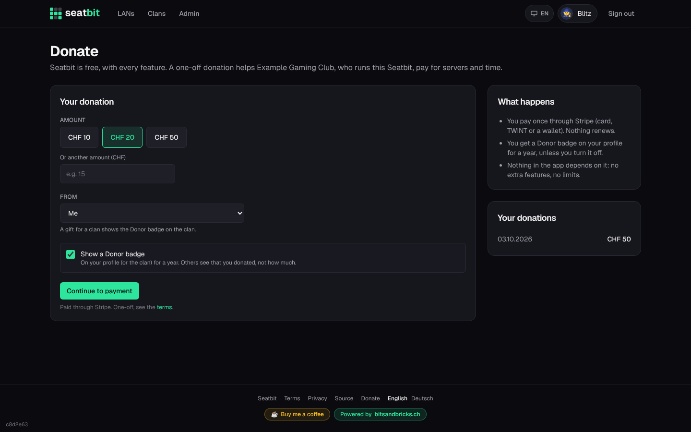
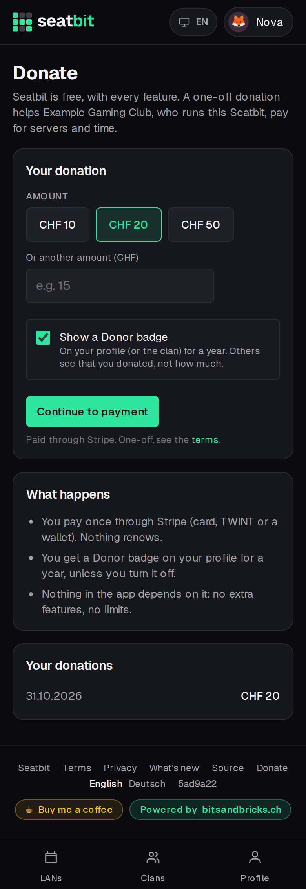
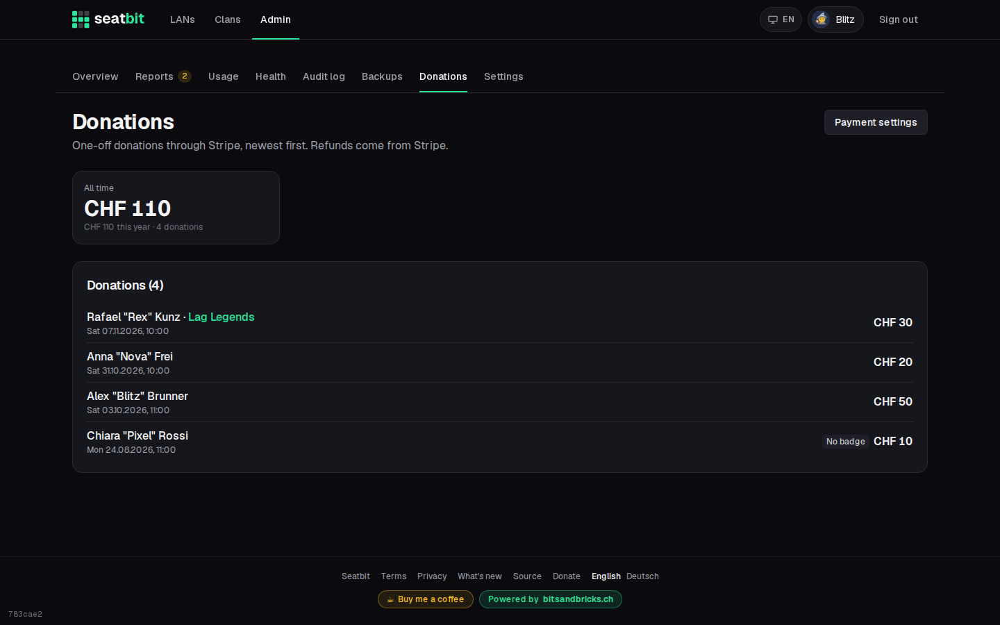

# Donations

On instances where the operator turned on donations, anyone who is signed in can give a **one-off** amount to the people who run the instance. Nothing renews, and nothing in the app depends on it: no plans, no limits, no extra features.

**Who:** everyone signed in · **Where:** footer → *Donate* (`/donate`), or *Rather give once?* in the clan's *Support Seatbit* card

!!! note "Off by default"
    Until the operator sets up Stripe and turns donations on, there's no Donate link and the page doesn't exist. See [Stripe (supporter payments and donations)](../installation/stripe.md).

{ .shot }

- Pick one of the suggested amounts or type your own (1 to 10,000, in the instance's currency). Paying opens Stripe Checkout with the methods the operator turned on (card, TWINT, Apple Pay, Google Pay).
- **From:** yourself, or a clan you manage (clan admins). A gift for a clan shows on the clan.
- **Donor badge:** on by default. It shows a small *Donor* mark on your profile and member page (or on the clan) for a year. Others see that you donated, never how much. Untick it to give quietly.
- **Clan Supporter for a year:** where Supporter payments are on too, a gift for a clan of at least the yearly Supporter price makes the clan a Supporter for a year, without a subscription. A running subscription is extended by that year.
- After paying you land on a thank-you page; Stripe sends the receipt by email. *Your donations* on the donate page lists what you gave, and your [data export](accounts.md) includes it.

<figure markdown>
{ .shot width="320" }
</figure>

## For platform owners

Only [owners](admin.md#platform-roles) see it: *Admin → Donations* (`/admin/donations`) lists every donation with the donor, the clan, the amount and whether the badge is shown, and totals per currency (all time and this year). A refund in the Stripe Dashboard marks the donation **Refunded**: it no longer counts and the badge goes. Donations also show in the audit log.

{ .shot }
