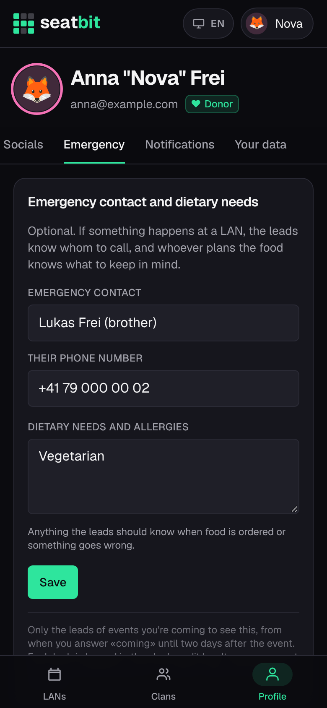
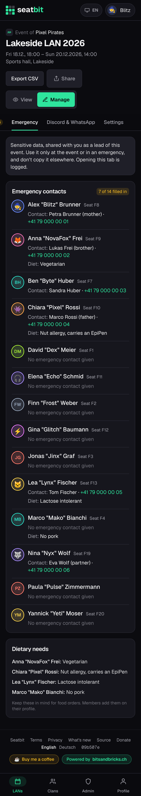
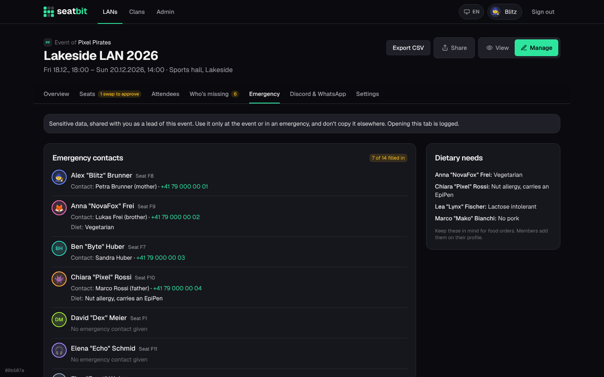

# Emergency contact and dietary needs

Members can leave an emergency contact and their dietary needs or allergies. The leads of an event they come to see them, so they know whom to call if something happens at the LAN and what to keep in mind when ordering food.

**Who:** members fill it in, leads see it · **Where:** *Profile → Emergency*; event *Manage → Emergency*

## Fill it in

On *Profile → Emergency*, all optional:

| Field | |
| --- | --- |
| **Emergency contact** | A name, e.g. "Anna Muster (sister)". |
| **Their phone number** | Tapping it on the lead page calls the number. |
| **Dietary needs and allergies** | Free text, e.g. "vegetarian" or "nut allergy, carries an EpiPen". |

Clear all fields and save to remove it.

<figure markdown>

{ .shot }

</figure>
<figure markdown>

{ .shot }

</figure>

## For leads

*Manage → Emergency* lists everyone coming (not the waitlist) with their seat, emergency contact and dietary needs, and shows how many filled it in. A second card collects all dietary needs for food orders. On the event's *Food* tab, leads see how many people coming noted dietary needs, with a link to the list.

{ .shot }

## Privacy

Allergies can be health data, so access is narrow:

- Only the event's leads and the clan's event managers (admins, organizers) see it, and only for people coming to that event. Platform staff don't get the tab just for being staff.
- The tab closes two days after the event ends.
- Each time a lead opens the tab, the clan's [audit log](audit-log.md) notes it (at most once an hour per lead and event).
- It's never sent by mail or Discord and isn't in the attendee CSV export.
- It's in the member's own **Download my data** file and is deleted with the account. See [Accounts and profile](accounts.md#your-data).
