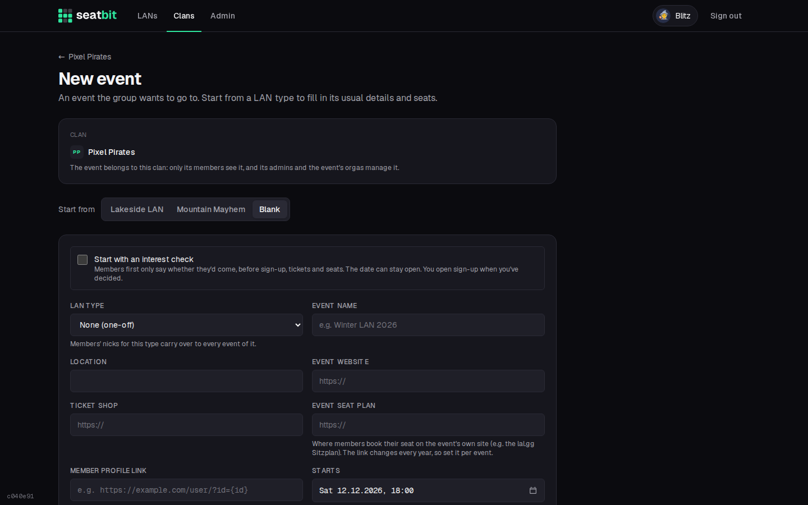
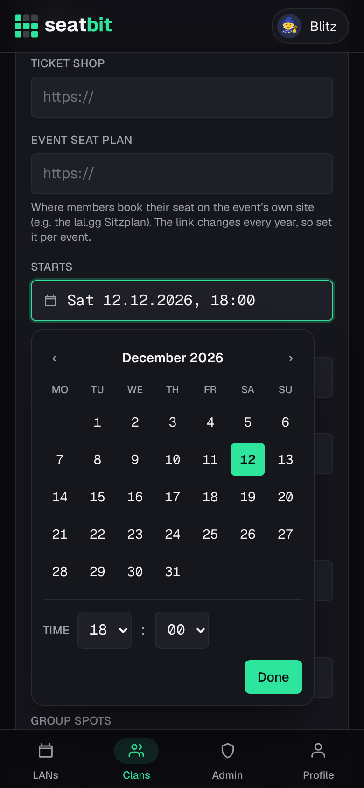
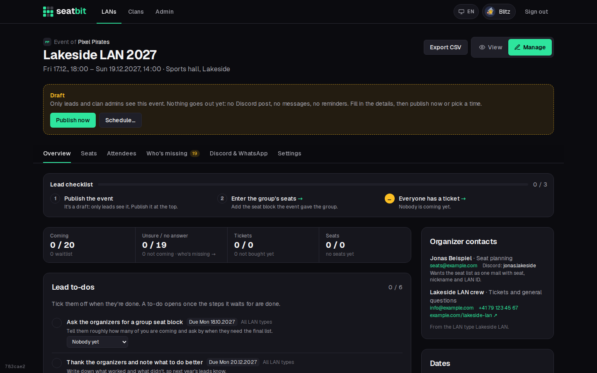
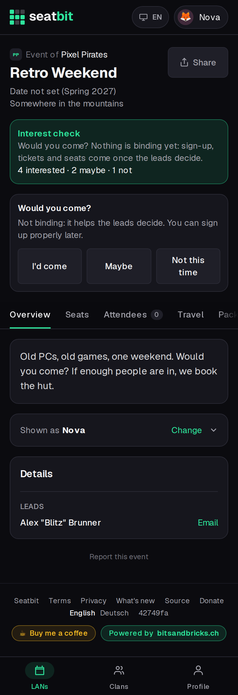
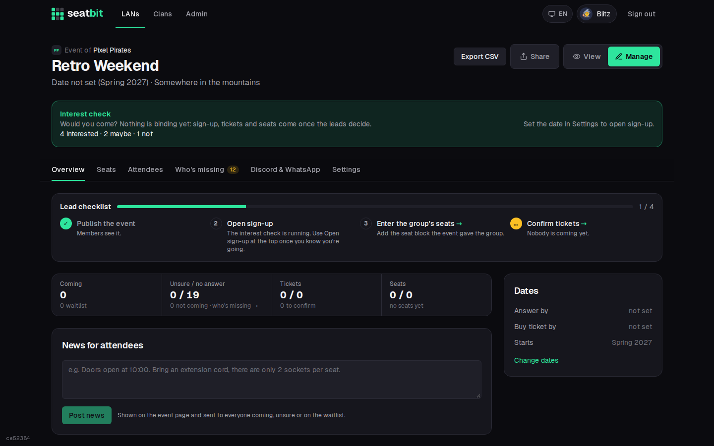
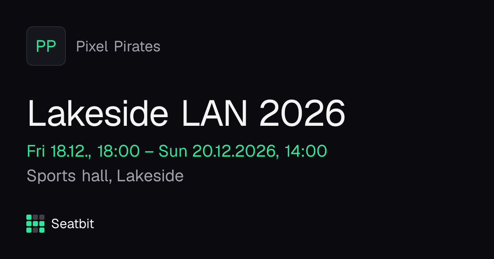
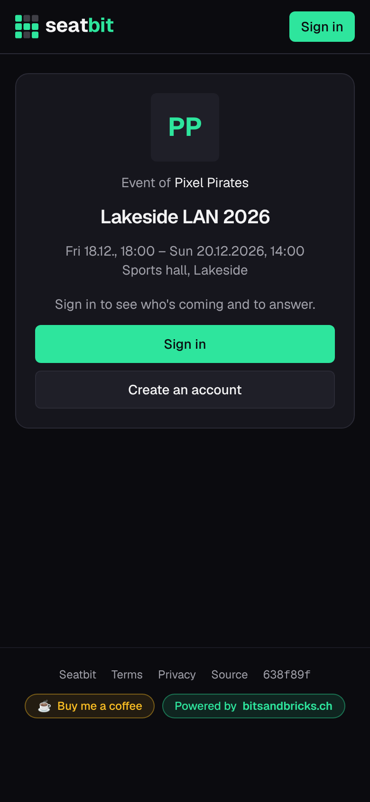
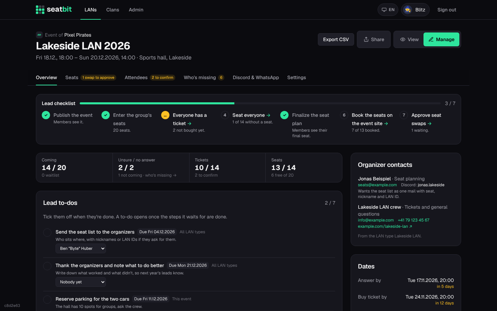
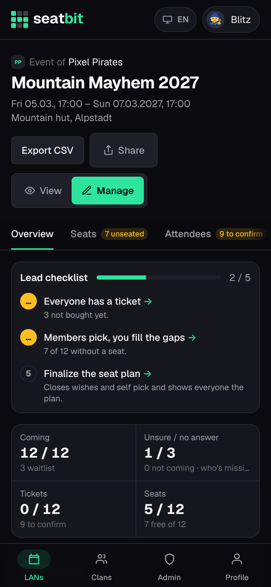
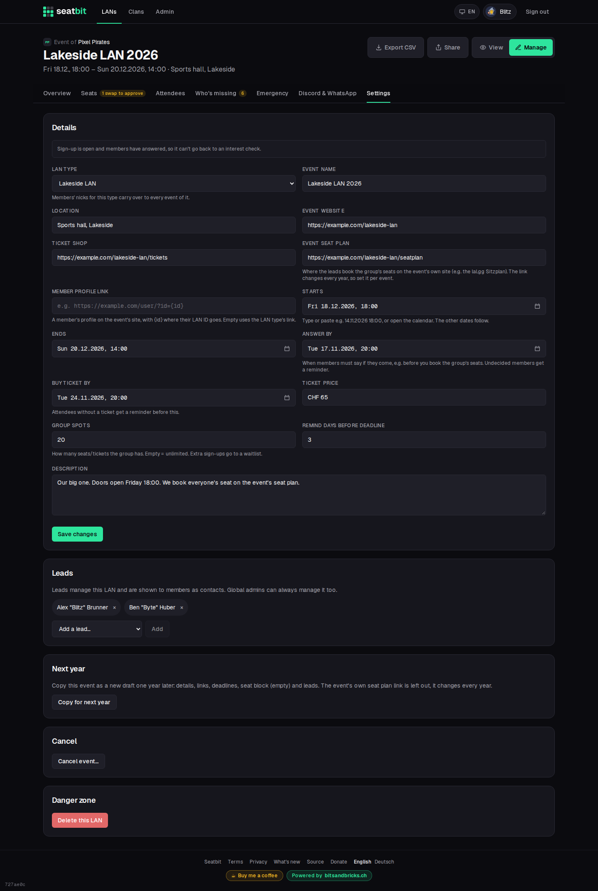

# Event lifecycle

An **event** is one edition of a LAN the group attends. It goes from draft (optionally an interest check) to published, sign-up, the LAN itself, and next year's copy.

**Who:** leads, clan admins and event managers create and run events; members answer · **Where:** *New event* on the *LANs* tab or the clan page; *Manage* on the event

| Stage | Who sees it | What happens |
| --- | --- | --- |
| **Draft** | Leads, clan admins, event managers | Nothing goes out. |
| **Interest check** (optional) | The clan | *Would you come?* answers, date can stay open. |
| **Published** | The clan | Announcement, answers, tickets, seats, reminders. |
| **LAN day** | The clan | Check-in with *I'm here*. |
| **Cancelled** | The clan, greyed out | Everyone who answered is told. Can be undone. |

**Copy for next year** turns a past event into next year's draft.

## Create an event

**Start from** a LAN type to copy its details and seats, or from *Blank* for a one-off event. Everything can be changed later.

{ .shot }

| Field | |
| --- | --- |
| **Start, end** | Set the start and the end follows from the type's usual length. Moving the start later moves the end and the deadlines by the same amount. |
| **Answer by** | When the group must know who comes (e.g. before booking the seat block). Defaults from the type's days before. |
| **Buy ticket by** | Deadline for tickets. |
| **Spots** | How many people the group can bring. When full, new answers go on the [waitlist](attendance.md#waitlist); leads choose whether the next in line moves up by itself or they pick. |
| **Seats** | The seats the event gave the group, e.g. `F1-F16, F19-F22`. See [Seats](seats.md). |
| **Event seat plan** | Link to the event's own seat plan where the leads book the group's seats (new every year). |
| **Member profile link** | A member's profile on the event's site with `{id}` for their LAN ID. Empty uses the LAN type's. See [Profile links](clans.md#profile-links). |

Every date field is a text box: type or paste `14.11.2026 18:00`, `14.11. 18` or `14.11.26 1800`, or open the calendar.

{ .shot width="300" }

## Draft, publish and schedule

A new event starts as a **draft**: only its leads, clan admins and event managers see it, and nothing goes out (no Discord post, no reminders, no messages).

{ .shot }

- **Publish now** makes it live.
- **Schedule…** sets a time; the server publishes it by itself (checked every minute).

Publishing shows the event to the clan, posts the [Discord announcement](discord.md) with answer buttons, starts the [reminders](reminders.md) and tells members about the new event by email or Discord DM. Members choose per clan whether they hear about all events or only certain LAN types (one-off events always count).

## Interest check

For when you're not sure yet if, or when, the group goes. Turn it on when creating the event, or later under *Settings* while it's a draft or nobody has answered.

- Members answer *I'd come*, *Maybe* or *Not this time*. Nothing is binding.
- The date can stay open with a rough hint like "Spring 2027".
- **Open sign-up** (after setting the date) tells everyone who was interested (except those who said no) and starts normal answers, tickets and seats.

<figure markdown>

{ .shot }

<figcaption>Member view</figcaption>
</figure>

{ .shot }

## Share an event

Every published event has a **Share** button next to its title, for members and leads alike.

- **On a phone** it opens the phone's share sheet (WhatsApp, Discord, Signal, ...).
- **On a computer** it copies the link and shows *Link copied*.

Pasted into a chat, the link shows a preview card with the event's name, date, place and the clan's name and avatar. Clan avatars in WebP show the clan's initials instead. Drafts have no Share button and their links show a plain Seatbit card, so nothing leaks before you publish.

{ .shot }

Someone who opens the link but can't see the event yet gets a card with the event's name, date and place and a way in:

| Who opens it | What they see |
| --- | --- |
| Signed out | *Sign in* or *Create an account*, then straight back to the event. New accounts fill in their name first. |
| Signed in, not in the clan, clan is **open** | *Join clan*, then the event. |
| Signed in, not in the clan, clan needs **approval** | *Ask to join*. The link opens the event once a clan admin lets them in. |
| Signed in, not in the clan, clan is **invite-only** | A note to ask a lead for an [invite link](clans.md#clan-settings). |

<figure markdown>

{ .shot }

<figcaption>Signed out</figcaption>
</figure>

For ready-made WhatsApp texts with the link (announcement, reminders), see *Manage → Discord & WhatsApp*.

## Manage

Leads see **View / Manage** next to the event title. *Manage* has the tabs:

| Tab | |
| --- | --- |
| **Overview** | The lead checklist, [lead to-dos and organizer contacts](lead-todos.md), a strip with the numbers (coming, unsure, tickets, seats; each opens its tab), deadlines, news, [manual reminders](reminders.md#manual-reminders). |
| **Seats** | The seat planner. See [Seats](seats.md#plan-the-seats). |
| **Attendees** | Answers, tickets, LAN IDs, CSV export. See [Attendance](attendance.md#attendee-list). |
| **Who's missing** | Who still owes something, with nudges. See [Who's missing](reminders.md#whos-missing). |
| **Discord & WhatsApp** | Re-post the announcement, post reminders, WhatsApp texts. See [Discord](discord.md#per-event). |
| **Settings** | Details, dates, spots, links, co-leads, copy, cancel, delete. |

{ .shot }

### Lead checklist

The top of *Manage → Overview* lists what the leads still have to do for the event. Open steps link to the tab where you do them; on phones only the open steps show.

{ .shot width="300" }

| Step | Done when |
| --- | --- |
| **Publish the event** | The event is published (waits while a scheduled publish is set). |
| **Open sign-up** | Only during an [interest check](#interest-check): you opened sign-up. |
| **Enter the group's seats** | The seat block is entered. |
| **Move people up from the waitlist** | Only when you move people up by hand and a spot is free. |
| **Everyone has a ticket** | Everyone coming has a ticket. A member saying they have one counts; confirming it is optional. |
| **Seat everyone** | Everyone coming has a seat. With self pick on: *Members pick, you fill the gaps*. |
| **Finalize the seat plan** | The plan is final. |
| **Book the seats on the event site** | Only with an event seat plan link: every seat is ticked as booked. See [Seats](seats.md#book-on-the-event-site). |
| **Approve seat swaps** | Only while swaps wait for approval. |

Below it, the leads' own [to-dos](lead-todos.md) (e.g. *Send the seat list to the organizers*) can wait for these steps and open once they are done.

### News

Short updates ("Doors open at 10:00, bring cash for pizza"). They show on the event page and go by email or Discord DM to everyone coming, unsure or on the waitlist.

### Settings

{ .shot }

| Action | |
| --- | --- |
| **Copy for next year** | Creates next year's event as a draft: dates +1 year, seat block, leads. |
| **Cancel event…** | Tells everyone who answered and turns the Discord post red. The event stays visible, greyed out. Can be undone. |
| **Delete** | Removes a draft or an event for good. |

## On the day

Members coming tap **I'm here** when they arrive, and everyone sees who is still on the way.
