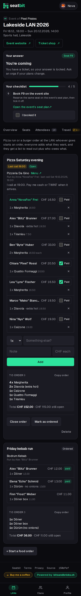
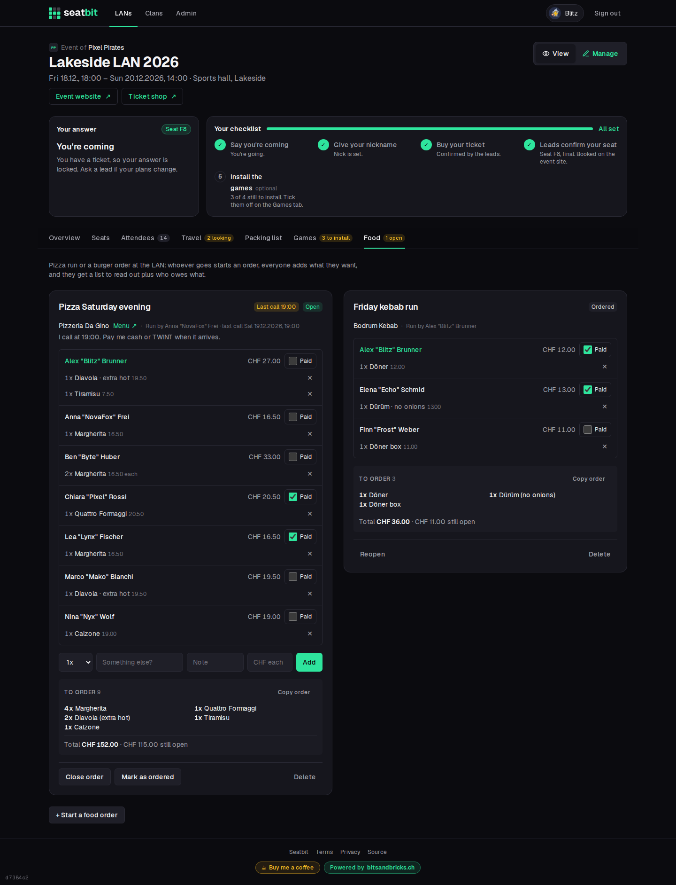

# Food orders

The pizza run or a burger order at the LAN: everyone adds what they want, one person orders and ticks off who paid.

**Who:** anyone coming · **Where:** event *Food* tab

## Start an order

| Field | |
| --- | --- |
| **What** | e.g. "Pizza Saturday evening". |
| **From** | The restaurant, with an optional menu link. |
| **Last call** | Optional. After it, the order takes no new lines. |
| **Note** | e.g. how to pay. |
| **Send everyone coming a Discord DM** | Optional. Never sends a mail. |

## Add your order

Add how many, the item, a note ("no onions") and the price. Until the last call you can remove your own lines.

## Place it and collect the money

- **To order** lists the same items merged ("4x Margherita"), to read out on the phone. **Copy order** puts it on the clipboard for a chat.
- The order shows the total and what each person owes.
- Whoever started the order (or an orga) closes it, marks it as ordered and ticks off who **paid**.

The currency is a platform setting (`FOOD_CURRENCY`, default CHF). See [Configuration](../installation/configuration.md).

<figure markdown>

{ .shot }

</figure>

{ .shot }
