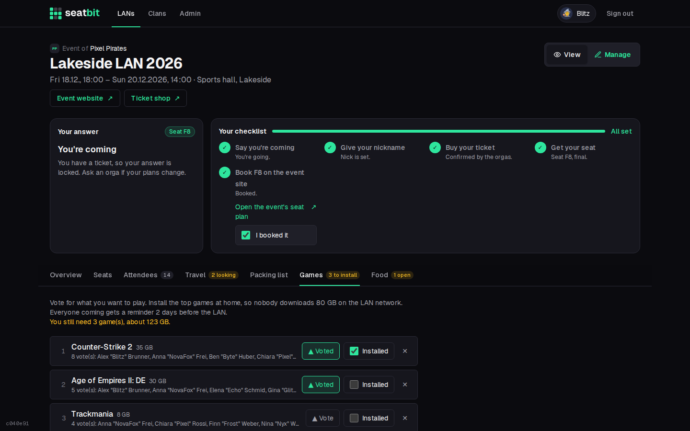
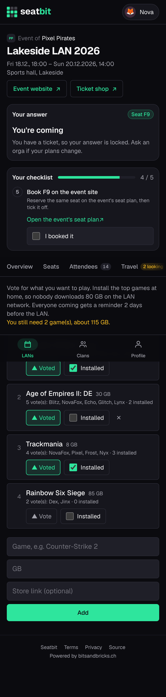

# Games

Decide what to play and make sure everyone has it installed before the LAN.

**Who:** members · **Where:** event *Games* tab

- **Suggest** a game with its download size. Each game shows who added it, with their avatar and the clan's name display.
- **Fix** a game later with the pencil: name, size or store link. Whoever added it and the event's leads can edit or remove it; votes and *installed* ticks stay.
- **Vote** for the ones you want to play. The list is sorted by votes.
- **Tick off** what you installed. The tab shows how many games you still have to install.
- Two days before the LAN, everyone coming gets an *install your games* [reminder](reminders.md).

{ .shot }

<figure markdown>

{ .shot }

</figure>

