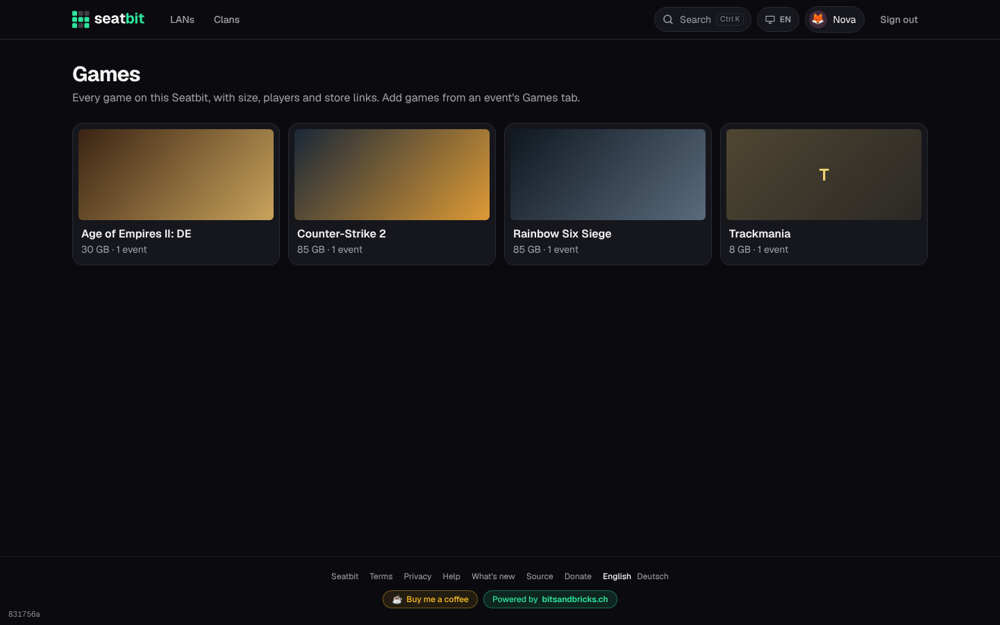
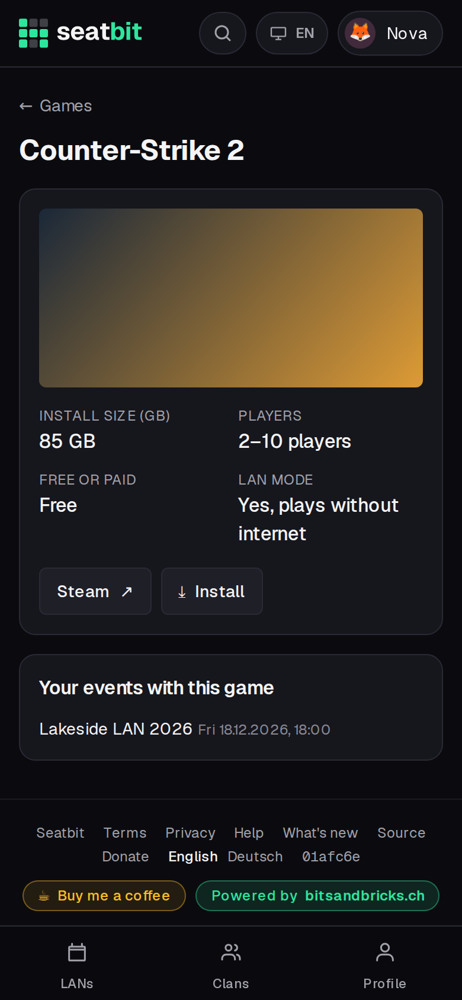

# Games

Decide what to play and make sure everyone has it installed before the LAN.

**Who:** members · **Where:** event → *Games* tab

- **Suggest** a game: start typing its name and pick it from the list. The list shows games from the [game catalog](#game-catalog) first, then matching Steam games. A picked game brings its cover, install size, store link, player count and *Free* / *LAN mode* tags along. A name nobody has used yet goes into the catalog with the size and link you type. Each game shows who added it, with their avatar and the clan's name display.
- **Store and install:** each game links to its store page (*Steam*, *Epic Games*, *GOG*, *Battle.net*, ... or *Website*). Steam games also get an **Install** button that opens Steam's install dialog on your computer, so you can start the download at home.
- **Fix** a game later with the pencil. Whoever added it and the event's organizers can rename it (which points it at another catalog game) or remove it from the event; votes and *installed* ticks stay. Size, link, players, price and LAN mode belong to the catalog and show on every event, so only whoever put the game in the catalog and platform support change them.
- **From last time:** for an event of a LAN type, the games of the clan's previous event of that type that aren't on the list yet show above the form. Tap one to add it again (your vote included).
- **Each game** shows its cover (or, without one, a box in the game's colour with its initials, so every row lines up), its place in the ranking, size, players, *Free* / *LAN mode*, and below it who voted and who already installed it, with their avatars.
- **Vote** for the ones you want to play. The list is sorted by votes.
- **Tick off** what you installed. The tab shows how many of the games you voted for you still have to install, and their size. Games only others voted for don't count.
- Two days before the LAN, everyone coming gets an *install your games* [reminder](reminders.md).

{ .shot }

<figure markdown>

{ .shot }

</figure>

## Game catalog

Every game exists once per Seatbit instance, in the **game catalog**, so the details are entered once for every clan and event:

- **From Steam:** pick a Steam game, or paste its Steam store link, and Seatbit fills in the name, cover, install size (from Steam's system requirements, rounded up), whether it's free and whether it has a LAN mode. Steam doesn't say how many players a game takes; add that by hand. The cover is copied to your Seatbit server once, so looking at the list never sends your browser to Steam.
- **Other stores** (Epic Games, GOG, Battle.net, ...) have no public data to read, so their size and link are typed in.
- **Everyone signed in** can look through the catalog under *Games* (`/games`, or *All games* on an event's Games tab) and open a game's page: cover, size, players, price, LAN mode, store and install links, and the events of theirs that play it. It's read-only; games are added from an event.
- Platform owners, admins and support keep the catalog tidy under [*Admin → Games*](admin.md#games): fix details, upload a cover, fetch from Steam again, and merge duplicates.

{ .shot }

<figure markdown>

{ .shot }

</figure>

## Tournament teams

Playing a tournament at the LAN? Build the team under the game:

- **+ Team** under a game starts a team: name, number of players (2 to 16), an optional link to the tournament page on the event's site and a note. Whoever starts it is the **captain** and its first player. Organizers can set up teams without playing in them.
- Each team shows as a chip under the game with its places, like *Lizards A 2/5*, or a check mark when it's full. Tap it to open the team in a side panel: players, open places, and who voted for the game but has no team yet.
- **Join** a team with a free place; you play in one team per game. **Leave team** takes you out again.
- The captain and the event's organizers edit or delete the team and can take players out (after a confirmation).
- When a team is full, its players get a Discord DM with the line-up.
- Teams are part of [your data](accounts.md) export and go when you delete your account.
