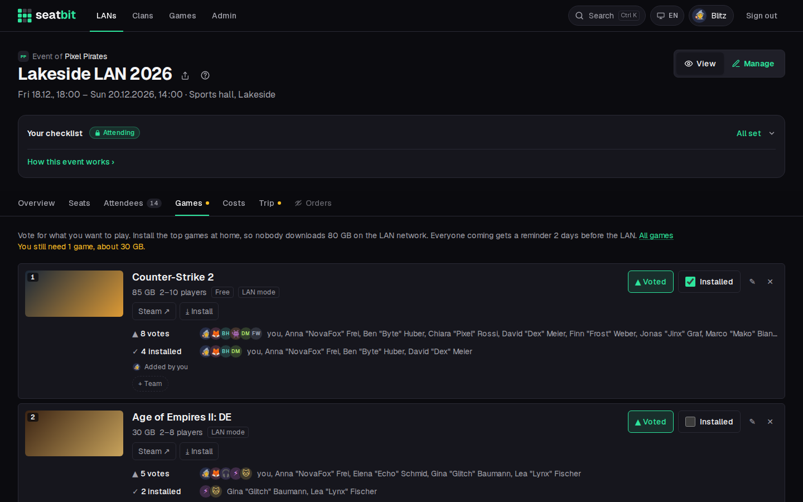
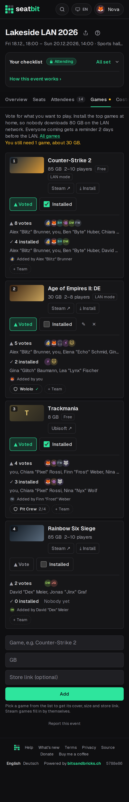

# Games

Decide what to play and make sure everyone has it installed before the LAN.

**Who:** members · **Where:** event → *Trip* → *Games*

- **Suggest** a game with its download size. Each game shows who added it, with their avatar and the clan's name display.
- **Fix** a game later with the pencil: name, size or store link. Whoever added it and the event's leads can edit or remove it; votes and *installed* ticks stay.
- **From last time:** for an event of a LAN type, the games of the clan's previous event of that type that aren't on the list yet show above the form. Tap one to add it again, with its size and link (your vote included).
- **Vote** for the ones you want to play. The list is sorted by votes.
- **Tick off** what you installed. The tab shows how many of the games you voted for you still have to install, and their size. Games only others voted for don't count.
- Two days before the LAN, everyone coming gets an *install your games* [reminder](reminders.md).

{ .shot }

<figure markdown>

{ .shot }

</figure>

## Tournament teams

Playing a tournament at the LAN? Build the team under the game:

- **+ Team** under a game starts a team: name, number of players (2 to 16), an optional link to the tournament page on the event's site and a note. Whoever starts it is the **captain** and its first player. Leads can set up teams without playing in them.
- Each team shows as a chip under the game with its places, like *Lizards A 2/5*, or a check mark when it's full. Tap it to open the team in a side panel: players, open places, and who voted for the game but has no team yet.
- **Join** a team with a free place; you play in one team per game. **Leave team** takes you out again.
- The captain and the event's leads edit or delete the team and can take players out (after a confirmation).
- When a team is full, its players get a Discord DM with the line-up.
- Teams are part of [your data](accounts.md) export and go when you delete your account.
