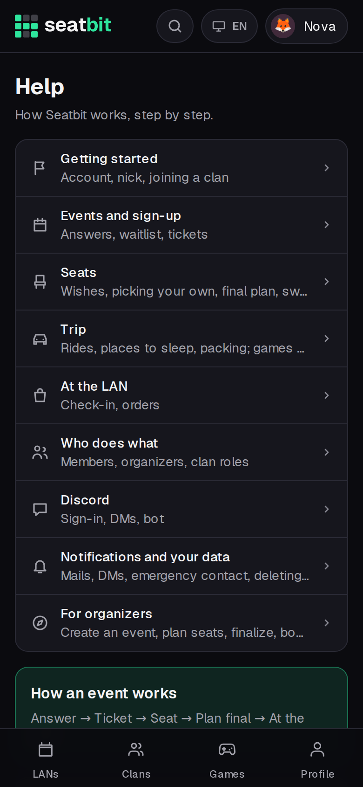

# Help page

How Seatbit works, written for members and organizers, in English and German.

**Who:** everyone, also signed out · **Where:** *Help* in the footer, `/help`, and *More help* in an event's *How this event works* panel

The page starts with the flow of an event in one line (answer → ticket → seat → plan final → at the LAN), then one card per topic with short questions that open on tap:

| Topic | |
| --- | --- |
| **Getting started** | Signing in, joining a clan, taking over a guest. |
| **Events and sign-up** | Answers, interest checks, waitlist, tickets, the checklist. |
| **Seats** | The seat block, seat wishes, self pick, what «final» means, who wants to sit near you, swaps. |
| **Trip** | When the tab opens, rides and places to sleep, packing list, games, shared costs. |
| **At the LAN** | Check-in and orders. |
| **Who does what** | Organizers, clan roles, and who runs the LAN itself. |
| **Discord** | Sign-in, DMs, `/verify`. |
| **Notifications and your data** | Mails and DMs, emergency contact, language and theme, export and delete. |
| **For organizers** | Creating an event, planning seats, finalizing and booking, keeping everyone posted. |

On phones the topics come first as a list that jumps to their card; on desktop they stay in a sidebar.

{ .shot width="300" }

Each event also explains its own flow, with its dates and settings: see [How this event works](attendance.md#how-this-event-works).

The texts live in `src/i18n/messages/{en,de}/help.ts`. Instances that run Seatbit differently can change them there.
