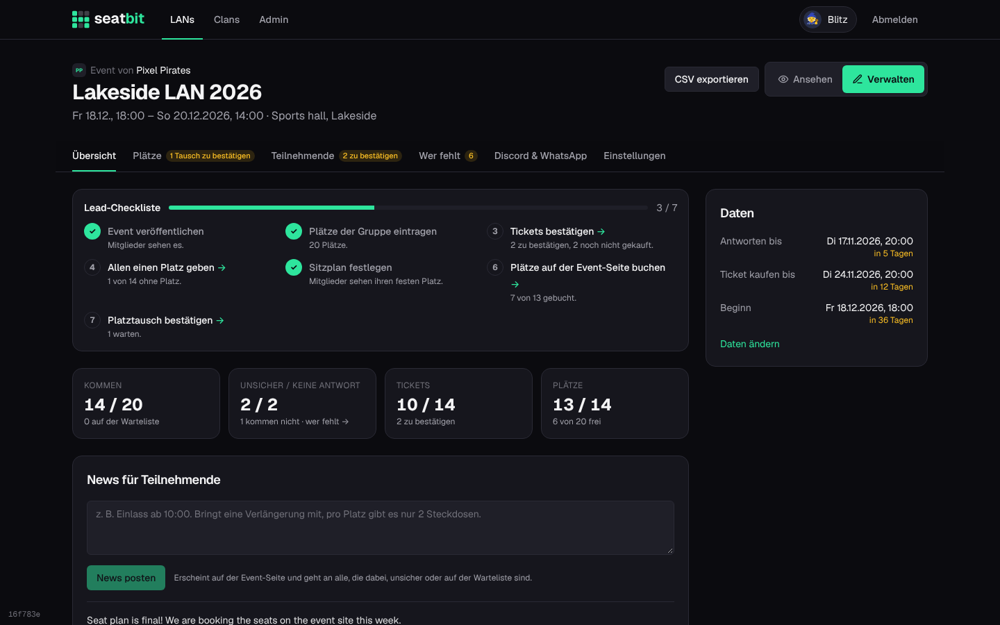
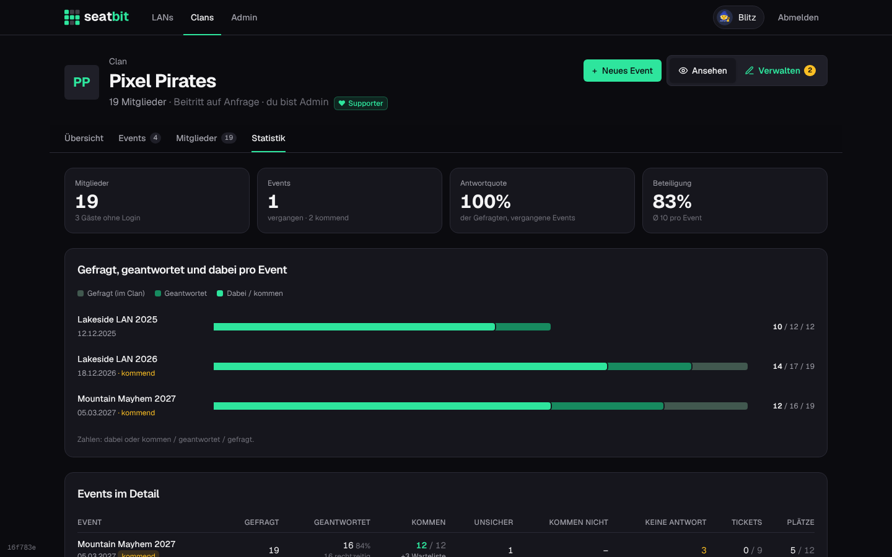

# Languages

Seatbit speaks English and German. Everyone picks their own language; the event, its seats and everybody's names stay the same for all.

**Who:** everyone · **Where:** *Profile › Account › Language*, and the links in the footer

## Which language you get

1. The language you picked on your profile.
2. Otherwise the language you picked in the footer (remembered in this browser, also before you sign in).
3. Otherwise your browser's language, when it's English or German.
4. Otherwise the instance's **Default language** (platform setting `DEFAULT_LOCALE`, default English).

On your first sign-in Seatbit keeps the language you signed up in. Choose **Automatic** on your profile to follow the browser again.

German uses Swiss spelling ("ss", never "ß"). Dates keep the same 24-hour format in both languages: "Sa 14.11.2026, 18:00".

## Mails

Every mail goes out in the language of the person it's for: their profile language, or the instance default when they never picked one. Guest invites use the clan's language, since the guest has no profile yet.

Each mail template has its own text per language. Platform admins switch between English and German at the top of *Admin › Platform settings › Mail templates*; editing or resetting one language leaves the other alone. See [Email](../installation/email.md#mail-templates).

## Discord

- **Replies to one person** (slash commands, buttons, DMs) use that person's Seatbit language, else the language of their Discord app, else the clan's.
- **Posts in a channel** (event announcements, attendee lists, deadline reminders) use the clan's **Language of Discord posts** from the clan settings. When it's empty, the instance default applies.
- Slash commands and their options show German descriptions in Discord apps set to German.

WhatsApp texts on *Manage › Discord & WhatsApp* follow your own language, since you copy them yourself.

## What is translated

Everything members, leads and clan admins see: the event pages, *Manage*, clan pages and settings, stats, member profiles, the audit log, mails, Discord, WhatsApp texts and error messages.

Still in English: *Admin › Platform settings* (the setup for whoever runs the instance) and the built-in Terms of Service and Privacy Policy.

<figure markdown>

{ .shot }

</figure>
<figure markdown>

{ .shot }

</figure>

{ .shot }

{ .shot }

{ .shot }

## For developers

Texts live in `src/i18n/messages/en.ts` and `de.ts`; TypeScript checks that both have the same keys. Server components use `await getT()` from `src/i18n/server.ts`, client components `useT()` from `src/i18n/client.tsx`. See [Architecture](../development/architecture.md#languages).
