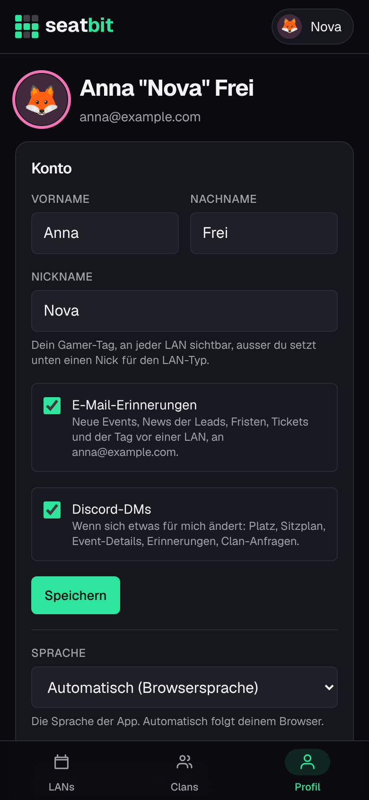
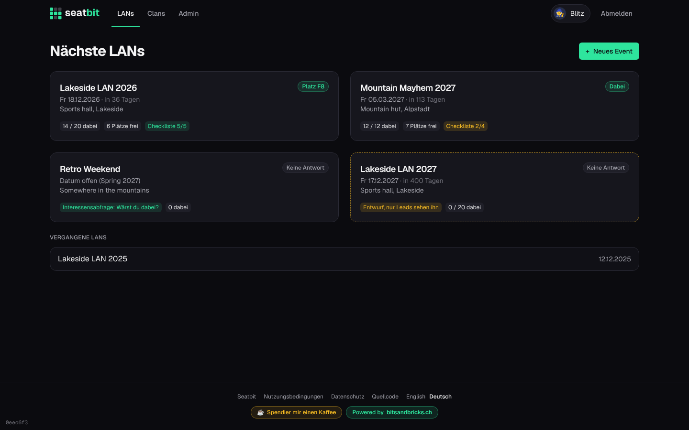

# Languages

Seatbit speaks English and German. Everyone picks their own language; the event, its seats and everybody's names stay the same for all.

**Who:** everyone · **Where:** *Profile › Account › Language*, and the links in the footer

## Which language you get

1. The language you picked on your profile.
2. Otherwise the language you picked in the footer (remembered in this browser, also before you sign in).
3. Otherwise your browser's language, when it's English or German.
4. Otherwise the instance's **Default language** (platform setting `DEFAULT_LOCALE`, default English).

On your first sign-in Seatbit keeps the language you signed up in. Choose **Automatic** on your profile to follow the browser again.

German uses Swiss spelling ("ss", never "ß"). Dates keep the same 24-hour format in both languages: "Sa 14.11.2026, 18:00".

## Clan language for Discord

Clan admins set **Language of Discord posts** in the clan settings. It is meant for the bot's posts in the clan's channels; when it's empty, the instance default applies.

## What is translated so far

The app shell, sign-in, welcome, home, profile, the clan list and the event page with all its tabs (overview, seats, attendees, travel, packing list, games, food) are translated.

Still in English for now: the lead views (*Manage*), clan settings and stats, the platform admin pages, the legal pages, mails and the Discord bot. They follow in the next steps.

<figure markdown>

{ .shot }

</figure>
<figure markdown>

{ .shot }

</figure>

{ .shot }

## For developers

Texts live in `src/i18n/messages/en.ts` and `de.ts`; TypeScript checks that both have the same keys. Server components use `await getT()` from `src/i18n/server.ts`, client components `useT()` from `src/i18n/client.tsx`. See [Architecture](../development/architecture.md#languages).
