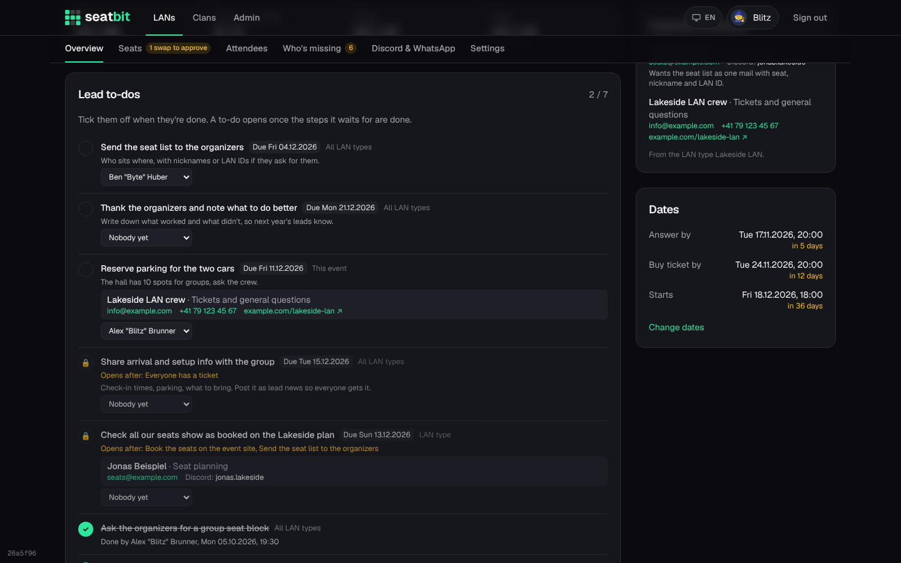
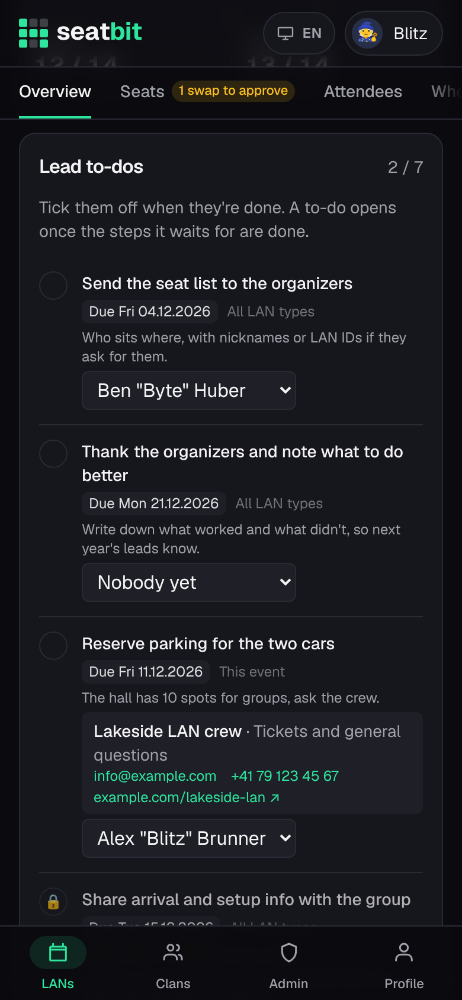
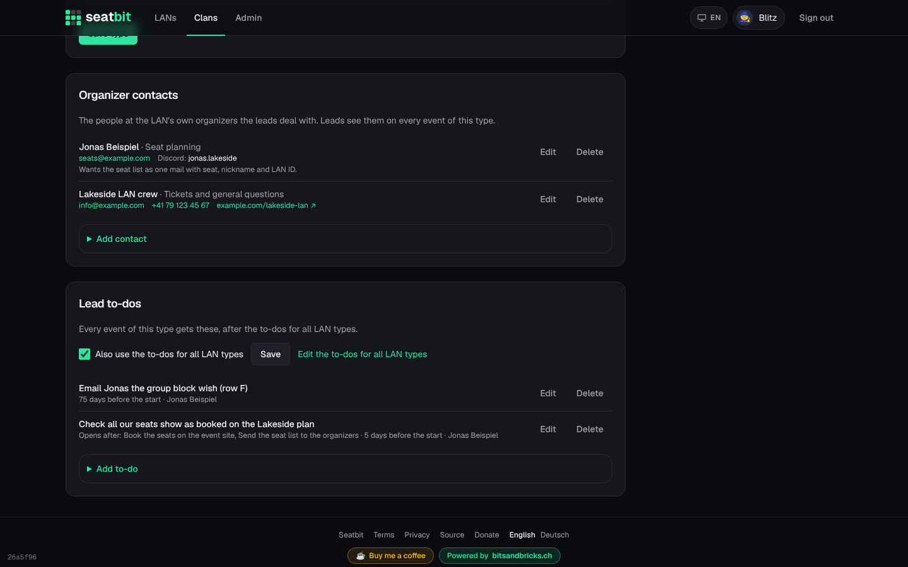

# Lead to-dos and organizer contacts

**Who:** leads tick off to-dos; clan admins and event managers define them · **Where:** *Manage → Overview* of an event; *Clan settings → LAN types*

Besides the built-in [lead checklist](events.md#lead-checklist), which Seatbit ticks off by itself, every event has **lead to-dos**: things only the leads know they did, like mailing the LAN's organizers about a seat block or sending them the seat list. Next to them, the event shows the **organizer contacts**: the people at the LAN's own organizers (not your clan) the leads deal with.

{ .shot }

## At the event

*Manage → Overview* lists the event's to-dos, open ones first:

- **Tick** the circle when it's done. The list shows who ticked it and when; tick again to reopen it.
- **Who does it:** give the to-do to one of the event's leads.
- **Due:** a to-do can be due a number of days before (or after) the start. Overdue ones are marked red. Events with an open date have no due dates yet.
- **Opens after:** a to-do can wait for built-in checklist steps or other to-dos. Until they are done it shows a lock and what it waits for. Leads can still tick it early.
- **Contact:** a to-do can name an organizer contact; their email, phone, Discord and website show right below it.

**Add a to-do for this event only** at the bottom of the card adds one-off to-dos. They are copied along when you [copy the event for next year](events.md#settings) (not ticked).

The sidebar shows the organizer contacts of the event's LAN type.

{ .shot width="300" }

## Where to-dos come from

An event gets, in this order:

| Level | Where to edit | |
| --- | --- | --- |
| **All LAN types** | *Clan settings → LAN types*, card *Lead to-dos for all LAN types* | Every event of the clan. A LAN type can turn them off (*Also use the to-dos for all LAN types*). |
| **LAN type** | The LAN type's page, card *Lead to-dos* | Every event of that type. |
| **This event** | *Manage → Overview* | Only that event. |

New clans (and clans that existed before) start with four to-dos for all LAN types, in the clan's language. Edit or delete them like your own:

| To-do | Opens after | Due |
| --- | --- | --- |
| Ask the organizers for a group seat block | right away | 60 days before |
| Send the seat list to the organizers | *Finalize the seat plan* | 14 days before |
| Share arrival and setup info with the group | *Everyone has a ticket* | 3 days before |
| Thank the organizers and note what to do better | right away | 3 days after the start |

A to-do has a **title**, optional **notes** (how to do it, links), **opens after** (built-in steps *Publish*, *Seats*, *Tickets*, *Seat everyone*, *Finalize*, *Book on the event site*, or other to-dos), **due** in days before the start (negative = after), and a **contact** (on LAN type and event to-dos). A step an event doesn't have counts as the step before it: *Book on the event site* without a seat plan link counts as *Finalize*.

## Organizer contacts

Contacts belong to a **LAN type**, since the organizers stay the same from year to year. On the LAN type's page, card *Organizer contacts*, add a name, what they do (e.g. *Seat planning*), email, Discord, phone, website and a note. Only leads see them, on *Manage → Overview* of every event of that type.

{ .shot }

Ticking, reopening and handing out to-dos is listed in the [audit log](audit-log.md) under *Events*.
