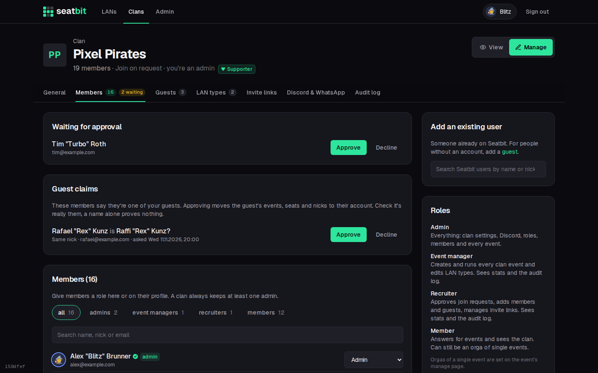
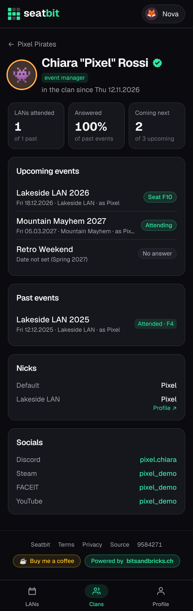
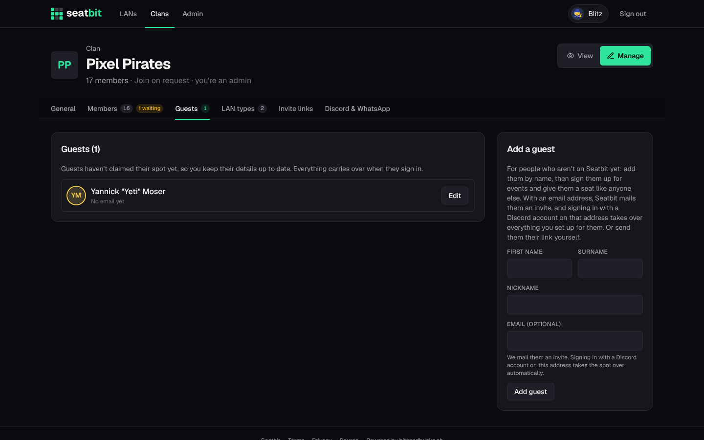
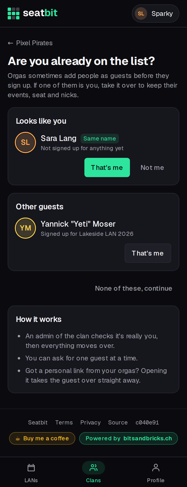
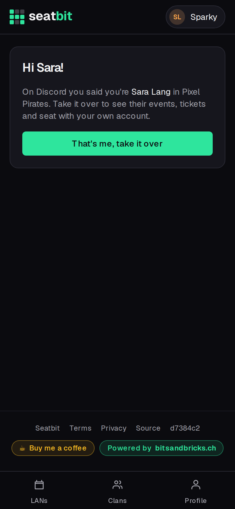

# Members and guests

Approve join requests, add people, and keep **guests**: people without a Seatbit account who can take over their guest later.

**Who:** clan admins and recruiters · **Where:** clan *Manage* → *Members* and *Guests*

## Members

{ .shot }

| Section | |
| --- | --- |
| **Waiting for approval** | People who asked to join (join mode *Approval*). Approve or decline. Admins and recruiters get a Discord DM for each request. |
| **Guest claims** | Members who say they're one of your guests. See [below](#members-claiming-a-guest). |
| **Add an existing user** | Search Seatbit users by name or nick and add them directly. |
| **Role** | One [role](clans.md#roles) per person (admins only). |
| **Remove** | Takes someone out of the clan. Recruiters can remove plain members only. |

### Member profiles

Click a name to open the member's profile: their events, nicks, [socials](accounts.md#profile) and, where the LAN type has a [profile link](clans.md#profile-links), their profile on the event's site. Admins and recruiters also see contact details, LAN IDs and tickets.

{ .shot width="300" }

## Guests

Guests are people who aren't on Seatbit yet, e.g. a friend who comes once a year. Add them with first name, surname and nick, then sign them up for events and give them a seat like anyone else. Name and nick can be edited later.

{ .shot }

To hand a guest over to its owner:

| Way | |
| --- | --- |
| **Email invite** | Enter their email and click **Send invite**. When they sign in with a Discord account with the same verified email, everything moves to their account automatically. |
| **Claim link** | Copy the guest's link and send it yourself (WhatsApp, Discord, ...). Whoever opens it and signs in takes the guest over. **New link** invalidates the old one. |
| **That's me** | The member claims the guest themselves, on the website or with `/claim` on Discord. See below. |
| **`/guest` on Discord** | Say which Discord member the guest is. See [On Discord](#on-discord). |

### Members claiming a guest

When someone joins and a guest has the **same name or nick** (ignoring case and accents: *Jörg Bäcker*, *Jorg Backer* and *Joerg Baecker* all match), Seatbit asks *"Are you already on the list?"*. Any member can also open that page later from the clan's **Members** tab (*Take it over*).

{ .shot width="300" }

What happens on **That's me** depends on **Clan settings → General → Can members claim guests?**

| Setting | What happens |
| --- | --- |
| **An admin confirms each claim** (default) | The request shows under **Members → Guest claims**; admins and recruiters get a Discord DM. **Approve** moves everything over, **Decline** tells the member. |
| **Same name or nick moves over right away** | A matching guest moves over at once. Picking any other guest still needs an admin. |
| **Only with the guest's own link** | Members can't claim guests. Use the email invite or the claim link. |

Safeguards, whatever the setting:

- On the website only clan members can claim, never someone still waiting for approval. On Discord, someone who isn't a member yet can ask (see [On Discord](#on-discord)), but that always needs an admin.
- One open claim per member.
- A guest someone else already asked for (waiting for an admin), or that an orga tied to another Discord member with `/guest`, isn't offered to anyone else, on the website or on Discord.
- A guest with an email address, or a guest made clan admin, always needs an admin's OK.
- A name is no proof: check before you approve (the request shows their email and why it was suggested).
- Declined claims and guests marked *Not me* aren't suggested again.
- Every claim, approval and decline is in the [audit log](audit-log.md).

The guest's events, seat and nicks become the member's.

### On Discord

The [Seatbit bot](discord.md) does both directions in a server linked to the clan.

**Members: `/claim`.** The bot lists the clan's guests whose name or nick matches the member's Seatbit profile or their Discord names (server nickname, display name, username), with a **That's me** button. `/claim guest:<name>` picks any other guest. The clan's *Can members claim guests?* setting and the safeguards above apply as on the website.

- With a Seatbit account (Discord linked), the guest moves over or the request goes to the admins right away.
- Without one, the bot answers with a **Sign in and take it over** link. It works for 24 hours, only for the Discord account that ran `/claim`. After signing in, they confirm once (below). If they aren't a clan member yet, they show up under *Waiting for approval* and *Guest claims*; approving the claim lets them in too.

{ .shot width="300" }

**Orgas: `/guest guest:<name> member:<name>`.** Needs a Seatbit role that manages members (admin or recruiter); no Discord permission needed. `guest` lists only guests nobody asked for or got linked to yet. `member` searches the Discord server as you type (before you type, by the guest's first name) and leaves out bots and people who are already in the clan on Seatbit.

- If that person already has Seatbit with Discord linked, the guest moves to their account at once and they get a DM.
- Otherwise the bot DMs them the guest's claim link, and their first sign-in with that Discord account (or linking Discord on their profile) takes the guest over automatically, like the verified email invite. The guest list shows *Discord member linked*. Running `/guest` again for the same person moves the link to the new guest.
