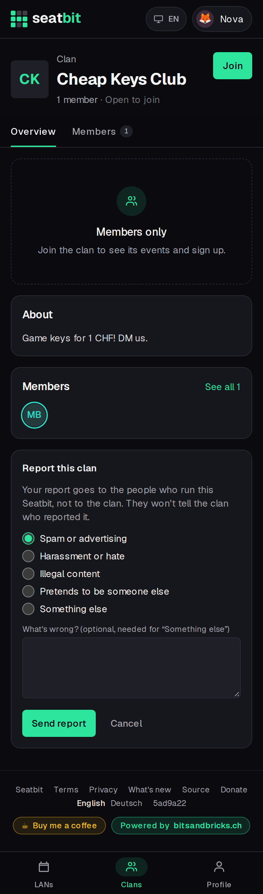
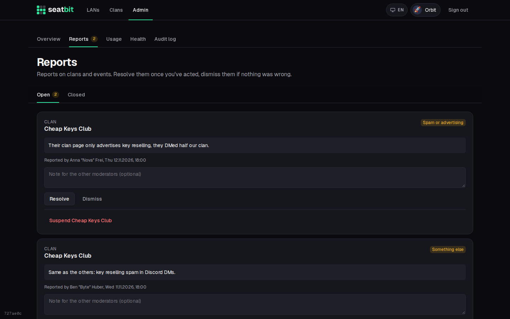

# Reports and suspensions

Members report clans and events that break the rules. Reports go to the platform moderators, never to the clan, and the clan isn't told who reported it.

**Who:** every signed-in member reports; platform owners, admins and moderators handle reports · **Where:** *Report this clan* / *Report this event* at the bottom of the page; *Admin → Reports*

## Reporting

At the bottom of a clan page (except your own clan's admins) and of an event page (except for its leads) there is a small **Report this clan** or **Report this event** link. Pick a reason (spam, harassment, illegal content, impersonation, something else) and optionally say what's wrong.

{ .shot-phone }

To keep the queue useful, each person can file five reports a day and one open report per clan or event.

## The report queue

*Admin → Reports* lists open reports first, with the reason, the message, who reported it and when. The *Reports* tab shows how many are open.

{ .shot }

- **Resolve** once you acted on it, **Dismiss** if nothing was wrong. An optional note tells the other moderators what you did.
- **Suspend** the reported clan right from the report.
- Closed reports stay under *Closed*, where you can **Reopen** them.

## Suspending

Moderators, admins and owners suspend from the admin page's clan and user lists, or from a report. A reason is optional and shown to the people affected.

| | What happens | Restore |
| --- | --- | --- |
| **User** | Signed out everywhere. Signing in again only shows a "your account is suspended" page with the reason and the operator's contact email. The Discord bot treats them as not linked. | *Restore* in the user list, or `admin.mjs unsuspend` |
| **Clan** | Members see "this clan is suspended" instead of the clan and its events, nobody can join, the Discord bot ignores its server, and reminders stop. Platform staff still see it, with a banner. | *Restore* in the clan list or on the report |

Nobody can suspend themselves or someone with the same or a higher platform role.

Every report, decision, suspension and role change is in the [platform audit log](audit-log.md#platform-audit-log). The reporter's name only shows to platform staff.
