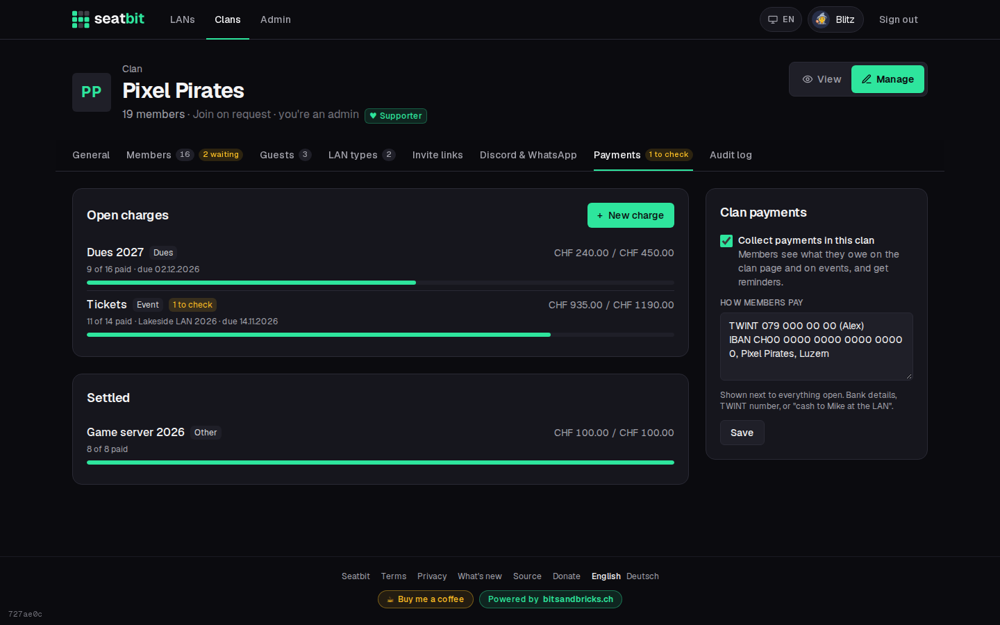
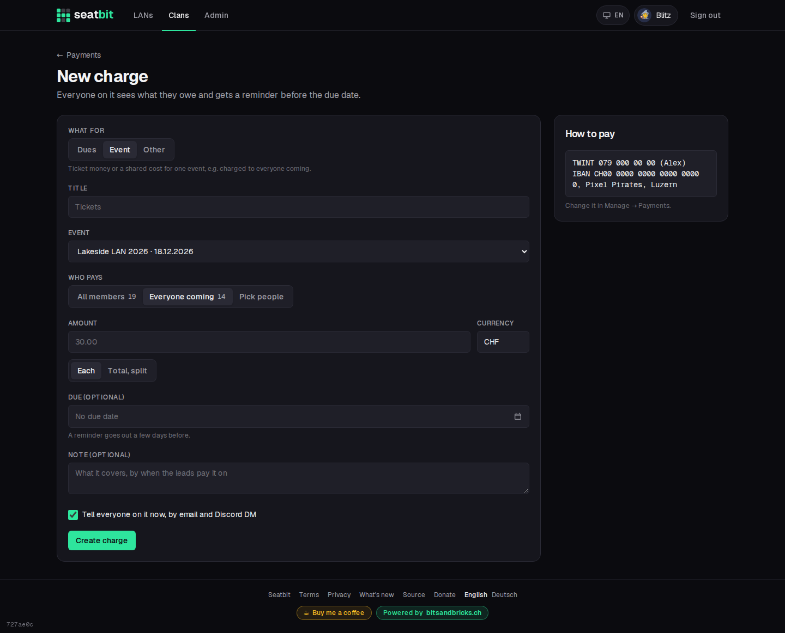
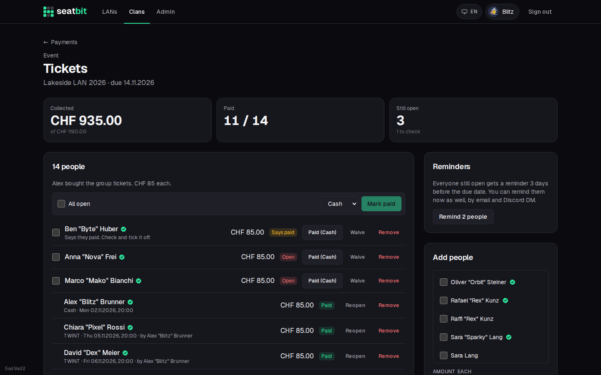
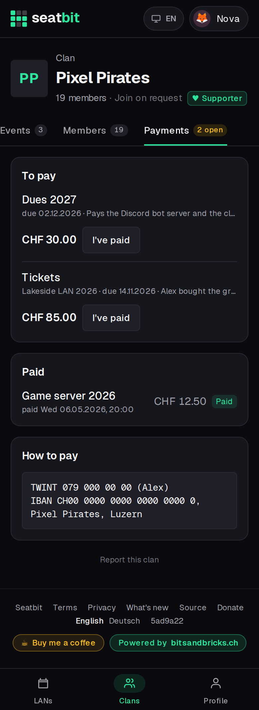

# Clan payments

Collect money from your own members: yearly dues, the ticket money for an event, a shared cost. Seatbit keeps the list of who owes what and who paid; the money goes to the clan directly (cash, bank transfer, TWINT, or online to the clan's own Stripe account).

When members paid something for each other (one paid the fuel, the others pay them back), use [shared costs](shared-costs.md) on the event instead.

**Who:** clan admins and event managers run it, members see what they owe · **Where:** clan *Manage → Payments*, and the *Payments* tab on the clan page

!!! note "Off until a clan turns it on"
    Each clan switches payments on in *Manage → Payments*. The operator can hide the feature on the whole instance with **Clan payments** in the platform settings (`CLAN_PAYMENTS=false`), see [Configuration](../installation/configuration.md).

{ .shot }

## Turn it on

In *Manage → Payments*, tick **Collect payments in this clan** and fill in **How members pay**: your IBAN, a TWINT number, or "cash to Mike at the LAN". Members see this text next to everything they still owe.

## Create a charge

**New charge** asks for:

| Field | |
| --- | --- |
| **What for** | *Dues* (a membership fee), *Event* (ticket money or a shared cost for one event) or *Other*. |
| **Title** | e.g. "Dues 2027" or "Tickets". |
| **Event** | For event charges. Shows the charge on that event's page as well. |
| **Who pays** | All members (guests included), everyone coming to the event (not the waitlist), or people you pick. |
| **Amount** | **Each** person pays the amount, or the **total** is split evenly (the cents that don't divide go to the first people, so it always adds up). |
| **Currency** | Defaults to the instance currency (`FOOD_CURRENCY`). |
| **Due** | Optional. Everyone still open gets a reminder 3 days before. |
| **Tell everyone on it now** | Sends an email and a Discord DM with the amount, the due date and how to pay. |

{ .shot }

## Tick off who paid

The charge page shows what's collected, who paid and who's still open.

- **Paid** marks a line as paid in cash, by bank, by TWINT or otherwise (pick it in the bar above the list). Tick several people and **Mark paid** to do them at once, e.g. after collecting cash at the LAN.
- **Waive** lets someone off; **Reopen** undoes either.
- Click an amount to change it for one person. **Add people** puts more people on the charge, **Remove** takes them off.
- **Remind** sends everyone still open an email and a Discord DM now.
- A member who pressed **I've paid** shows as *Says paid* until you tick it off. The *Payments* tab in Manage counts how many are waiting for you.

{ .shot }

Every change lands in the clan's [audit log](audit-log.md) under *Payments*.

## What members see

Members get a **Payments** tab on the clan page once they're on a charge: what they still owe with **I've paid**, how to pay, and what they paid before. The clan overview says how much they owe, and an event page lists the charges for that event.

<figure markdown>

{ .shot }

</figure>

## Pay online

If the operator turned on [online payments for clans](../installation/stripe.md#online-payments-for-clans), a clan admin can connect the clan's **own Stripe account** in *Manage → Payments → Online payments*. Stripe asks who runs the clan and where payouts go. After that:

- Members see **Pay online** next to everything they owe and pay with TWINT or card (whatever the clan turned on in Stripe).
- The money goes straight to the clan's Stripe account. The line is ticked off by itself as *Paid online*.
- Refunds happen in the clan's Stripe Dashboard; a full refund opens the line again.
- The clan pays Stripe's fees. The card says if the operator keeps a platform fee.

Reminders follow the member's notification settings: mails only with email reminders on, DMs only with Discord DMs on. Guests have no address, so they get nothing; a lead collects from them in person.

Members find their payments in the data export of their profile. When someone deletes their account, the clan keeps the lines (shown as "Deleted member") so the books still add up. When a guest is taken over by a real account, their lines move with them.
