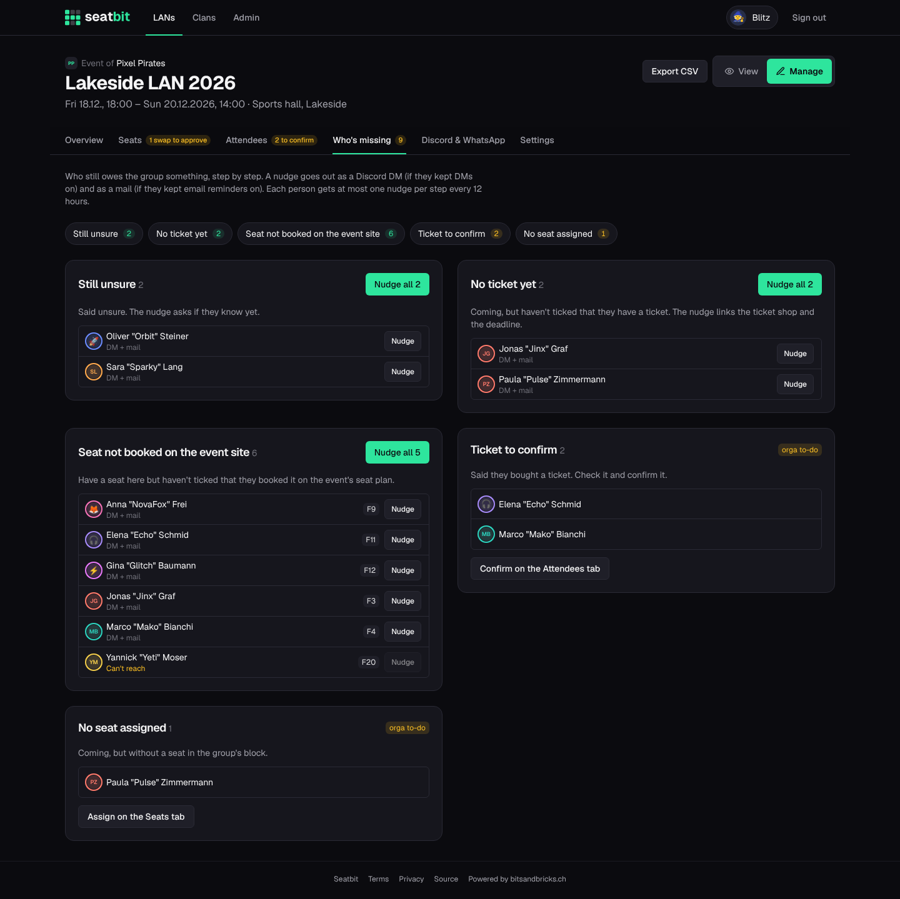
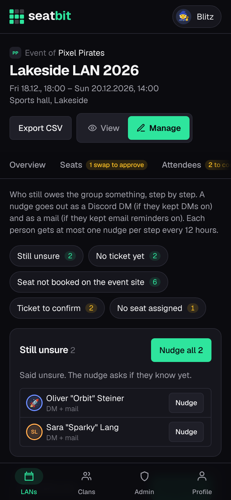

# Reminders and who's missing

Seatbit reminds people before deadlines by itself. Leads can also remind by hand, and **Who's missing** lists everyone who still owes the group something, with one-tap nudges.

**Who:** leads · **Where:** *Manage → Overview* and *Manage → Who's missing*

## Automatic reminders

| Reminder | When | To |
| --- | --- | --- |
| **Answer** | A few days before *answer by* (set per event) | Members who haven't answered |
| **Ticket** | A few days before *buy ticket by* | Members coming without a ticket |
| **Install your games** | Two days before the LAN | Everyone coming |
| **Starts tomorrow** | The day before the LAN | Everyone coming |

- Each reminder is sent **once per person**.
- They go by email and, when the clan has the [Discord bot](discord.md), as a DM and a post in the clan's channel.
- Members turn emails or DMs off on their [profile](accounts.md#profile).
- Drafts, cancelled events and interest checks get no reminders.
- The server checks every *Reminder check interval* minutes (default 60). See [Configuration](../installation/configuration.md#reminders-without-a-long-running-process) for running it from cron instead.

## Manual reminders

*Manage → Overview* has buttons to remind **everyone who hasn't answered**, **everyone without a ticket** or **everyone coming** right now, even if they got the automatic reminder already.

## Who's missing

*Manage → Who's missing* lists everyone who still owes the group something, step by step:

- no answer to the interest check, no answer at all, or still unsure
- coming but no ticket yet, or no nickname
- self pick is on and they have a ticket, but no seat
- seat not booked on the event's own seat plan

{ .shot }

Each person shows how a nudge reaches them:

| Badge | |
| --- | --- |
| *DM + mail* | Reaches them by Discord DM and email. |
| *Discord DM* | Only a Discord DM reaches them (email reminders off). |
| *Mail only* | Only email reaches them (no Discord or DMs off). |
| *Can't reach* | No Discord and email reminders off. |

**Nudge** sends one person a short reminder for that step, **Nudge all** everyone in it. DMs have buttons where they fit (*Coming / Unsure / Not coming*, *Buy ticket*, *I booked it*). Members' DM and email settings are respected, and each person gets at most **one nudge per step every 12 hours**. Nudges are off for drafts and cancelled events.

Your own to-dos come last: **tickets to confirm** and people **without a seat**, linking to the tab where you fix them.

{ .shot width="300" }
