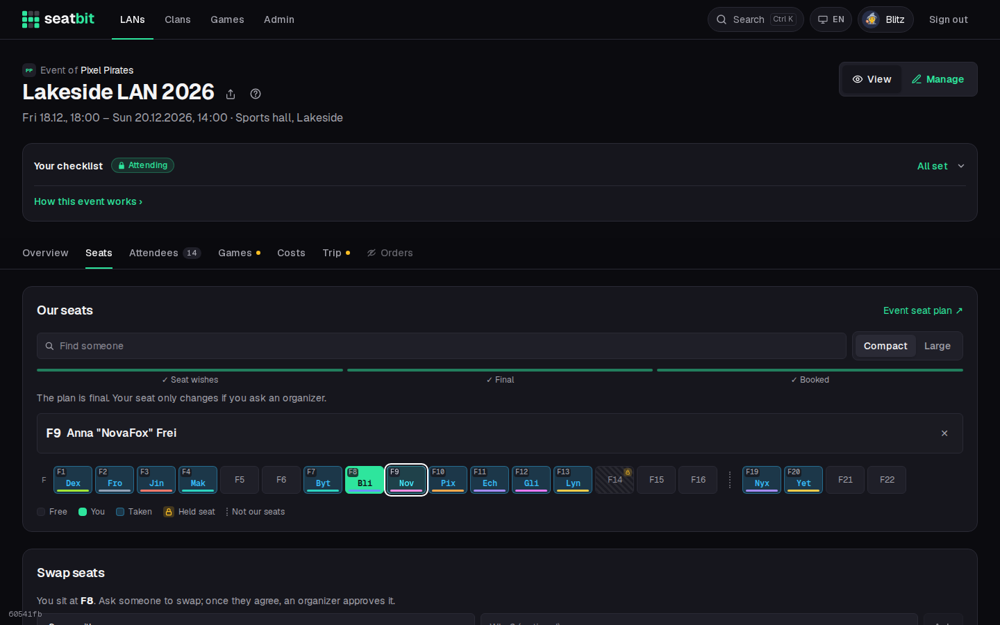
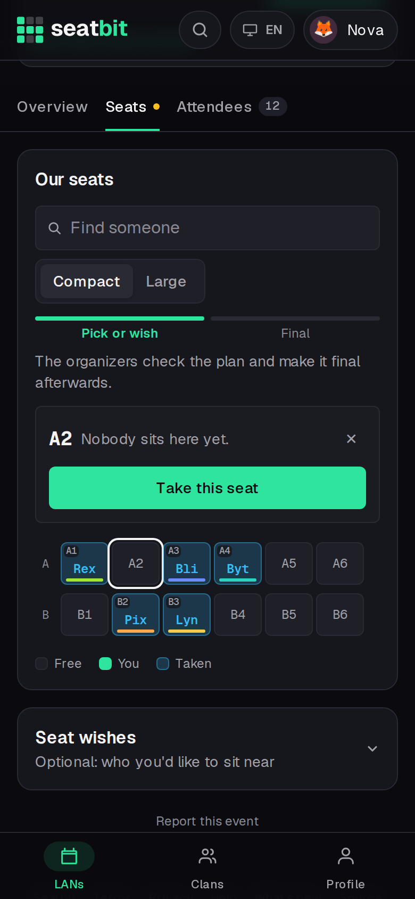
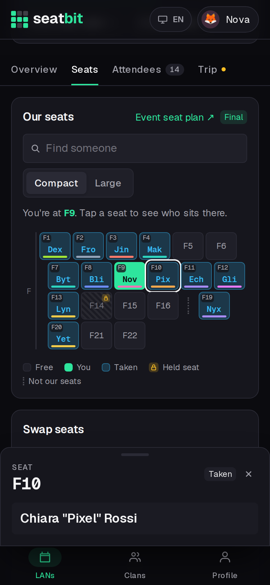
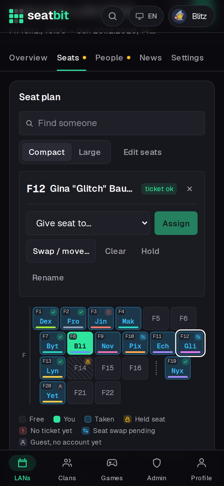
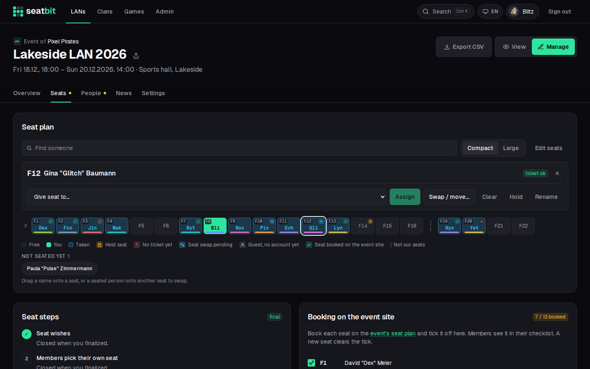
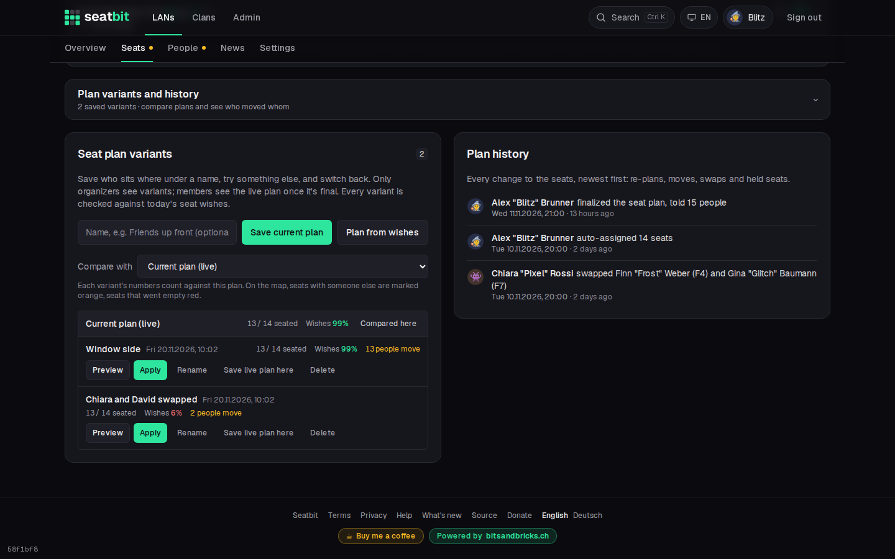
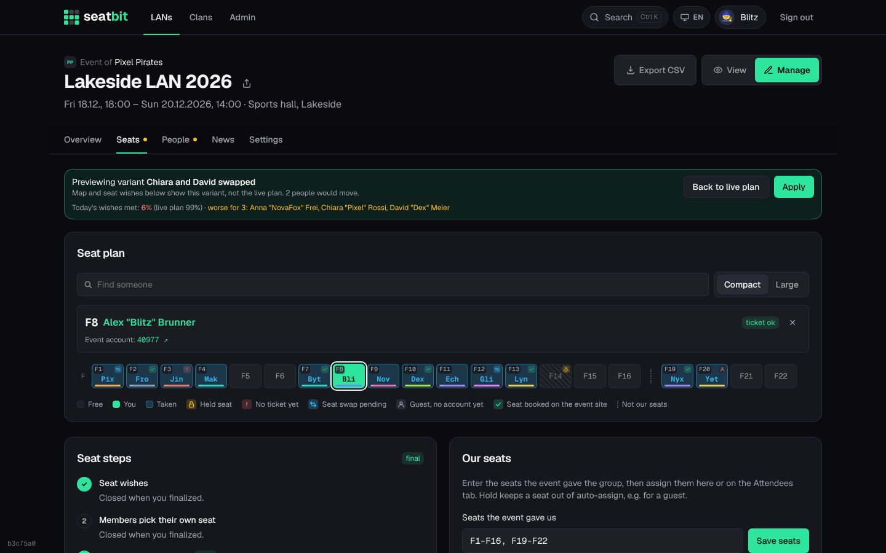
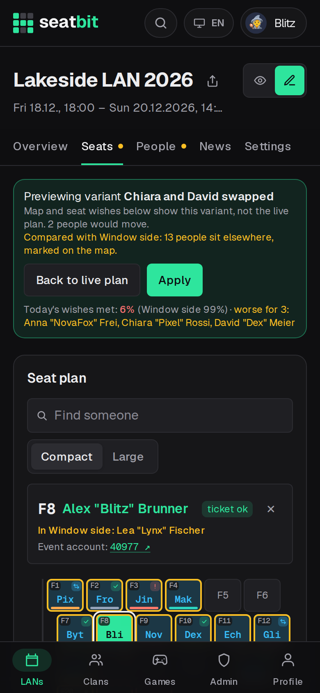

# Seats

The **seat plan** shows the group's seat block. Members send seat wishes or pick a seat, leads plan and finalize it, then everyone books the same seat on the event's own site.

**Who:** members view, wish and pick; leads plan · **Where:** event *Seats* tab; *Manage → Seats*

{ .shot }

## The plan

- Each letter is a row; each seat sits at its number. A dotted gap means those numbers aren't the group's.
- Free seats show their label, taken seats the first letters of the nick with the seat number in a small badge, so the order stays clear. **Large** shows whole nicks (remembered on the device).
- Your own seat's details are open when you come to the tab. Tap any seat for its details: they show in a strip right above the map, so the map keeps the full width. Tap the seat again, ✕ or Esc closes them. In *Manage → Seats*, leads get a panel on the right on desktop and a sheet at the bottom on phones.
- **Find someone** highlights a person.

## Seat steps

| Step | |
| --- | --- |
| 1. **Seat wishes** | Members list their wishes as ranked rules, most important first (see [Seat wishes](#seat-wishes)). On Discord: `/wish`. |
| 2. **Self pick** (optional) | Leads turn it on; members with a ticket tap a free seat and **Take this seat**, **Move here** or **Give up my seat**. |
| 3. **Final plan** | Leads finalize. This closes wishes and self pick, shows everyone the plan and can tell everyone their seat. Later changes notify the people who moved. **Reopen** goes back. |

Seats only count, and everyone sees the plan, once it is final. The member [checklist](attendance.md#checklist) follows these steps: *Pick your seat* (or the optional *Send seat wishes*), then *Leads confirm your seat*.

<figure markdown>

{ .shot }

<figcaption>Self pick</figcaption>
</figure>
<figure markdown>

{ .shot }

<figcaption>Final plan</figcaption>
</figure>
<figure markdown>

{ .shot }

<figcaption>Lead: editing</figcaption>
</figure>

## Seat wishes

On the event's *Seats* tab, each member keeps a ranked list of wishes:

| Wish | Met when | Limit |
| --- | --- | --- |
| **Right next to someone** | You sit directly beside them. Counts a bit more than its place in the list says. | One person |
| **Near someone** | You sit within 4 seats of them in the same row (leads can change the 4, see below). | Four people |
| **A seat** | You get that seat. Add several to rank alternatives ("F7, else F9"). | |
| **A row** | You sit in that row. | |
| **At the edge** / **In the middle** | Your seat is (or isn't) at the end of a row. A row is everything with the same letter, so in F1-F20 only F1 and F20 are at the edge, even when a narrow screen wraps the row onto several lines. You can have one of the two. | |

The order is the priority: the top wish counts most, each one below half as much as the one above, so a wish outweighs all the wishes below it together. Everyone's wishes add up to the same total, so a member with ten wishes doesn't count more than one with three. Drag a wish by its handle (works with touch) or use the arrows to move it; every change saves right away. To put someone else into a wish about a person, tap ✎ (or the name in **Not right next to**) and pick the new person: the wish keeps its place in the list. A wish that contradicts an older one (near and right next to the same person, edge and middle) takes the older one's place.

Below the ranked list, **Not right next to** lists people you don't want directly beside you, as many as you like. They aren't ranked: each one counts as much as all your other wishes together, so the planner keeps them whenever it can. Add a free-text note for the leads at the end.

**Leads can change a member's wishes**, e.g. when someone told them in person: on *Manage → Seats*, pick the member under **Change someone's wishes**, open a member in the **Seat wishes** card and choose **Change wishes**, or use the **Seat wishes** link under someone's seat in *Manage → People*. This works for guests without an account too. The editor is the same one members use, and the change shows in the event's log. Wishes a lead adds say **Added by** and the lead's name, for the member and the other leads; moving a wish keeps that mark. The member gets no message by default. Tick **Tell … by Discord DM** in the editor and they get a DM with their wishes as they are now a minute after the lead's last change (unless they turned DMs off on their profile); unticking it drops a DM that is still waiting.

**How far "near" reaches** is set per event under *Manage → Seats → Our seats* ("“Near” means within … seats", 2 to 12, default 4). Changing it re-plans right away when automatic re-planning is on.

## Plan the seats

*Manage → Seats*.

{ .shot }

**Our seats:** enter the seats the event gave you, e.g. `F1-F16, F19-F22`. Saving again keeps assignments for seats that stay in the list. **Edit seats** in the map shows every number of a row: tap a dashed one to add it, a seat to remove it.

Tap a seat: its details (who sits there, ticket, wishes) and these actions open in a strip above the map, so the map keeps the full width:

| Action | |
| --- | --- |
| **Give seat to** | Assign someone. |
| **Swap / move** | Swap two people or move one. |
| **Clear** | Free the seat. |
| **Hold** | Members can't take it and auto-assign skips it (e.g. for a guest). A small lock in the corner marks held seats in the map, free or taken (more [status icons](attendance.md#status-icons) for leads); whoever sits on a held seat stays there when the seats are re-planned. |
| **Rename** | Match the event's numbering. |

People coming without a seat are listed under **Not seated yet**: tap one, then a seat. On desktop, drag names onto seats and seated people onto other seats to swap.

**Fill free seats** seats everyone without a seat; **Re-plan everyone** starts over. The planner follows seat wishes in each member's order, so when two wishes can't both be met the higher one wins, and it seats people with a ticket first. It looks at the whole plan at once: after a first rough plan it tries thousands of changes and keeps the plan that meets the most wishes for everyone together, weighted by each member's order. A change can swap two people, swap two groups of neighbours (also between rows, so a whole group of friends can change rows together) or move a group along the row while the others shift over to make room. That way a group moves over to give someone their edge seat even when that takes several steps, and a wish like "near Reykime" is still met when Reykime was seated earlier. The plan is worked out in full first and then saved in one go. The same wishes always give the same plan, and a re-plan keeps people on their seats unless moving them meets a wish better, so changing one member's wishes doesn't shuffle everyone else. Held seats never move, and **Fill free seats** leaves people who already have a seat where they are.

**How hard the planner looks** (above the buttons) has three levels:

| Level | What it does |
| --- | --- |
| **Quick** | One search. This is what the automatic re-plan after a wish change uses. |
| **Extended** (default) | Several searches from different starting points; keeps the best plan. Stops as soon as every wish is met. Takes a few seconds at most. |
| **Thorough** | Keeps searching in the background for up to 2 minutes (operators can change that, see [configuration](../installation/configuration.md)), and stops as soon as every wish is met. It doesn't touch the live seats: the best plan it finds is saved as a new [variant](#variants) ("Thorough search 1"), which you preview and apply like any other. One search per event at a time; a server restart ends it without a result. |

When every wish can be met, Extended nearly always finds such a plan. If a plan still misses wishes you think could be met, try Thorough.

**Re-plan automatically when wishes change** (under *Our seats*) re-plans every seat that isn't held whenever someone changes their wishes, on the website or with `/wish`, and once right away when you turn it on. It pauses while self pick is on and once the plan is final, so it never moves a member's own pick or a final seat.

Seat pages update by themselves when the plan or someone's wishes change, so leads and members don't need to reload (see [Live updates](events.md#live-updates)).

The **Seat wishes** card scores the current plan: for each member the share of their wishes that are met, weighted by their order (a met top wish counts more), and the average over everyone. **Needs a look** (the default) lists only members with a missed wish in their top 5, a missed "not right next to", or wishes that can't be checked yet; **Everyone** lists all members with wishes. Each member is one line, lowest score first: their seat, how many wishes are met, their score and the wishes the plan misses. Tap a member for all their wishes in order (✓ met, ✗ missed, an orange ✗ for a missed wish below the top 5, which counts little, · can't be checked yet because they or the other person have no seat) and their note. The seat details above the map show the same for one person.

The **Plan history** card lists every change to the seats, newest first: re-plans (by a lead, or automatic after a wish change), moves, swaps, held seats, saved and applied variants, and the final plan. For each re-plan and each applied variant it shows who moved from which seat to which, or that nobody moved.

### Variants

The **Seat plan variants** card keeps seat arrangements under a name, so you can try something else and switch back. Only leads see variants; members only see the plan you apply.

{ .shot }

- **Save current plan** keeps who sits where right now. Leave the name empty for "Variant 1", "Variant 2" and so on.
- **Plan from wishes** lets the planner (Extended) seat everyone from their seat wishes into a new variant, without touching the live seats. The **Thorough** search under *Our seats* saves its result here too. Held seats keep their person. Unlike **Re-plan everyone**, nobody's current seat counts, so you get a real alternative to a hand-made plan.
- Each variant shows how many people coming have a seat in it, how well **today's** seat wishes are met (checked again every time, not when it was saved) and how many people sit elsewhere than in the compared plan. The live plan is the first row.
- **Compare with** picks the plan the others are measured against: the live plan (the default) or any variant. The picked plan is marked *Compared here*.
- **Preview** shows the variant on the map and in the Seat wishes card. The bar above the map compares it with the picked plan: the wish score of both, who it suits worse and how many it suits better. On the map, seats where someone else sits than in the compared plan have an **orange** outline and seats that went empty a dashed **red** one. Tap a seat to see that person's wishes and who sits there in the compared plan. With a variant picked and no preview open, the live map marks its differences to that variant the same way.

    { .shot }

    { .shot }

- **Apply** makes the variant the live plan. People who aren't coming any more are left out, and anyone coming who isn't in the variant has no seat afterwards. Like any seat change it clears the "booked on the event site" tick of everyone who moved. Before the plan is final nobody gets a message; once it is final, everyone who moved hears about their new seat.
- **Save live plan here** overwrites a variant with the current plan, after you changed it on the map. **Rename** and **Delete** do what they say.

An event keeps at most 20 variants. Variants store seat labels, so they survive re-entering the seat block; seats that no longer exist are skipped.

## Book on the event site

When the event has an **event seat plan** link, the leads book everyone's seat there once the plan is final. *Manage → Seats → Booking on the event site* lists every seat with the person and their LAN ID: book it on the event site and tick it off. Members see *Booked on the event site* in their checklist, the Attendees tab shows *booked on site*, and the [lead checklist](events.md#lead-checklist) counts the open ones. A seat change (or an approved swap) clears the tick, so the leads book again.

## Seat swaps

After the plan is final, a member can ask another to swap. Once the other agrees, a lead **approves** or rejects it on the Seats tab, and both are told.
