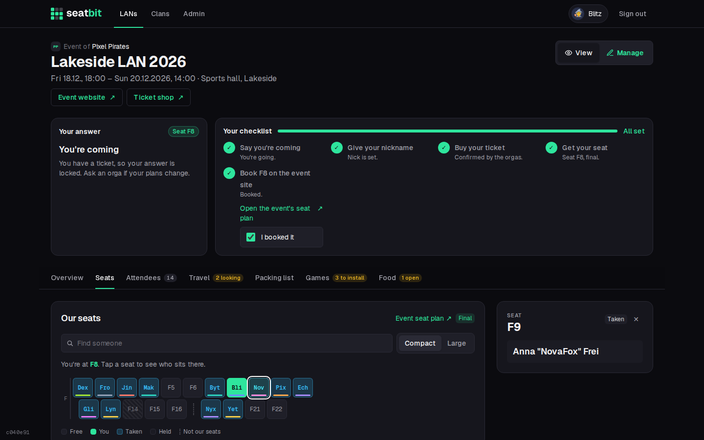
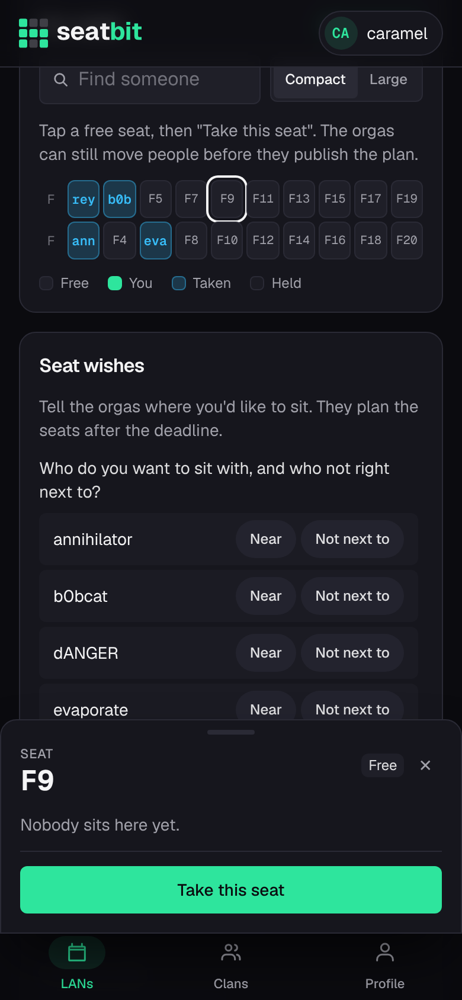
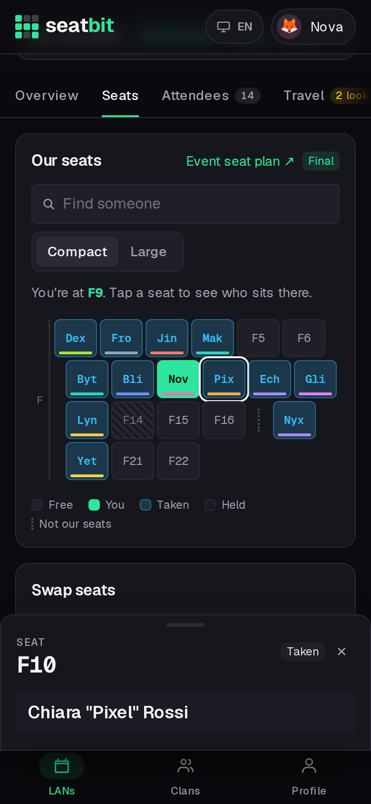
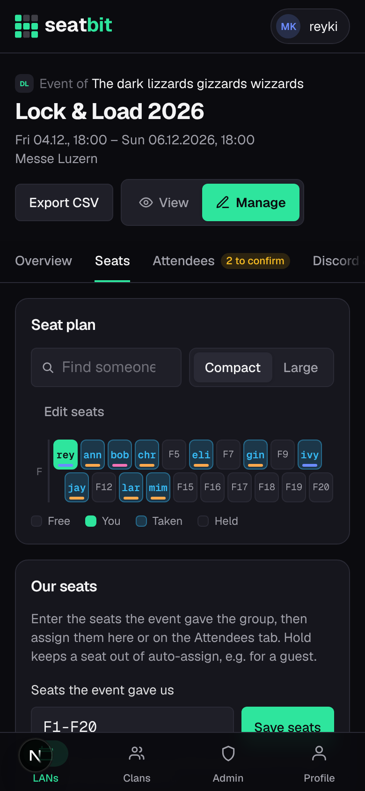
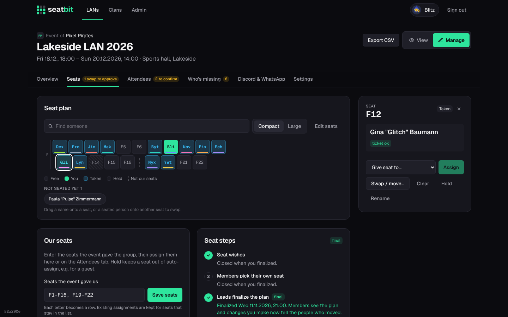

# Seats

The **seat plan** shows the group's seat block. Members send seat wishes or pick a seat, orgas plan and finalize it, then everyone books the same seat on the event's own site.

**Who:** members view, wish and pick; orgas plan · **Where:** event *Seats* tab; *Manage → Seats*

{ .shot }

## The plan

- Each letter is a row; each seat sits at its number. A dotted gap means those numbers aren't the group's.
- Seats show the seat label or the first letters of the nick. **Large** shows whole nicks (remembered on the device).
- Tap a seat for details: a panel on the right on desktop, a sheet at the bottom on phones.
- **Find someone** highlights a person.

## Seat steps

| Step | |
| --- | --- |
| 1. **Seat wishes** | Members say who they want to sit with, who not right next to, edge or middle, or a specific seat. On Discord: `/wish`. |
| 2. **Self pick** (optional) | Orgas turn it on; members with a ticket tap a free seat and **Take this seat**, **Move here** or **Give up my seat**. |
| 3. **Final plan** | Orgas finalize. This closes wishes and self pick, shows everyone the plan and can tell everyone their seat. Later changes notify the people who moved. **Reopen** goes back. |

Seats only count, and everyone sees the plan, once it is final.

<figure markdown>

{ .shot }

<figcaption>Self pick</figcaption>
</figure>
<figure markdown>

{ .shot }

<figcaption>Final plan</figcaption>
</figure>
<figure markdown>

{ .shot }

<figcaption>Orga: editing</figcaption>
</figure>

## Plan the seats

*Manage → Seats*.

{ .shot }

**Our seats:** enter the seats the event gave you, e.g. `F1-F16, F19-F22`. Saving again keeps assignments for seats that stay in the list. **Edit seats** in the map shows every number of a row: tap a dashed one to add it, a seat to remove it.

Tap a seat:

| Action | |
| --- | --- |
| **Give seat to** | Assign someone. |
| **Swap / move** | Swap two people or move one. |
| **Clear** | Free the seat. |
| **Hold** | Members can't take it and auto-assign skips it (e.g. for a guest). |
| **Rename** | Match the event's numbering. |

People coming without a seat are listed under **Not seated yet**: tap one, then a seat. On desktop, drag names onto seats and seated people onto other seats to swap.

**Fill free seats** seats everyone without a seat; **Re-plan everyone** starts over. The planner follows seat wishes and seats people with a ticket first.

## Book on the event site

When the event has an **event seat plan** link, each member gets a checklist step *Book F9 on the event site* and a Discord DM with an **I booked it** button once the plan is final. The Attendees tab shows *booked on site*. A seat change clears the tick, so the member books again.

## Seat swaps

After the plan is final, a member can ask another to swap. Once the other agrees, an orga **approves** or rejects it on the Seats tab, and both are told.
