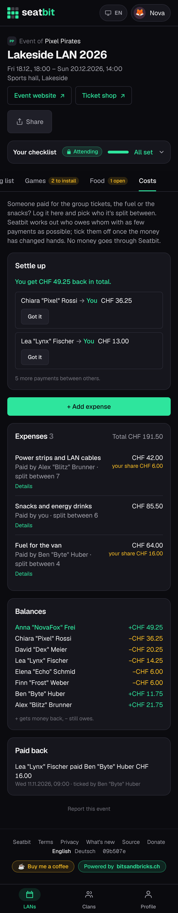
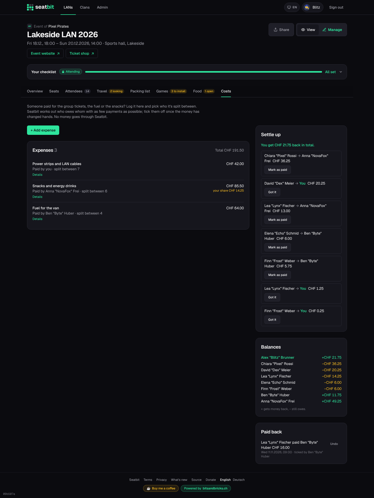

# Shared costs

Someone paid for the group tickets, the fuel for the van or the snacks? Log it on the event, pick who it's split between, and Seatbit works out who owes whom. People tick off what they paid back. No money goes through Seatbit.

**Who:** anyone coming · **Where:** event *Costs* tab

!!! note "Shared costs or clan payments?"
    Shared costs are money **between members** (Ben paid the fuel, the others pay Ben back). Money the **clan** collects (dues, ticket money for the clan's account) is [clan payments](payments.md).

## Add an expense

| Field | |
| --- | --- |
| **What for** | e.g. "Fuel for the van". |
| **Amount** | In the platform currency. |
| **Paid by** | You by default; anyone at the event. |
| **Split evenly between** | Everyone coming is ticked by default. Untick people, or tick someone who isn't coming (a deposit before they dropped out). |
| **Note** | Optional, e.g. where the receipt is. |

The amount is split in whole cents; leftover cents go to the first people, so the parts always add up. **Details** on an expense shows everyone's share. Who logged it, who paid it, or a lead can edit or delete it.

## Settle up

- **Settle up** shows your total ("You owe CHF 20.25 in total") and the payments that even everything out, with as few payments as possible. You see the ones you're in; leads see all of them.
- Once the money has changed hands, tap **Mark as paid** (you paid) or **Got it** (you received it). Like tickets, this is trust-based: either of the two, or a lead, can tick it.
- **Balances** lists everyone who isn't even: `+` gets money back, `−` still owes.
- **Paid back** lists the ticked payments. **Undo** removes one ticked by mistake.
- The *Costs* tab shows how much you still have to pay.

The currency is a platform setting (`FOOD_CURRENCY`, default CHF), the same as for food orders. See [Configuration](../installation/configuration.md).

<figure markdown>

{ .shot }

</figure>

{ .shot }
