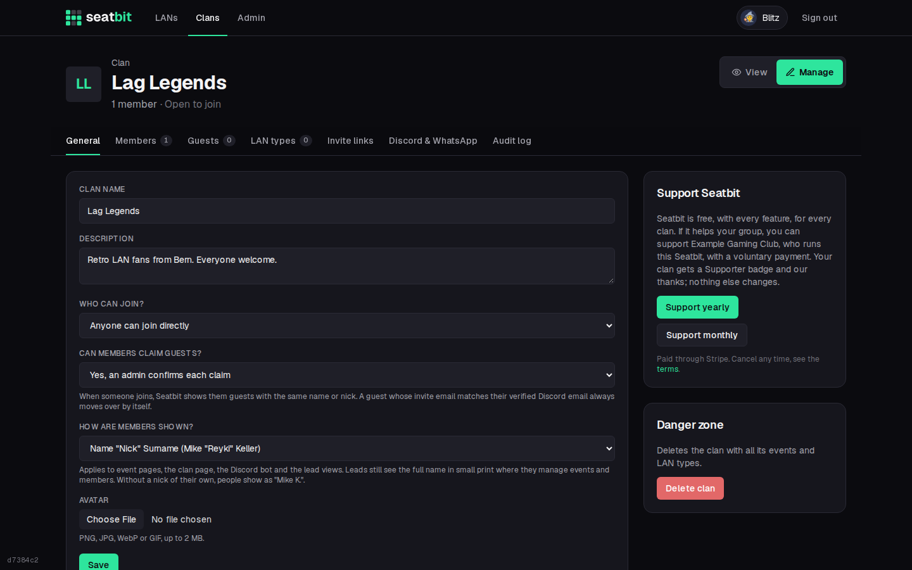

# Supporter badge

On instances where the operator turned on supporter payments, a clan can support the instance with a voluntary yearly or monthly payment and gets a **Supporter** badge. Nothing else changes: there are no plans, limits or paid features.

**Who:** clan admins · **Where:** clan *Manage → General → Support Seatbit*

!!! note "Off by default"
    Until the operator sets up Stripe, nobody sees anything about payments. See [Stripe (supporter payments)](../installation/stripe.md).

{ .shot }

- The **annual** option comes first (lower fees); **monthly** is there if the operator set a monthly price.
- Paying opens Stripe Checkout with the payment methods the operator turned on (card, TWINT, Apple Pay, Google Pay).
- A Supporter clan shows a **Supporter** badge next to its name, and members see a short thank-you on the clan overview.
- Admins see until when it's paid and **Manage or cancel**, which opens the Stripe customer portal (payment method, receipts, cancel).
- A cancelled subscription keeps the badge until the end of the paid period. Deleting a clan cancels its subscription right away.
