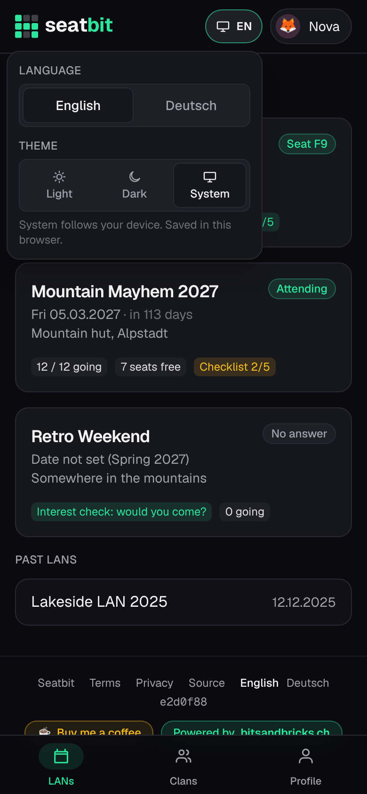
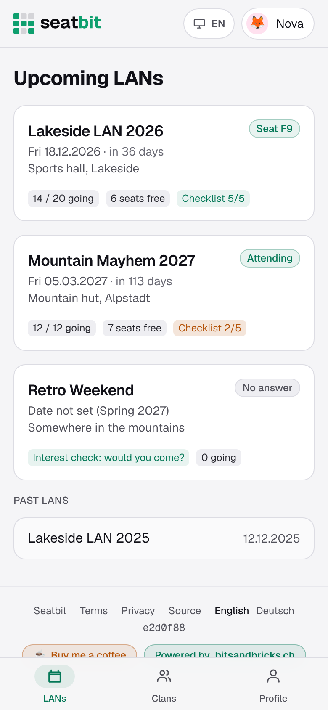
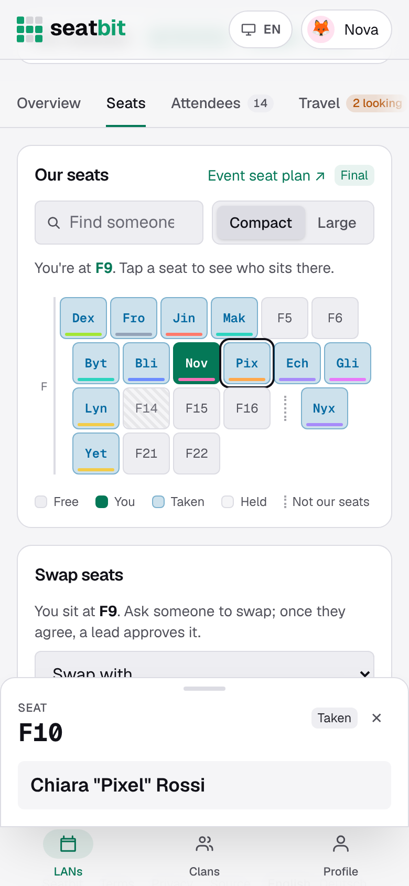
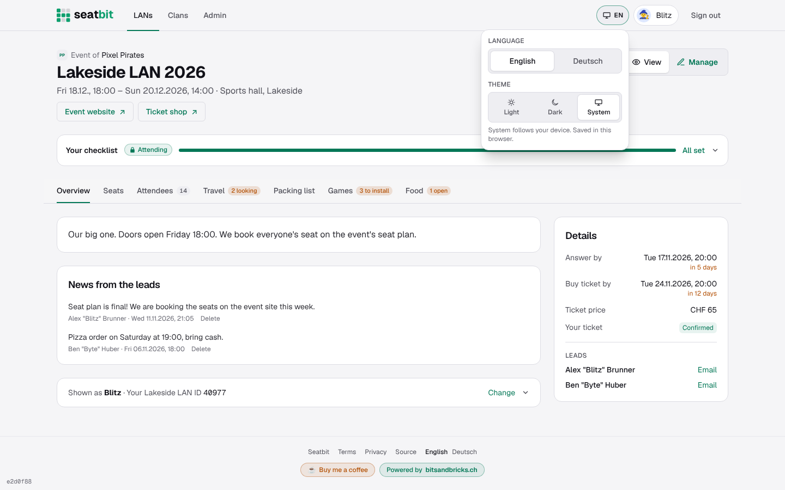
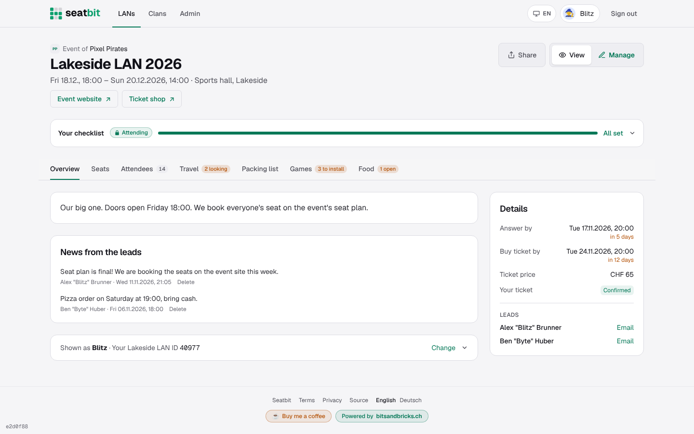
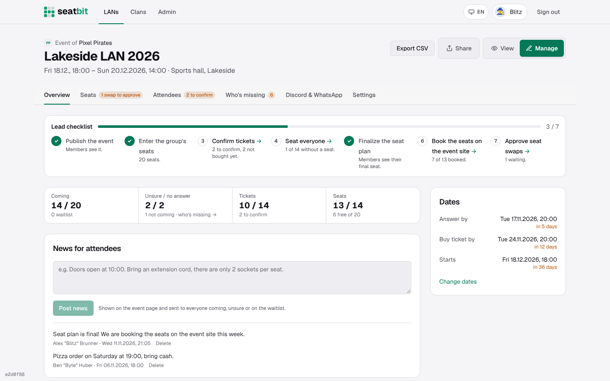

# Light and dark theme

Seatbit comes in a dark and a light theme. By default it follows your device: dark when your phone or computer is set to dark, light when it's set to light.

**Who:** everyone, also before signing in · **Where:** the language and theme button in the top bar (the screen icon with *EN* or *DE*)

## Switching

Tap the button next to your profile in the top bar. It opens a small menu with:

- **Language:** English or Deutsch. Same as the footer links and *Profile › Account › Language*; when you're signed in, the choice is saved on your profile. See [Languages](languages.md).
- **Theme:** *Light*, *Dark* or *System*. *System* follows your device and switches along when your device does (for example at sunset).

The button shows the current theme's icon and language, so you see at a glance what's set.

The theme is remembered **in this browser** (a cookie), not on your account, so your phone can stay dark while the office PC is light. The page is drawn in the right theme straight away, without a flash of the other one.

<figure markdown>

{ .shot }

</figure>
<figure markdown>

{ .shot }

</figure>
<figure markdown>

{ .shot }

</figure>

{ .shot }

{ .shot }

{ .shot }

## What stays the same

- Mails keep their own layout, which already follows the mail app's light or dark mode.
- Link previews (the image shown when you share an event) stay dark.

## For developers

Both themes use the same tokens from `brand/tokens.css` (`bg-surface`, `text-muted`, `text-bit`, ...); the light values are set on `:root[data-theme="light"]` and, for *System*, under `prefers-color-scheme: light`. Use the tokens and both themes work without extra classes. Text on a green fill is `text-on-bit` (dark in the dark theme, white in the light one), never `text-ink`. For the rare thing a token can't cover, such as the logo file, there's a `light:` variant (`light:hidden`). The root layout reads the `seatbit-theme` cookie and sets `data-theme` on `<html>`, so no script runs before the page shows.
