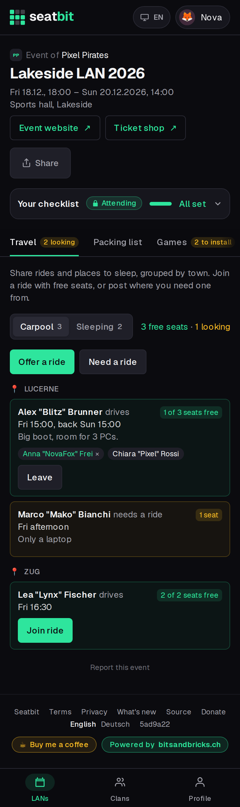
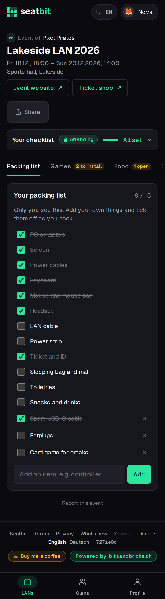

# Travel and packing list

Offer or ask for rides and places to sleep, and keep a private packing list per event.

**Who:** members · **Where:** event *Travel* and *Packing list* tabs

## Travel

Members offer or ask for **rides** and **places to sleep**, grouped by town.

- Join an offer with free places with one tap.
- Drivers can take someone who asked along, which also clears the request.

{ .shot width="300" }

## Packing list

Everyone gets a private **packing list** per event with the usual items (PC, screen, cables, headset, ticket, sleeping bag, ...). Add your own items and tick them off while you pack. Nobody else sees it. There is no shared gear list.

{ .shot width="300" }
