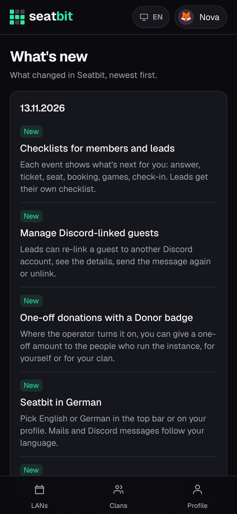

# What's new

The **What's new** page lists what changed in Seatbit, newest day first, in your language (English or German). Each entry is marked **New**, **Improved** or **Fixed**.

**Who:** everyone, also before signing in · **Where:** footer → *What's new* (`/changelog`)

<figure markdown>
{ .shot width="320" }
</figure>

- Entries that only matter to the people who run the instance (settings, backups, upgrades) are marked *Platform admins* and show to the platform team only.
- When a new version starts, its new entries are posted to the instance's announcements Discord channel, if the operator set one up, and sent to the platform admins with the upgrade notice. See [Upgrades](../installation/operations.md#upgrades).
- The same list is in these docs: [Changelog](../changelog/index.md) ([Deutsch](../changelog/de.md)).

Developers: every pull request that changes something people notice adds an entry, see [Changelog entries](../contributing/changelog.md).
