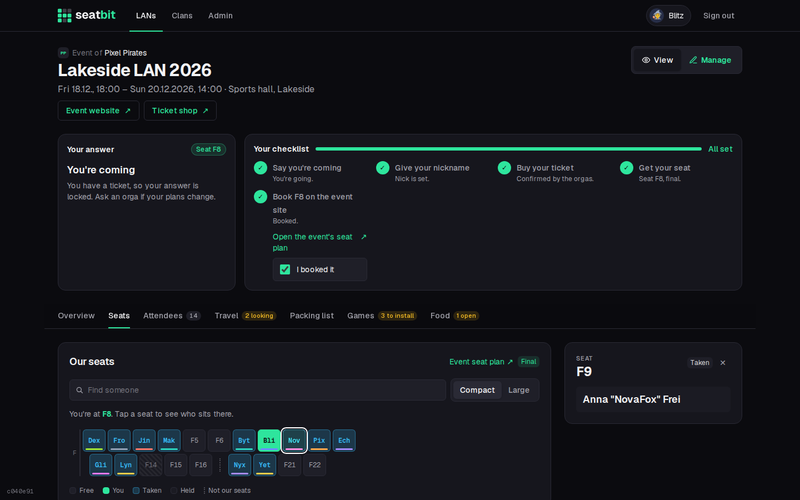

---
hide:
  - navigation
  - toc
---

# Seatbit documentation

Seatbit is a self-hostable web app that helps a clan coordinate going to **LAN parties run by others**: who's coming, tickets, the group's seat block, travel, packing lists, games and food, plus a Discord bot. It is not a tool for running a LAN.

-   :material-view-grid-outline:{ .lg .middle } **Features**

    ---

    What Seatbit does, page by page: events, attendance, seats, clans, guests, Discord and more. For members, leads and admins.

    [:octicons-arrow-right-24: Features](features/index.md)

-   :material-server-outline:{ .lg .middle } **Installation**

    ---

    Run your own instance: Docker or Kubernetes, configuration, the Discord app, email, Stripe and your operator details.

    [:octicons-arrow-right-24: Installation](installation/index.md)

-   :material-code-braces:{ .lg .middle } **Development**

    ---

    Local setup with demo data, the stack, database migrations, generated screenshots and CI.

    [:octicons-arrow-right-24: Development](development/index.md)

-   :material-source-pull:{ .lg .middle } **Contributing**

    ---

    How to propose a change, code guidelines, writing docs and the rules for AI coding agents.

    [:octicons-arrow-right-24: Contributing](contributing/index.md)

## Concepts

| Term | Meaning |
| --- | --- |
| **Instance** | One Seatbit installation, run by an **operator**. Hosts any number of clans. |
| **Clan** | Your group: members, roles, LAN types, events and its Discord server. A clan only sees its own events. See [Clans and roles](features/clans.md). |
| **LAN type** | A template for a LAN party you go to regularly (e.g. *Lock & Load*): location, links, usual spots, seats and length. See [LAN types](features/clans.md#lan-types). |
| **Event** | One edition of a LAN the group attends, usually created from a LAN type. See [Event lifecycle](features/events.md). |
| **Lead** | A member who runs a single event: attendance, tickets, seats. Clan admins and event managers can run every event. |
| **Spots** | How many people the group can bring. When full, new answers go on a waitlist. |
| **Seat block** | The seats the event gave the group, e.g. `F1-F16, F19-F22`. See [Seats](features/seats.md). |
| **Guest** | A person without a Seatbit account, added by leads, who can take over the guest later. See [Guests](features/members-guests.md#guests). |
| **Platform admin** | Runs the instance: platform settings, all clans and users. See [Platform admin](features/admin.md). |

{ .shot }

Seatbit is free software under the [GNU AGPL-3.0](https://github.com/bitsandbricks-ch/seatbit/blob/main/LICENSE). Source code, issues and releases are on [GitHub](https://github.com/bitsandbricks-ch/seatbit).
