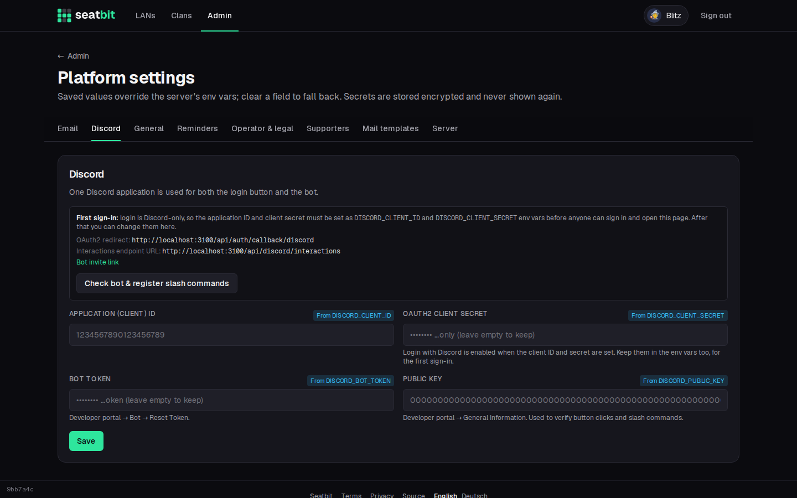

# Discord app and bot

Seatbit uses **one Discord application** for both the "Continue with Discord" login and the bot. The bot runs inside Seatbit: Discord sends button clicks and slash commands to Seatbit over HTTPS, so there is no extra process to host.

## 1. Create the application

1. Go to the [Discord Developer Portal](https://discord.com/developers/applications) and click **New Application**.
2. **OAuth2:** copy the **Client ID** and reset/copy the **Client Secret**. Add the redirect `https://seatbit.example.com/api/auth/callback/discord` (your `BETTER_AUTH_URL` + `/api/auth/callback/discord`).
3. Start Seatbit with `DISCORD_CLIENT_ID` and `DISCORD_CLIENT_SECRET` set as environment variables and sign in. The first account becomes platform admin. (To pick admins up front, set `ADMIN_EMAILS` to the emails of their Discord accounts.)

!!! warning "Keep the login variables"
    Login is Discord-only, so keep the two variables in place even if you later save the values in the platform settings. If wrong ones are ever saved there, nobody can sign in; `node scripts/admin.mjs reset-setting discord.clientSecret` (and `discord.clientId`) in the container brings back the env values.

## 2. Set up the bot

1. In the developer portal, **Bot:** reset and copy the **token**.
2. **General Information:** copy the **Public Key**, and set **Interactions Endpoint URL** to `https://seatbit.example.com/api/discord/interactions`. Seatbit must be running and reachable for Discord to accept it.
3. In Seatbit, open **Admin → Platform settings → Discord**, enter the bot token and public key, and click **Check bot & register slash commands**. This registers `/lans`, `/claim`, `/guest` and `/seatbit`. Click it again after an update that adds commands.

{ .shot }

The page also shows the **bot invite link**. Clan admins find the same link in their clan settings, add the bot to their server and run `/seatbit here` there (see [Discord and WhatsApp](../features/discord.md)). The invite asks for the permissions the bot uses: send messages and embeds, pin messages, create invites, and use slash commands.

## Privacy

The bot only receives the commands and button clicks addressed to it, never other messages. Data it stores is listed in the built-in privacy policy.
