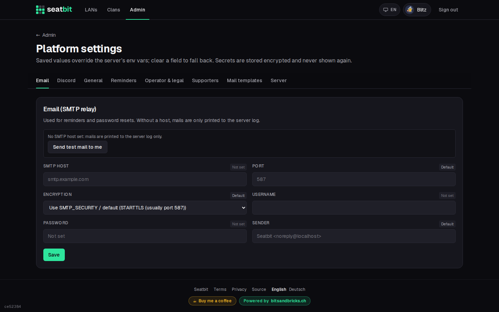
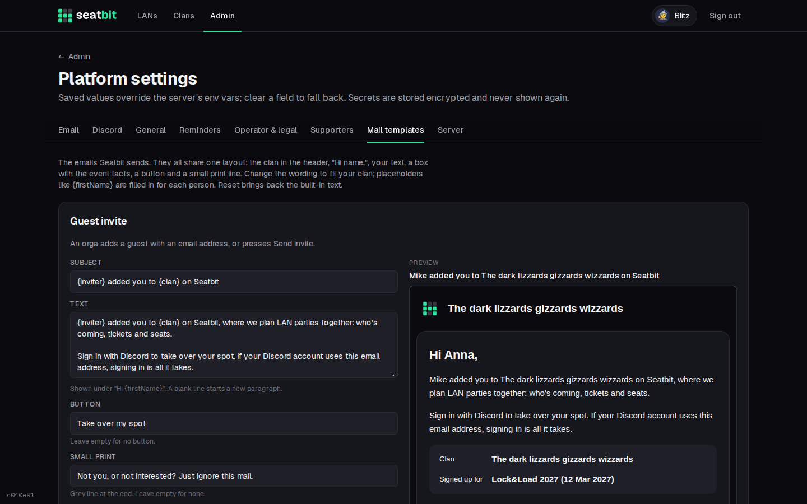

# Email

Seatbit sends reminders, invites for guests and notices like "you moved up from the waitlist" by email. Set up an SMTP relay under **Admin → Platform settings → Email** (or with the `SMTP_*` variables, see [Configuration](configuration.md)) and click **Send test mail to me**.

{ .shot }

Without an SMTP host, emails are written to the server log instead, which is handy for trying things out.

Use a sender address on a domain you control (`MAIL_FROM`, e.g. `Seatbit <lan@example.com>`) and set up SPF/DKIM for it with your mail provider, or reminders end up in spam.

## Mail templates

Under **Mail templates**, change the wording of every email Seatbit sends. They share one layout: the clan in the header, "Hi name,", your text, a box with the event facts, a button and a footer with links to the privacy policy and terms. Placeholders like `{firstName}` are filled in per person. **Reset** brings back the built-in text, and you can send yourself a test.

Each template has an English and a German text; the switch above the templates picks which one you edit. Every mail goes out in its recipient's [language](../features/languages.md#mails).

{ .shot }

Members turn reminder emails off on their profile.
