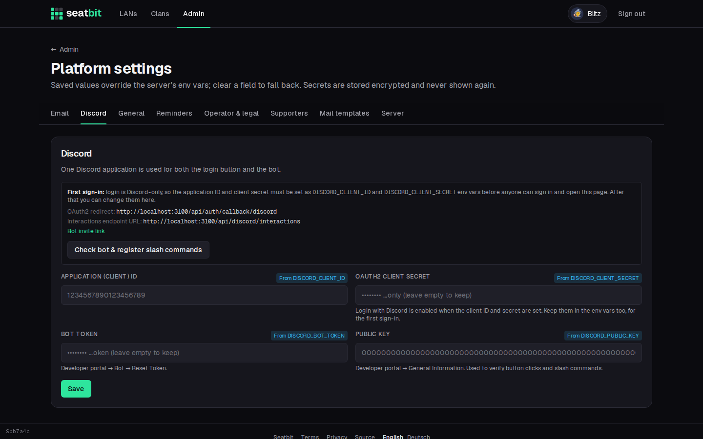

# Installation

Run your own Seatbit instance. Seatbit is one Node.js process with a SQLite database, shipped as a container image for amd64 and arm64. It runs on any machine with Docker, a small VPS or a Kubernetes cluster.

## What you need

- A server that can run a container (amd64 or arm64), about 256 MB RAM and a little disk for the database.
- A **domain with HTTPS** in front of it (a reverse proxy such as Caddy, Traefik or nginx, or your cluster's ingress). Discord only talks to HTTPS URLs.
- A **Discord application** for the login and the bot (free). See [Discord app and bot](discord.md).
- Optional: an **SMTP** account to send emails. Without one, emails are only written to the server log.

## Steps

1. Start the container with [Docker](docker.md) or on [Kubernetes](kubernetes.md) with a few [environment variables](configuration.md).
2. Sign in with Discord. **The first account becomes platform owner.**
3. Open **Admin → Platform settings** and set up [email](email.md), the [Discord bot](discord.md) and the [operator details for the privacy policy and terms](legal.md).
4. Create your clan and invite your people. See [Clans and roles](../features/clans.md).
5. Set up [backups](operations.md#backups).

{ .shot }

!!! info "You are the operator"
    Whoever runs an instance is responsible for it and for the personal data in it. Fill in your details under **Operator & legal** before you invite people, and check that the built-in privacy policy and terms fit how you run it. See [Operator, privacy and terms](legal.md).
