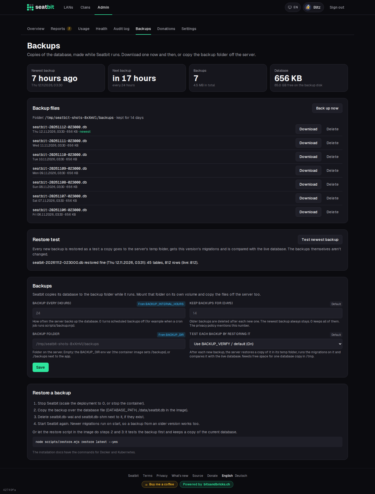

# Backups, upgrades, metrics and admin CLI

## Backups

All data is in the SQLite database (`/data/seatbit.db`) and the uploaded avatars (`/data/uploads`).

Seatbit backs up its database by itself: once a day by default, while it runs, with SQLite's online backup API (a consistent copy, no downtime). Each backup is checked (`PRAGMA integrity_check`) and written as `seatbit-YYYYMMDD-HHMMSS.db` to the backup folder. Backups older than the retention are deleted after each new one; the newest always stays.

Platform [owners](../features/admin.md#platform-roles) manage them under **Admin → Backups**: when the last one ran and the next one is due, **Back up now**, download or delete a backup, and the settings:

| Setting | Variable | Default |
| --- | --- | --- |
| Backup every (hours, `0` = off) | `BACKUP_INTERVAL_HOURS` | `24` |
| Keep backups for (days, `0` = keep all) | `BACKUP_KEEP_DAYS` | `14` |
| Backup folder | `BACKUP_DIR` | `/backups` in the image |

{ .shot }

A failed backup shows on the admin page and logs a `[backup] failed` line. Downloads, manual backups and deletions are in the [audit log](../features/audit-log.md#platform-audit-log), since a backup holds everyone's data.

### Where to keep them

Mount `/backups` as its **own volume**, so a broken data volume doesn't take the backups with it (see [Docker](docker.md#docker-compose) and [Kubernetes](kubernetes.md#backups)). It must be writable for uid 1001. Then also copy the folder off the server now and then, e.g. with restic, rsync or your volume snapshots: a backup on the same disk doesn't help when the disk dies.

The privacy policy says how long backups are kept, from the **Keep backups for** setting.

If *Admin → Backups* says the folder **isn't writable**, the volume on `/backups` belongs to another user. The server runs as uid 1001: on Kubernetes set `fsGroup: 1001` in the pod's `securityContext` (as in the [example](kubernetes.md#example)). For volume types that ignore `fsGroup` (hostPath, some NFS shares), run `chown -R 1001:1001` on the folder, or use an init container that does. With Docker: `sudo chown -R 1001:1001 backups`.

### Backups from a cron job instead

If you'd rather back up from outside, set **Backup every** to `0` and run the script that is in the image:

```sh
docker exec seatbit node scripts/backup.mjs
```

It writes the same files to `BACKUP_DIR` and deletes ones older than `BACKUP_KEEP_DAYS`, so they show up under *Admin → Backups* too (when the app uses the same folder).

### Restore test

A backup only counts if it restores. So after each new backup, Seatbit restores it as a test: it copies the file to its temp folder (`/tmp`), checks it (`integrity_check`, `foreign_key_check`), runs this version's migrations on the copy, as a start after a restore would, and compares its tables and row counts with the live database. The backup and the live database aren't touched; the copy is deleted right away.

The test also covers backups a cron job writes with `scripts/backup.mjs`: the server tests the newest backup in the folder once, whoever made it. *Admin → Backups* shows the last result and has **Test newest backup**; a failed test shows there, on *Admin → Health*, in the ops Discord channel (as an error) and in the [metrics](#metrics). Turn it off with **Test each backup by restoring it** (`BACKUP_VERIFY=false`), e.g. when `/tmp` has no room for a copy of the database.

From the command line, without the app:

```sh
docker exec seatbit node scripts/restore.mjs list             # backups, newest first
docker exec seatbit node scripts/restore.mjs verify           # test the newest backup
docker exec seatbit node scripts/restore.mjs verify seatbit-20261112-023000.db
```

`verify` checks the file, says how many migrations it is behind this version and compares it with the live database. It changes nothing, so it is safe while Seatbit runs.

### Restore

1. Download the backup from *Admin → Backups* (or take it from the backup folder).
2. Stop Seatbit.
3. Copy the backup over the database file and remove the WAL files next to it.
4. Start Seatbit again. Migrations of newer versions run on start, so a backup from an older version works too.

`scripts/restore.mjs` in the image does step 3 for you, more safely: it tests the backup first, refuses while Seatbit still has the database open, and keeps the current database as `pre-restore-YYYYMMDD-HHMMSS.db` in the backup folder (that file isn't listed or pruned; delete it once you're happy).

```sh
node scripts/restore.mjs restore latest --yes                       # the newest backup
node scripts/restore.mjs restore seatbit-20261112-023000.db --yes   # a file in the backup folder
node scripts/restore.mjs restore /tmp/downloaded.db --yes           # any path
```

Without `--yes` it only tests the backup and says what it would do. `--force` skips the "still running" check, e.g. after a crash left a WAL file behind.

With Docker Compose:

```sh
docker compose stop seatbit
docker compose run --rm seatbit node scripts/restore.mjs restore latest --yes
docker compose start seatbit
```

On Kubernetes, scale the deployment to 0 and run the script in a short-lived pod with the same image and both volumes:

```sh
kubectl scale deploy/seatbit --replicas=0
kubectl run seatbit-restore --rm -i --restart=Never --image=ghcr.io/bitsandbricks-ch/seatbit:main --overrides='
{"spec":{"securityContext":{"runAsUser":1001,"runAsGroup":1001,"fsGroup":1001},
 "containers":[{"name":"restore","image":"ghcr.io/bitsandbricks-ch/seatbit:main",
  "command":["node","scripts/restore.mjs","restore","latest","--yes"],
  "volumeMounts":[{"name":"data","mountPath":"/data"},{"name":"backups","mountPath":"/backups"}]}],
 "volumes":[{"name":"data","persistentVolumeClaim":{"claimName":"seatbit-data"}},
            {"name":"backups","persistentVolumeClaim":{"claimName":"seatbit-backups"}}]}}'
kubectl scale deploy/seatbit --replicas=1
```

Use the same image tag as the deployment. To restore a file you downloaded, copy it into the backup folder first (`kubectl cp` into a running pod that mounts it).

### Restore drill

The automatic test proves each file restores; a drill now and then proves that *you* can restore, and how long it takes. Once or twice a year, or after you changed storage or the cluster:

1. Pick a backup and copy it off the server, as you would in a real loss.
2. Start a second Seatbit from it somewhere harmless: `docker run --rm -p 3001:3000 -v "$PWD/drill:/data" -e BETTER_AUTH_URL=http://localhost:3001 -e BETTER_AUTH_SECRET=... ghcr.io/bitsandbricks-ch/seatbit:main` with the backup as `drill/seatbit.db`. Use the same `BETTER_AUTH_SECRET` (and `SETTINGS_ENCRYPTION_KEY`, if set) as production, or the saved secrets (SMTP password, bot token) can't be read; leave out the Discord settings so the copy doesn't talk to your bot.
3. Sign in, open a clan and an event, check the newest change you expect to be in it.
4. Note the date and how long it took, then delete the copy.

## Upgrades

Pull the new image and restart the container. Migrations run on startup. Take a backup first.

```sh
docker compose pull && docker compose up -d
```

There is one database, so run a single instance and stop the old container before the new one starts (`Recreate` strategy on Kubernetes).

After the start, Seatbit takes care of the rest:

- **Discord slash commands** are registered again when the update changed them (needs the bot token and application ID). If that fails, the notice below says so; then click **Check bot & register slash commands** under *Admin → Platform settings → Discord*.
- **Platform owners and admins get a notice** by mail and Discord DM, once per new version: the new version, the [changelog](../changelog/index.md) entries it brought and whether anything is left to do, with buttons to *What's new* and to *All changes in the code* (the compare view in the source repository, from the *Source code URL* setting). The very first start and builds without git information send nothing.
- **The ops channel** (if set) gets the same new changelog entries. Each entry is announced once, with the version that brought it; the first version with a changelog announces nothing, so the history isn't posted as news. The public announcements channel and clan channels don't get the changelog.

## Logs and health

- `GET /api/health` answers `{"ok":true}` while the server and database work.
- `GET /api/metrics` gives Prometheus metrics, see [Metrics](#metrics).
- Errors, sent reminders and (without SMTP) emails go to the container log.
- *Admin → Health* shows version, database size, mail and Discord status, background jobs and recent errors ([Health](../features/admin.md#health)).
- Set an ops channel to get errors, upgrades and other platform events on Discord ([Platform Discord](../features/admin.md#platform-discord)).
- Before planned downtime, put up a [maintenance banner](../features/admin.md#maintenance-banner).

## Metrics

Seatbit has a [Prometheus](https://prometheus.io/) endpoint at `GET /api/metrics`. It is off until you set a token under *Admin → Platform settings → Reminders & metrics* (or `METRICS_TOKEN`); then it needs `Authorization: Bearer <token>`:

```sh
curl -H "Authorization: Bearer $METRICS_TOKEN" https://seatbit.example.com/api/metrics
```

The metrics only hold totals, no names, clans or ids:

| Metric | |
| --- | --- |
| `seatbit_info{commit,node}` | Running version (always 1). |
| `process_*`, `nodejs_heap_used_bytes` | Start time, memory, CPU. |
| `seatbit_database_size_bytes`, `seatbit_database_wal_bytes` | SQLite file and WAL size. |
| `seatbit_users{kind}`, `seatbit_active_users{window}`, `seatbit_sessions`, `seatbit_clans` | Accounts and guests, active accounts in the last 1/7/30 days, signed-in sessions, clans. |
| `seatbit_events{state}`, `seatbit_upcoming_attendances{status}`, `seatbit_open_reports` | Events (draft, upcoming, past, cancelled), answers to upcoming events, unhandled abuse reports. |
| `seatbit_job_runs_total{job}`, `seatbit_job_failures_total{job}`, `seatbit_job_last_success_timestamp_seconds{job}`, `seatbit_job_running{job}` | Background jobs: `reminders`, `publish`, `backup`, `restore-test`, `upgrade`. |
| `seatbit_problems_total{kind}`, `seatbit_mails_total{result}` | Server errors, failed mails and Discord calls (as on *Admin → Health*), mails sent. |
| `seatbit_live_connections` | Open live update streams: event pages that refresh by themselves. |
| `seatbit_backup_files`, `seatbit_backup_size_bytes`, `seatbit_backup_last_timestamp_seconds`, `seatbit_backup_interval_seconds`, `seatbit_backup_last_failed` | Backups in the folder and when the newest was written. |
| `seatbit_backup_disk_free_bytes`, `seatbit_backup_disk_size_bytes` | Space on the backup volume. |
| `seatbit_backup_restore_test_ok`, `seatbit_backup_restore_test_timestamp_seconds`, `seatbit_backup_restore_test_backup_timestamp_seconds`, `seatbit_backup_restore_test_duration_seconds` | The last [restore test](#restore-test). |

Counters start at 0 when the server starts. HTTP request rates and latencies aren't in here; take them from your ingress controller or reverse proxy.

### Scraping on Kubernetes

Put the token in a Secret and point a `ServiceMonitor` (Prometheus Operator) at the Seatbit Service. This assumes a Service `seatbit` with a port named `http` and the label `app: seatbit`; adjust to your manifests:

```yaml
apiVersion: v1
kind: Secret
metadata:
  name: seatbit-metrics
stringData:
  token: change-me                 # same value as METRICS_TOKEN
---
apiVersion: monitoring.coreos.com/v1
kind: ServiceMonitor
metadata:
  name: seatbit
spec:
  selector:
    matchLabels: { app: seatbit }
  endpoints:
    - port: http
      path: /api/metrics
      interval: 60s
      authorization:
        type: Bearer
        credentials: { name: seatbit-metrics, key: token }
```

Plain Prometheus:

```yaml
scrape_configs:
  - job_name: seatbit
    metrics_path: /api/metrics
    scheme: https
    authorization:
      credentials_file: /etc/prometheus/seatbit-token
    static_configs:
      - targets: [seatbit.example.com]
```

The metrics are cheap (a few `count(*)` queries), so once a minute is fine.

### Alerts

Example rules (`PrometheusRule` or a rules file) for the things worth waking up for:

```yaml
groups:
  - name: seatbit
    rules:
      - alert: SeatbitDown
        expr: up{job="seatbit"} == 0
        for: 5m
      - alert: SeatbitBackupMissing
        # No backup for twice the interval (only when scheduled backups are on).
        expr: seatbit_backup_interval_seconds > 0 and time() - seatbit_backup_last_timestamp_seconds > 2 * seatbit_backup_interval_seconds
        for: 15m
      - alert: SeatbitRestoreTestFailing
        expr: seatbit_backup_restore_test_enabled == 1 and seatbit_backup_restore_test_ok == 0 and seatbit_backup_files > 0
        for: 30m
      - alert: SeatbitRestoreTestBehind
        # The newest backup that passed a restore test is more than two days older than the newest backup.
        expr: seatbit_backup_restore_test_enabled == 1 and seatbit_backup_last_timestamp_seconds - seatbit_backup_restore_test_backup_timestamp_seconds > 2 * 86400
        for: 1h
      - alert: SeatbitBackupDiskFull
        expr: seatbit_backup_disk_free_bytes < 3 * seatbit_database_size_bytes
        for: 1h
      - alert: SeatbitJobFailing
        expr: increase(seatbit_job_failures_total[1h]) > 2
      - alert: SeatbitErrors
        expr: increase(seatbit_problems_total{kind="error"}[15m]) > 5
```

## Admin CLI

`scripts/admin.mjs` manages platform roles, suspensions and settings straight on the database, also while the app runs. It is in the container image.

```sh
docker exec seatbit node scripts/admin.mjs list                     # platform staff
docker exec seatbit node scripts/admin.mjs users anna               # find users
docker exec seatbit node scripts/admin.mjs grant anna@example.com   # make owner
docker exec seatbit node scripts/admin.mjs grant ben@example.com --role=moderator
docker exec seatbit node scripts/admin.mjs revoke 123456789012345678
docker exec seatbit node scripts/admin.mjs reset-setting discord.clientSecret
```

| Command | |
| --- | --- |
| `list` | List platform staff (owners, admins, moderators, support). |
| `users [search]` | List users, optionally filtered. |
| `grant <user> [--role=...]` | Give a [platform role](../features/admin.md#platform-roles): `owner` (default), `admin`, `moderator` or `support`. An email nobody has signed in with yet is added to the admin emails, so that person becomes owner on first sign-in. |
| `revoke <user>` | Take the platform role away. Refuses to remove the last owner unless `--force`. |
| `unsuspend <user>` | Lift a suspension, e.g. if you suspended yourself out by mistake. |
| `reset-setting <key>` | Clear a saved platform setting, so the environment variable applies again (e.g. after saving wrong Discord login values). |

A user can be given by email, Discord user ID, Seatbit user ID, name or nickname. On Kubernetes use `kubectl exec deploy/seatbit -- node scripts/admin.mjs ...`; in a checkout `npm run admin -- list`.
