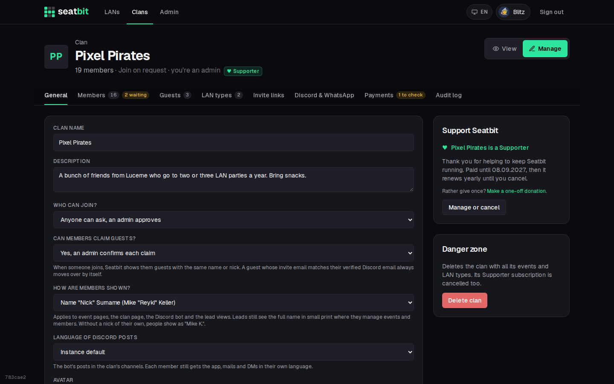
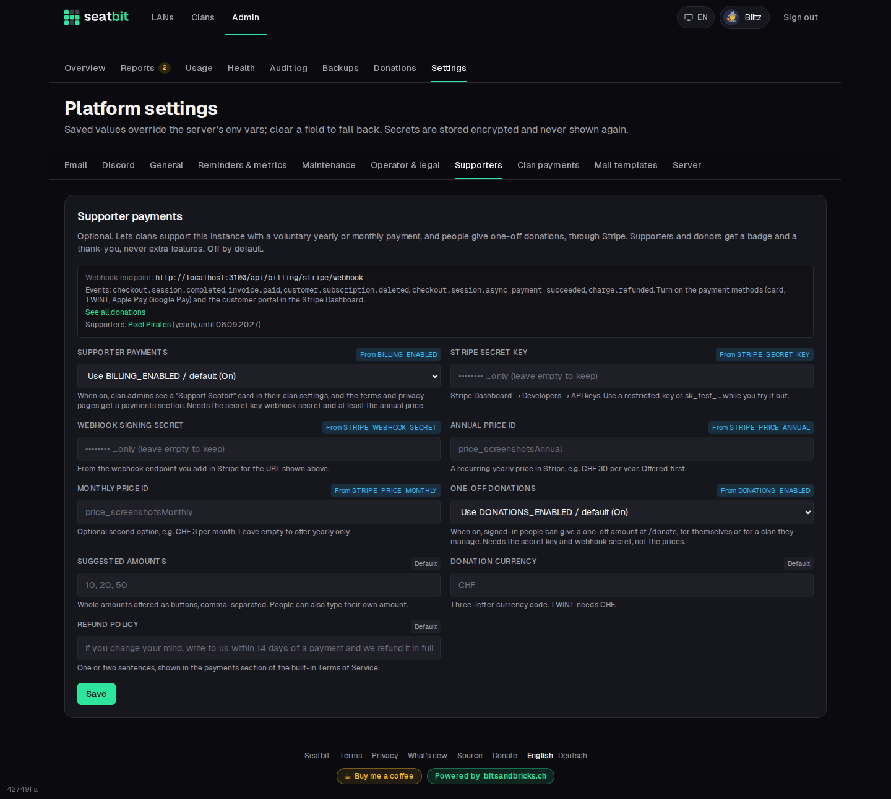

# Stripe (payments)

Seatbit is free, with every feature, for every clan. If you host an instance for others, you can let clans **support** it with a voluntary yearly (or monthly) payment, and let anyone give a **one-off donation**, through [Stripe](https://stripe.com). Supporters and donors get a small badge and a thank-you; nothing else changes. There are no plans, limits or locked features. You can turn on either one or both.

This is **off by default**. Until you turn it on, nobody sees anything about payments: no card in the clan settings, no badge, no payments section in the terms or privacy policy. Most self-hosters never need it.

What people see is described in [Supporter badge](../features/supporters.md) and [Donations](../features/donations.md).

{ .shot }

## Set it up

1. **Create a Stripe account** and switch to *Test mode* while you try it out.
2. **Turn on payment methods** under *Settings → Payments → Payment methods*: cards, TWINT, Apple Pay and Google Pay. TWINT needs prices in CHF. Checkout shows the methods that are on and fit the price.
3. **Create a product**, e.g. *Seatbit Supporter*, with a **recurring price per year** (e.g. CHF 30) and, if you like, a second **recurring price per month** (e.g. CHF 3). Copy the price IDs (`price_…`).
4. **Set up the customer portal** under *Settings → Billing → Customer portal*: allow customers to cancel and update their payment method, and save it once.
5. **Add a webhook endpoint** under *Developers → Webhooks* with the URL shown in Seatbit (`https://seatbit.example.com/api/billing/stripe/webhook`) and these events:
    - `checkout.session.completed`
    - `invoice.paid`
    - `customer.subscription.deleted`
    - `checkout.session.async_payment_succeeded` (donations paid with a delayed method)
    - `charge.refunded` (marks refunded donations)

    Copy its **signing secret** (`whsec_…`).
6. In Seatbit, open **Admin → Platform settings → Supporters**, enter the secret key, the webhook signing secret and the price IDs, and turn on **Supporter payments** and/or **One-off donations**. Or set the environment variables below.

Donations need only the secret key and the webhook: no product or price, because the amount is chosen on the donate page and sent to Checkout with it. Skip steps 3 and 4 if you only want donations.

{ .shot }

| Setting | Variable | |
| --- | --- | --- |
| Supporter payments | `BILLING_ENABLED` | `false` by default. |
| Stripe secret key | `STRIPE_SECRET_KEY` | `sk_test_…` / `sk_live_…`, or a restricted key (`rk_…`) with write access to Checkout Sessions, Customer portal and Subscriptions, and read access to Prices. |
| Webhook signing secret | `STRIPE_WEBHOOK_SECRET` | `whsec_…` |
| Annual price ID | `STRIPE_PRICE_ANNUAL` | Required. |
| Monthly price ID | `STRIPE_PRICE_MONTHLY` | Optional. |
| Refund policy | `BILLING_REFUND_POLICY` | Sentence shown in the terms. |
| One-off donations | `DONATIONS_ENABLED` | `false` by default. |
| Suggested amounts | `DONATION_AMOUNTS` | Whole amounts, comma-separated, e.g. `10, 20, 50`. People can type their own (1 to 10,000). |
| Donation currency | `DONATION_CURRENCY` | `CHF` by default. TWINT needs CHF. |

The card only shows up when the switch is on and the secret key and annual price are set. The settings page lists what's missing, and which clans are Supporters right now.

### Try it in test mode

Pay with a [Stripe test card](https://docs.stripe.com/testing) such as `4242 4242 4242 4242`. To get webhooks on your own machine, use the Stripe CLI and put the secret it prints into the settings:

```sh
stripe listen --forward-to localhost:3000/api/billing/stripe/webhook
```

When it works, switch Stripe to live mode, create the product, prices and webhook there as well, and replace the test values.

## How it works

- The **webhook** checks Stripe's signature (and refuses deliveries older than five minutes), and handles each event once, however often Stripe sends it.
- `checkout.session.completed` links the clan to its Stripe customer and subscription, `invoice.paid` extends **Supporter until** to the end of the paid period (also for every renewal), and `customer.subscription.deleted` ends it.
- Seatbit stores only the Stripe customer and subscription IDs, the plan and the paid-until date on the clan. Card and TWINT details stay with Stripe.
- The audit log of the clan notes when it became a Supporter and when the subscription ended.
- **Donations** use Checkout in payment mode. Only paid ones are stored (on `checkout.session.completed`, or `checkout.session.async_payment_succeeded` for delayed methods); the thank-you page also asks Stripe directly, so the badge shows even before the webhook arrives. Seatbit stores the donor, the clan (if any), amount, currency, the Checkout and PaymentIntent IDs and the badge choice. A full refund (`charge.refunded`) marks it refunded.
- A donation for a clan of at least the annual price (same currency) extends the clan's **Supporter until** by a year. Refunding it doesn't shorten that again; change it in the database if you need to.
- Each payment also raises an in-app event (`donation.received`, `donation.refunded`, `supporter.started`, `supporter.renewed`, `supporter.ended`, see `src/lib/platform-events.ts`) that ops notifications can listen to. It carries clan names and amounts, never emails.

## Legal texts

With payments or donations on, the built-in [Terms of Service](legal.md) get a *Supporter payments* (and/or *Donations*) section (voluntary, no extra features, cancel any time, your refund policy) and the Privacy Policy names Stripe as payment provider. If you use your own documents, add the same there. Seatbit doesn't issue invoices with VAT; Stripe sends receipts.

## Online payments for clans

Separately from the Supporter badge, clans can let their members **pay what they owe the clan** online (dues, ticket money, see [Clan payments](../features/payments.md)). This uses [Stripe Connect](https://docs.stripe.com/connect): your instance is the *platform*, and every clan connects **its own Stripe account**.

- Members pay with Stripe Checkout as a *direct charge* on the clan's account. The money goes straight to the clan, never through you.
- Each clan's account is a **Standard** account: the clan signs Stripe's terms, goes through Stripe's identity checks itself, has the full Stripe Dashboard, pays Stripe's fees and handles refunds and disputes there. Stripe, not you, carries the risk of failed or disputed payments.
- You can keep a share of each payment (**Platform fee**, default 0). If you do, check what that means for you (it's income, and Stripe may ask more questions about your platform).

This is **off by default** and independent of Supporter payments; it only needs the Stripe secret key from above.

### Set it up

1. In the Stripe Dashboard, open **Connect** and finish the platform setup (platform profile, branding shown on the clans' onboarding). Stripe asks you to accept the Connect platform terms.
2. Add a **second webhook endpoint** under *Developers → Webhooks*, set to listen to **events on connected accounts**, with the URL shown in Seatbit (`https://seatbit.example.com/api/payments/stripe/webhook`) and these events:
    - `checkout.session.completed`
    - `checkout.session.async_payment_succeeded`
    - `charge.refunded`
    - `account.updated`
    - `account.application.deauthorized`

    Copy its **signing secret** (`whsec_…`).
3. In Seatbit, open **Admin → Platform settings → Clan payments**, enter the Connect webhook signing secret, set a platform fee if you want one, and turn on **Online payments for clans**. The Stripe secret key is the one on the *Supporters* tab (or `STRIPE_SECRET_KEY`). A restricted key also needs write access to *Connect* (accounts and account links).

### What clans do

A clan admin opens *Manage → Payments* and presses **Connect Stripe**. Stripe asks for who runs the clan and the bank account for payouts. Back in Seatbit, the card shows **Members can pay online**, and every open line gets a **Pay online** button. Payment methods are whatever the clan turns on in its own Stripe Dashboard (TWINT needs CHF).

### How it works

- Seatbit stores the clan's Stripe account ID and whether it can take payments, and for each paid line the Stripe payment ID. Card and TWINT details stay with Stripe.
- `checkout.session.completed` (or `…async_payment_succeeded` for slower methods) marks the line **paid online**. A full refund in the clan's dashboard (`charge.refunded`) sets it back to open, so the lead can waive it if that was the point.
- `account.updated` keeps "can take payments" current; `account.application.deauthorized` unlinks a clan that removed your platform in Stripe. **Unlink Stripe account** in Seatbit only forgets the link; the clan's Stripe account stays theirs.
- Every event is checked against the signing secret and applied once.

### Try it in test mode

With test keys, the clan onboarding offers test data, and payments work with [test cards](https://docs.stripe.com/testing). Forward Connect events locally with:

```sh
stripe listen --forward-connect-to localhost:3000/api/payments/stripe/webhook
```
