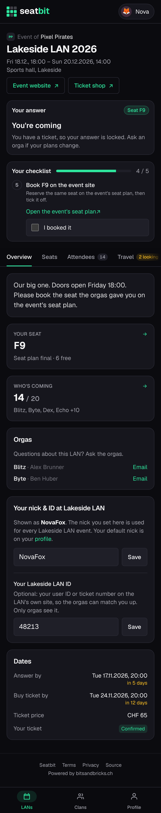
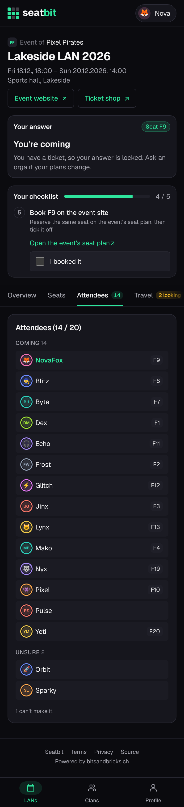

# Events

Open an event from the **LANs** tab. At the top you always see your answer and your checklist; below are the tabs **Overview**, **Seats**, **Attendees**, **Travel**, **Packing list** and **Games**.

<figure markdown>

{ .shot }

<figcaption>Overview</figcaption>
</figure>
<figure markdown>

{ .shot }

<figcaption>Attendees</figcaption>
</figure>

## Answer

Say **Coming**, **Unsure** or **Not coming** before the *answer by* date. You can also answer with the buttons on the clan's Discord announcement or with `/lans` in Discord.

- If the group's spots are full, you go on the **waitlist** and move up automatically (with an email) when someone drops out.
- Once you have a ticket, your answer is **locked**. If your plans change, ask an orga.

## Your checklist

1. **Say you're coming.**
2. **Give your nickname.** Your default nick is used unless you set one for this LAN type (e.g. the name you use on the event's own site).
3. **Buy your ticket** in the event's ticket shop before the *buy ticket by* date and tick it off. An orga then confirms it.
4. **Get your seat:** see [Seats](seats.md).
5. **Book your seat on the event site**, when the event has its own seat plan: once the orgas finalize the group's plan, book the same seat there and tick *I booked it*.

## Your nick and ID per LAN

On the Overview tab you can set a nick for this LAN type (used for every event of that type) and your **user ID or ticket number** on the event's own site, so the orgas can match you up. Only orgas see the ID.

## Reminders

Seatbit sends a reminder a few days before the answer and ticket deadlines (only to people who still have to act), the day before the LAN, and two days before to install your games. You get them by email and, if your clan uses the Discord bot, in Discord. Turn emails or Discord DMs off on your [profile](profile.md).
