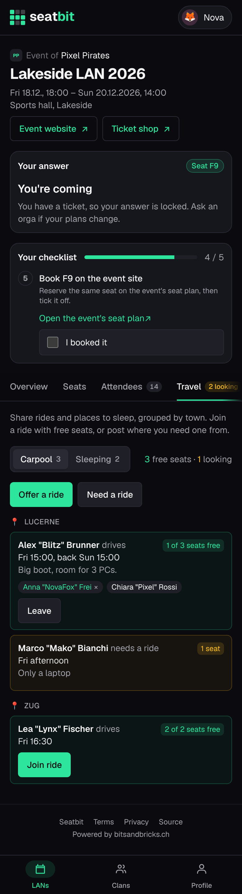
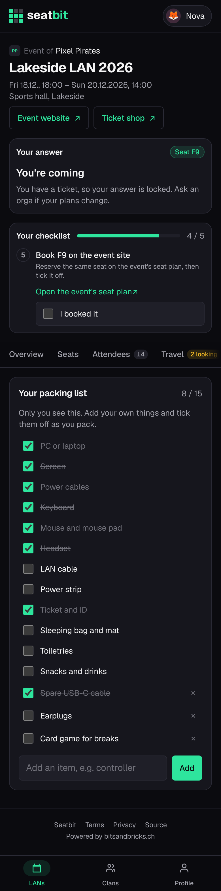
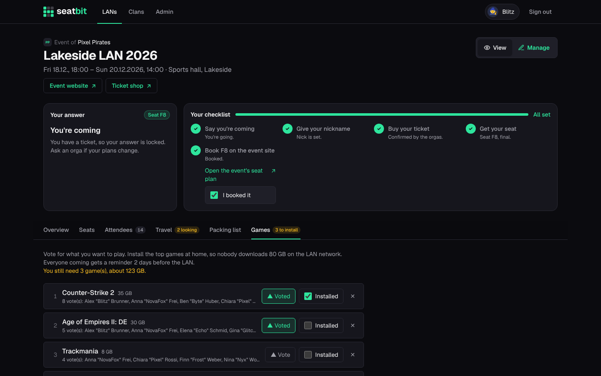
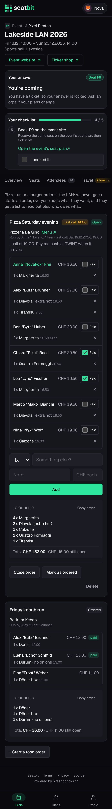

# Travel, packing, games and food

## Travel

On the **Travel** tab, members offer or ask for **rides** and **places to sleep**, grouped by town. Join an offer that has free places with one tap. Drivers can take someone who asked along, which also clears their request.

{ .shot width="300" }

## Packing list

Everyone gets a private **packing list** per event with the usual items (PC, screen, cables, headset, ticket, sleeping bag, ...). Add your own items and tick them off while you pack. Nobody else sees it.

{ .shot width="300" }

## Games

On the **Games** tab, suggest games to play with their download size, vote for the ones you want and tick off what you installed. The tab shows how many games you still have to install, and two days before the LAN everyone coming gets a reminder.

{ .shot }

## Food

The **Food** tab is for the pizza run or a burger order at the LAN. Anyone coming can **start an order**: what (e.g. "Pizza Saturday evening"), from where, a menu link, an optional **last call** and a note (e.g. how to pay). Tick *Send everyone coming a Discord DM* to let people know; it never sends a mail.

Everyone adds what they want: how many, the item, a note ("no onions") and the price. Until the last call you can remove your own lines.

The order shows a **To order** list with the same items merged ("4x Margherita") to read out on the phone, with **Copy order** to paste it into a chat, plus the total and what each person owes. Whoever started the order (or an orga) closes it, marks it as ordered and ticks off who **paid**.

{ .shot width="300" }
