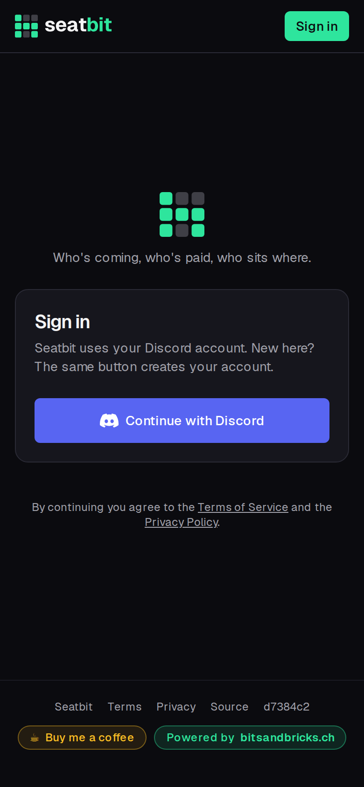
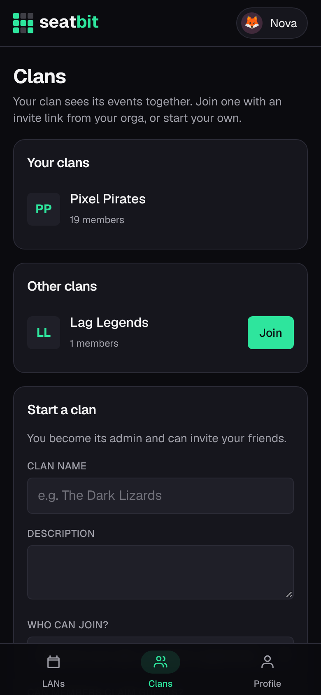
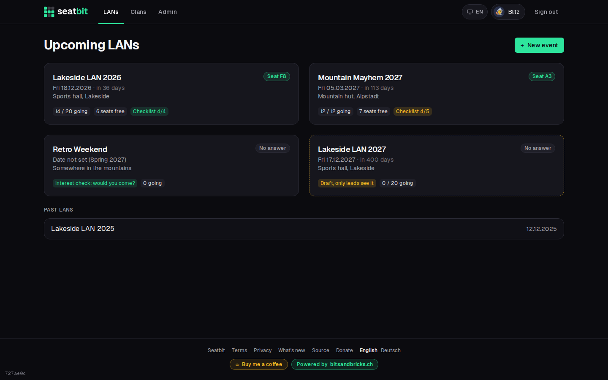

# Getting started

## Sign in

Open your clan's Seatbit (ask your orgas for the link) and click **Continue with Discord**. The same button creates your account the first time. Seatbit gets your Discord name, picture and email address; the email is used for reminders.

{ .shot width="300" }

The first time you sign in, Seatbit asks for your **first name, surname and nickname** (gamer tag). Your clan uses your real name to match you to tickets and seats; everyone else mostly sees your nick. Seatbit shows people as *Anna "Nova" Frei*.

## Join your clan

Everything in Seatbit belongs to a clan. Depending on how the clan admins set it up, you:

- open an **invite link** someone sent you, and you're in;
- click **Join** on the clan's page (*Clans* tab), and you're in, or an admin approves you first;
- are **added by an orga** (as a guest, before you even have an account). Then you get an email or a claim link, and signing in with a Discord account that has the same email takes over everything they set up for you.

Joined through the clan's link, but the orgas had already added you as a guest? Seatbit shows guests with your name or nick right after you join (or later under the clan's **Members** tab, *Take it over*). Click **That's me**: depending on the clan, an admin confirms it first or it moves over right away. Your events, seat and nicks from the guest are then yours.

{ .shot width="300" }

## Your LANs

The **LANs** tab lists the upcoming events of all your clans. Each card shows the date, how many people are coming, free seats and how far you are with your checklist.

{ .shot }

Next: [Events](events.md).
