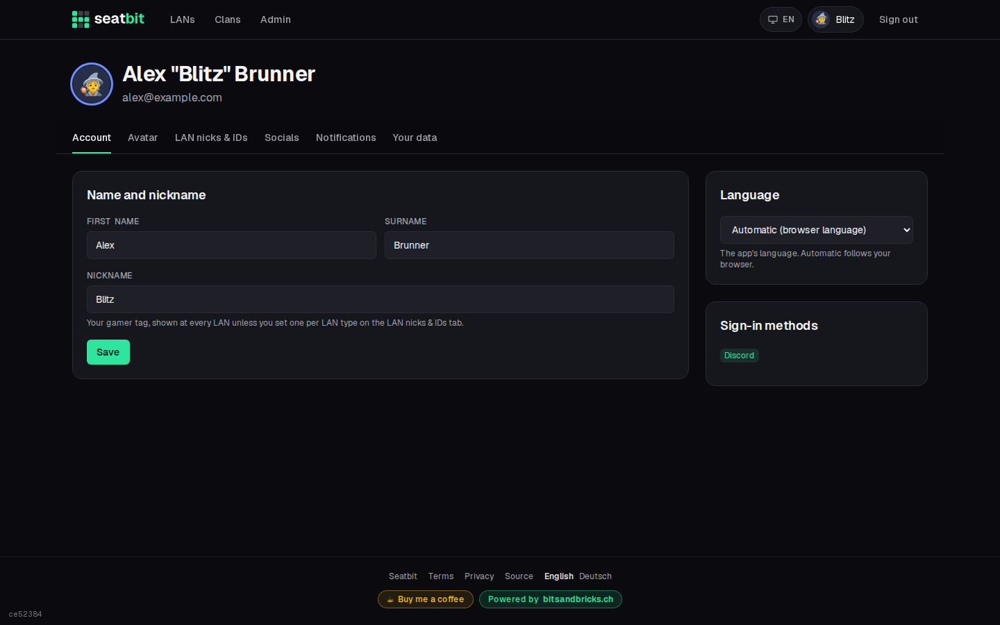
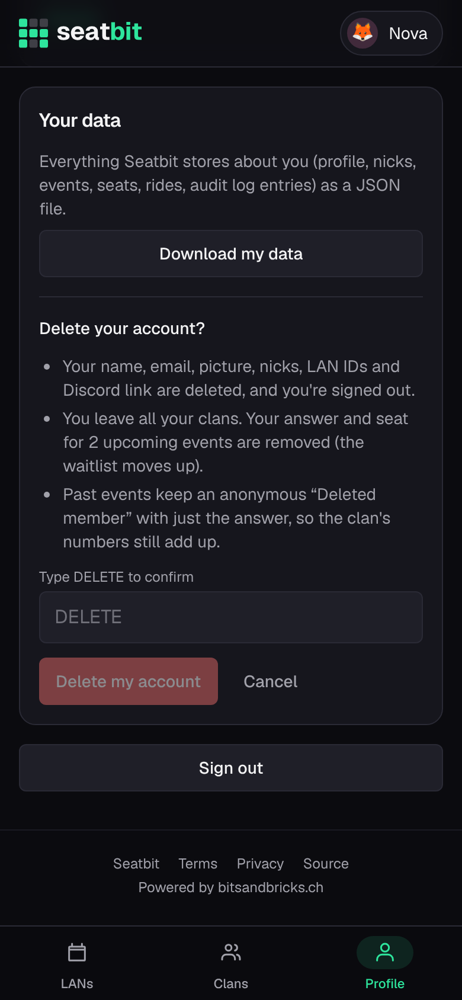

# Your profile

Open **Profile** (your avatar on desktop, the tab bar on phones).

{ .shot }

- **Account:** first name, surname and your default **nickname**.
- **Email reminders** and **Discord DMs:** switch them off if you don't want them. Discord DMs need a linked Discord account.
- **Events I hear about:** per clan, get told about all new events or only about certain LAN types (one-off events always count).
- **Avatar and colour:** use your Discord picture, an uploaded picture, an emoji or your initials. Your colour is used for the ring around your avatar and your seat on the plan.
- **Nicks and IDs per LAN type:** a nick for every event of a LAN type (e.g. your name on lal.gg) and your user ID or ticket number there.
- **Sign-in methods:** link Discord if you signed in another way.

## Your data

The **Your data** card has two buttons:

- **Download my data** gives you a JSON file with everything Seatbit stores about you: profile, sign-in methods, nicks, LAN IDs, clans, every event answer with seat and seat wishes, rides, packing lists, games, swap requests and the audit log entries about you.
- **Delete my account** (type DELETE to confirm) signs you out and deletes your name, email, picture, Discord link, nicks, LAN IDs, clan memberships, orga roles, rides and packing lists, plus your answers and seats for upcoming events (the waitlist moves up). Past events keep an anonymous *Deleted member* with only the answer, so your clan's history and stats still add up.

{ .shot }

If you're the only admin of a clan that has other members, make someone else admin first. A clan where nobody else with a login is left is deleted together with your account; the confirmation tells you before you delete.
