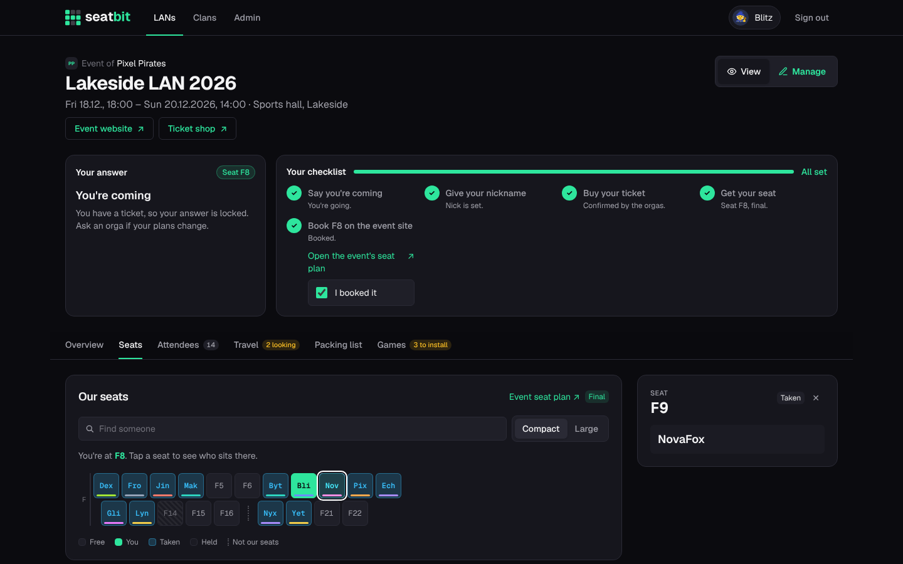
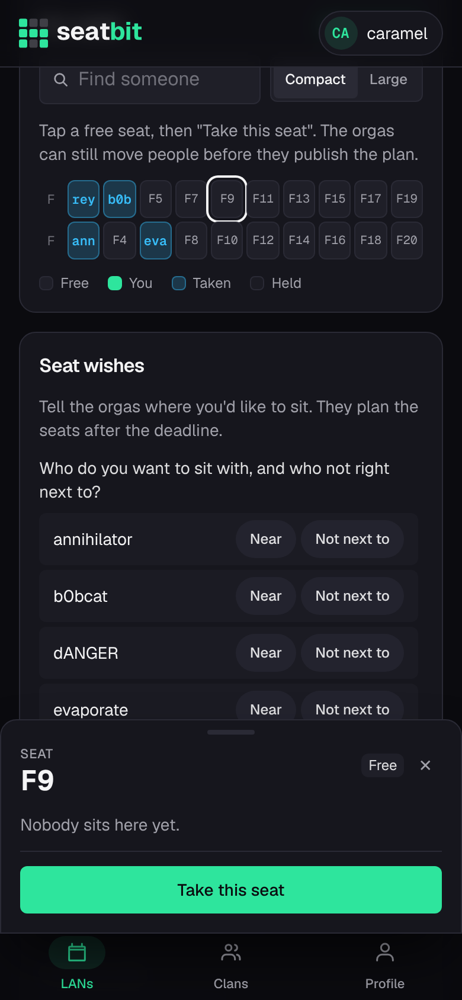
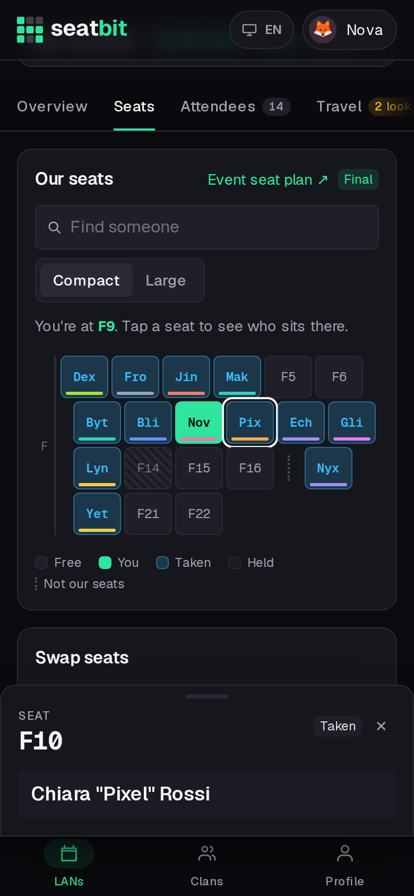

# Seats

The **Seats** tab shows the group's seat block: each letter is a row, each seat sits at its number. A dotted gap means those seat numbers aren't the group's.

- Seats show the seat label or the first letters of the nick. Switch to **Large** to show whole nicks (remembered on this device).
- Tap a seat to see who sits there (a panel on the right on desktop, a sheet at the bottom on phones).
- **Find someone** highlights a person.

{ .shot }

## How seats are given out

1. **Seat wishes:** tell the orgas who you want to sit with, who not right next to, whether you prefer the edge or the middle, or a specific seat.
2. **Self pick** (only when the orgas turn it on): tap a free seat and **Take this seat**. You can **Move here** or **Give up my seat** until the plan is final.
3. **Final plan:** the orgas check everything and finalize the plan. Only then do seats count, and everyone sees the plan.

<figure markdown>

{ .shot }

<figcaption>Self pick: take a free seat</figcaption>
</figure>
<figure markdown>

{ .shot }

<figcaption>The final plan</figcaption>
</figure>

## Book your seat on the event site

Many LANs have their own seat plan where every participant books their seat. When the orgas added its link to the event, your checklist gets a step *Book F9 on the event site* (and you get a Discord DM with an **I booked it** button). If your seat changes later, the tick is cleared so you book again.

## Swap seats

After the plan is final you can ask someone to swap. When they agree, an orga approves the swap and both of you are told.
