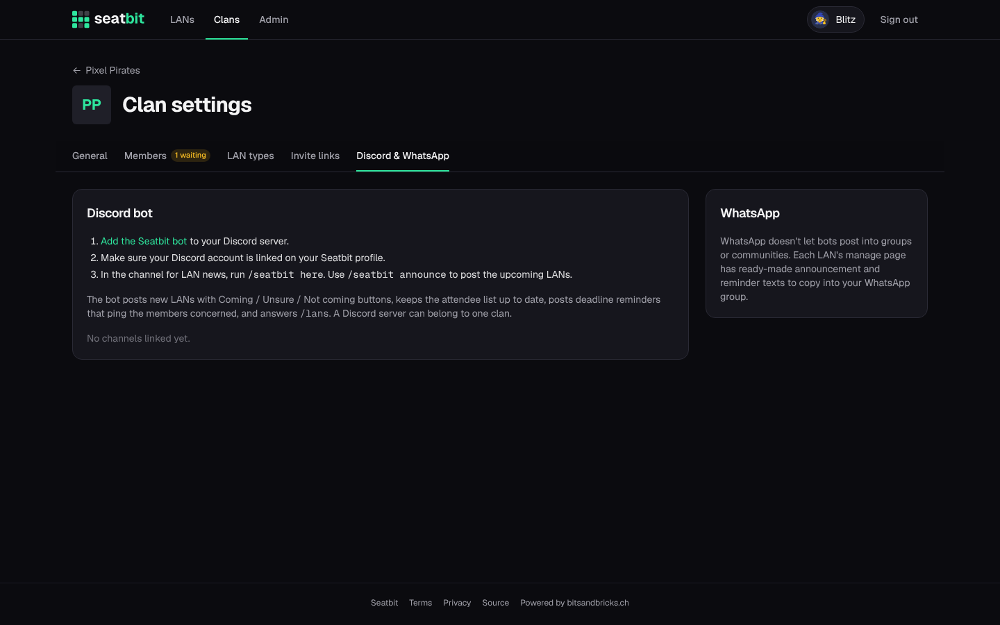
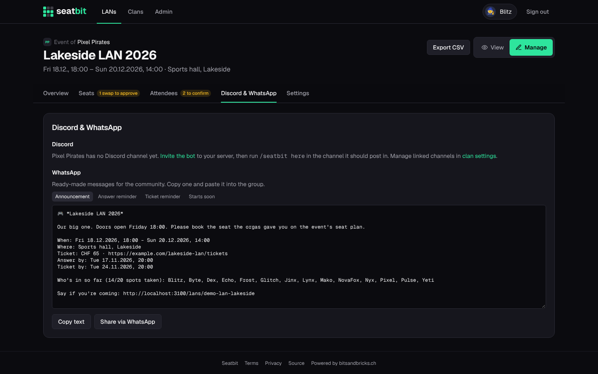

# Discord and WhatsApp

## Discord

If your Seatbit instance has the Discord bot set up (ask your platform admin, or see [Discord app and bot](../self-hosting/discord.md)), a clan admin can connect the clan's Discord server:

1. Open **Clan settings → Discord & WhatsApp** and click **Add the Seatbit bot** to invite it to your server.
2. In the Discord channel the bot should post in, run `/seatbit here`. You need *Manage Server* on Discord and a Discord account linked in Seatbit. If you admin several clans, use `/seatbit here clan:<name>`.

{ .shot }

A Discord server belongs to one clan. Once linked, the bot:

- posts each new event as an **announcement** with **Coming / Unsure / Not coming** buttons. The attendee list on the post updates live, also when people answer on the website. It also shows tickets, seat bookings and the next deadline, and pins the post if it has the *Pin Messages* permission;
- posts the **reminders** (answer, ticket, games, "starts tomorrow") in the channel, pinging the members they apply to;
- sends members **DMs** when something changes for them (their seat, the final plan, reminders), with buttons like *I booked it*. Members can turn DMs off on their profile.

Commands:

| Command | What it does |
| --- | --- |
| `/lans` | Your upcoming LANs of this server's clan (in DMs: all your clans) with answer buttons. Only you see it. |
| `/seatbit here` | Link this channel to your clan. |
| `/seatbit announce` | Post the clan's upcoming LANs in this channel. |
| `/seatbit stop` | Unlink this channel. |

Members who aren't on the clan's Discord server see a **Join our Discord** button on the clan page. The bot creates the invite itself if it has *Create Invite*; otherwise paste your own invite link in the clan settings.

## Per event

On **Manage → Discord & WhatsApp** of an event, re-post the announcement or post a reminder by hand.

{ .shot }

## WhatsApp

WhatsApp can't be automated for normal groups and communities, so Seatbit prepares the texts instead: on the same tab you get an announcement and reminder texts with a **Copy** button and a **Share via WhatsApp** link, ready to paste into your group.
