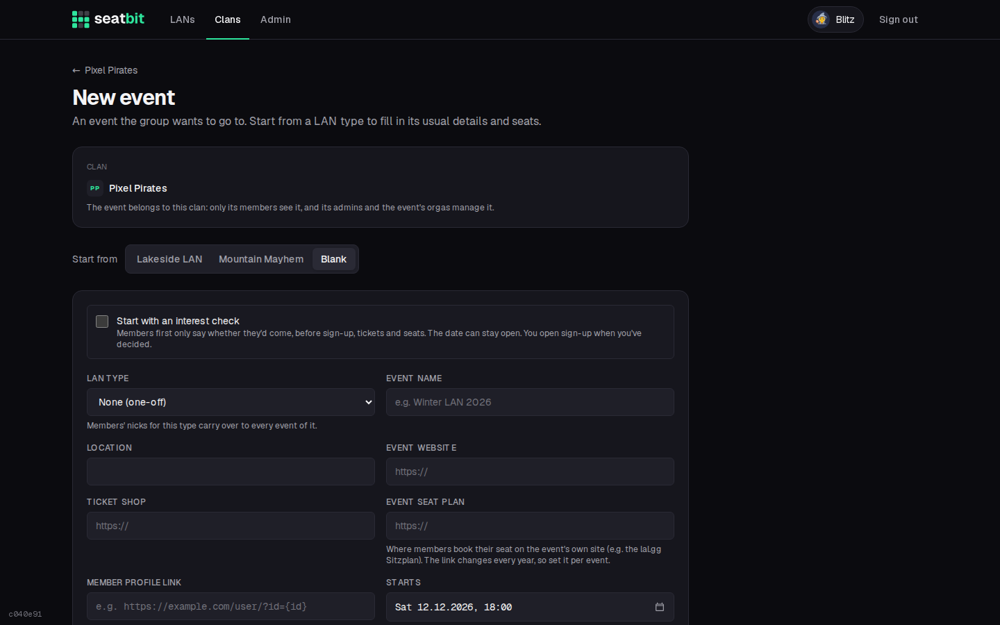
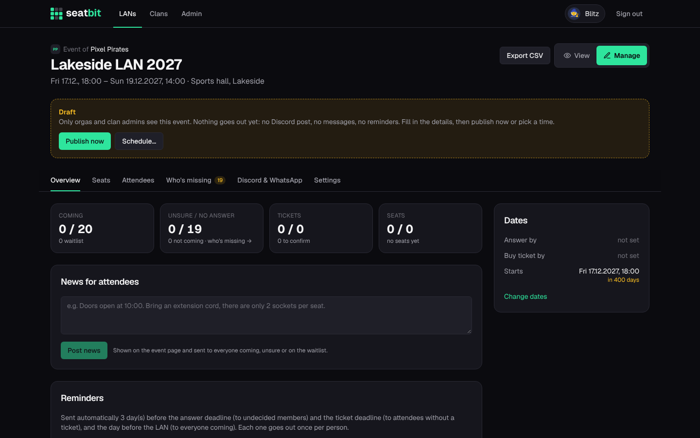
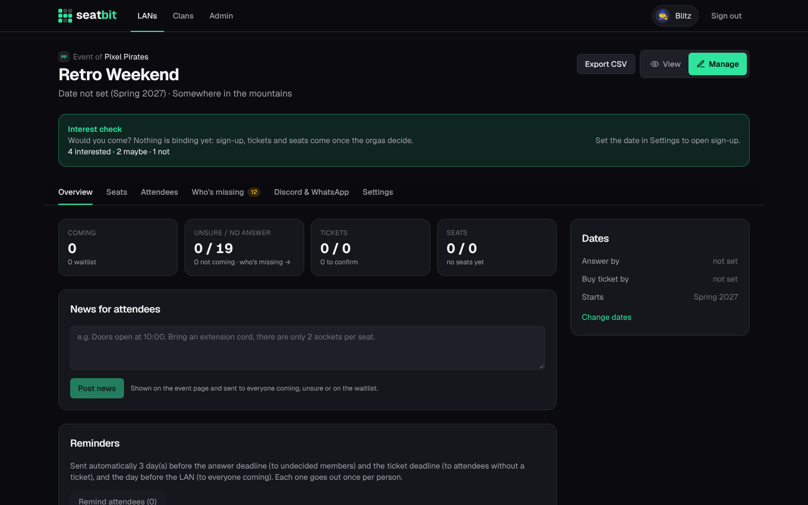
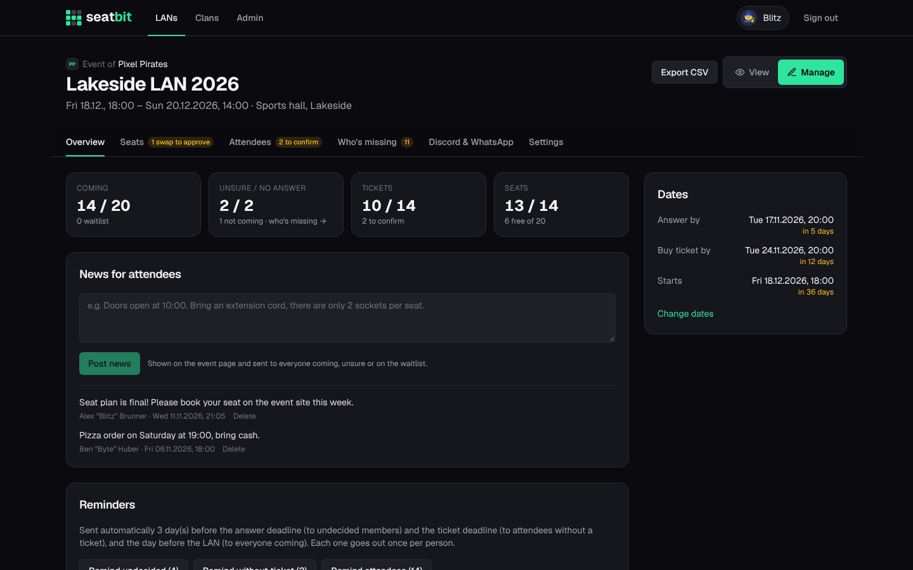
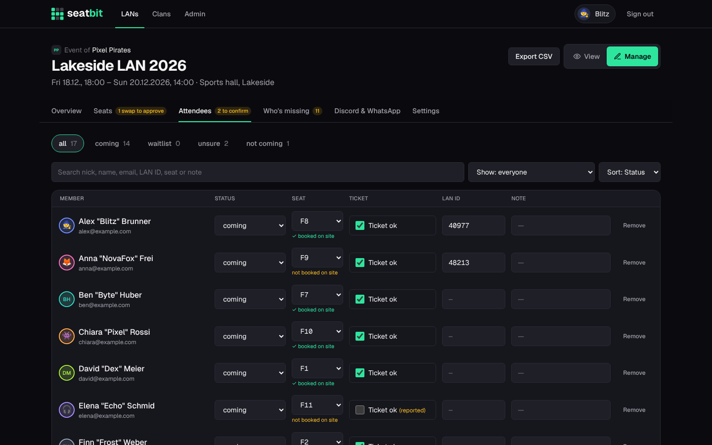
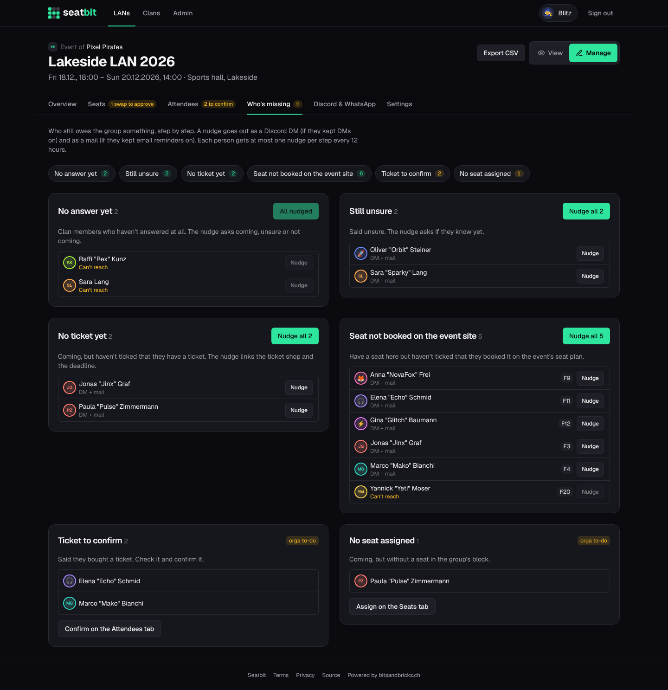
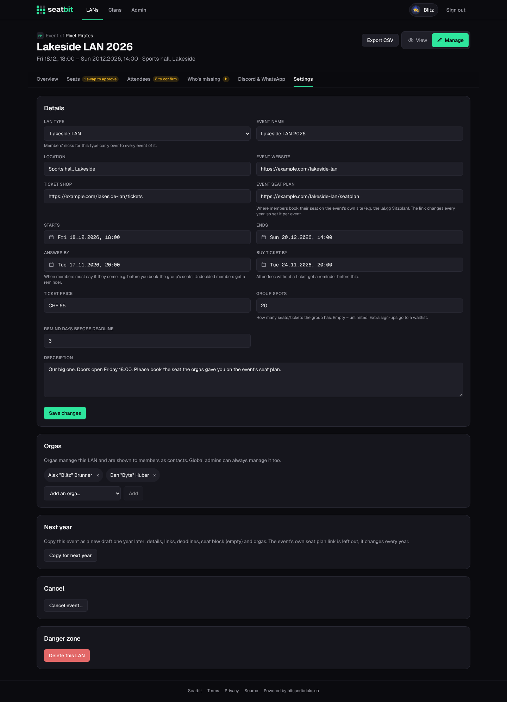

# Events

## Create an event

Click **New event** on the **LANs** tab or the clan page. **Start from** a LAN type to fill in its usual details and seats, or from *Blank* for a one-off event, then set the dates. Everything can be changed later.

{ .shot }

- **Dates:** start and end, the **answer by** date (when the group must know who comes, e.g. before you book the seat block) and the **buy ticket by** date.
- **Spots:** how many people the group can bring. When it's full, new answers go on a waitlist.
- **Seats:** the seats the event gave the group, e.g. `F1-F16, F19-F22`.
- **Event seat plan:** the link to the event's own seat plan, where every member books their seat (new every year).

## Draft, publish and schedule

A new event starts as a **draft**: only its orgas and the clan admins see it, and nothing goes out (no Discord post, no reminders, no messages). Fill in the details, then click **Publish now**, or **Schedule…** a time and it goes live by itself.

{ .shot }

Publishing shows the event to the clan, posts the Discord announcement with answer buttons, starts the reminders and tells members about the new event by email or Discord DM. Each member chooses per clan whether they hear about all events or only certain LAN types (one-off events always count).

## Interest check

Not sure yet if the group goes, or when? Turn on the **interest check**: members only answer *I'd come / Maybe / Not this time*, nothing binding. The date can stay open with a rough hint like "Spring 2027". When you've decided, set the date and click **Open sign-up**: everyone who was interested (except those who said no) is told, and the normal answers, tickets and seats start.

{ .shot }

## Manage an event

Orgas see **View / Manage** next to the event title. *Manage* has the tabs **Overview**, **Seats**, **Attendees**, **Who's missing**, **Discord & WhatsApp** and **Settings**.

{ .shot }

### Overview

Numbers at a glance (coming, unsure, tickets, seats), the deadlines, **news for attendees**, and **reminder buttons** to nudge people by hand: everyone who hasn't answered, everyone without a ticket, or everyone coming.

**News** are short updates ("Pizza order at 19:00, bring cash"). They show on the event page and go by email or DM to everyone coming, unsure or on the waitlist.

Reminders also go out automatically a few days before each deadline (set per event) and the day before the LAN. Each one is sent once per person.

### Attendees

One row per member: answer, seat, **ticket** (members tick *I bought my ticket*, you confirm with *Ticket ok*), their LAN ID and a note. Filter by status, search, and sort. You can change anyone's answer, also once it's locked.

{ .shot }

**Export CSV** downloads the group (seat, nick, name, email, status, ticket, LAN ID) to send to the event's organisers. It opens in Excel and Numbers with umlauts and accents intact.

### Who's missing

Everyone who still owes the group something, step by step:

- no answer to the interest check, no answer at all, or still unsure
- coming but no ticket yet, or no nickname
- self pick is on and they have a ticket, but no seat yet
- seat not booked on the event's own seat plan

Each person shows how a nudge reaches them: *DM + mail*, *Discord DM*, *Mail only* or *Can't reach* (no Discord and email reminders off). **Nudge** sends one person a short reminder for that step, **Nudge all** everyone in it. The Discord DM has buttons where they fit (*Coming / Unsure / Not coming*, *Buy ticket*, *I booked it*). DMs respect the member's DM setting and mails their email reminder setting, and each person gets at most one nudge per step every 12 hours. Nudges are off for drafts and cancelled events.

Your own to-dos are listed at the end: **tickets to confirm** and people **without a seat**, with a link to the tab where you fix them.

{ .shot }

### Settings

Edit the event's details, dates, spots and links, and add co-orgas. Also here:

- **Copy for next year** creates next year's event as a draft (dates +1 year, seat block, orgas).
- **Cancel event…** tells everyone who answered and turns the Discord post red. The event stays visible, greyed out; you can undo it.
- **Delete** removes a draft or an event for good.

## On the day

Members coming tap **I'm here** when they arrive, and everyone sees who is still on the way.

{ .shot }
