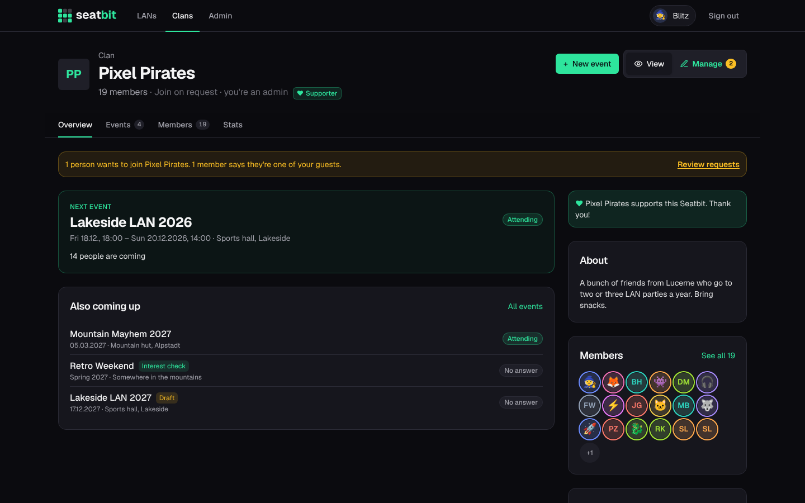
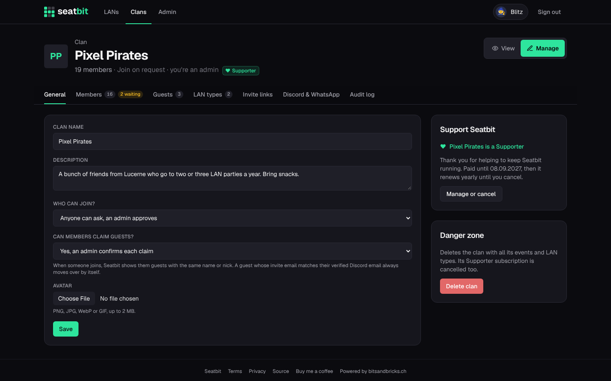
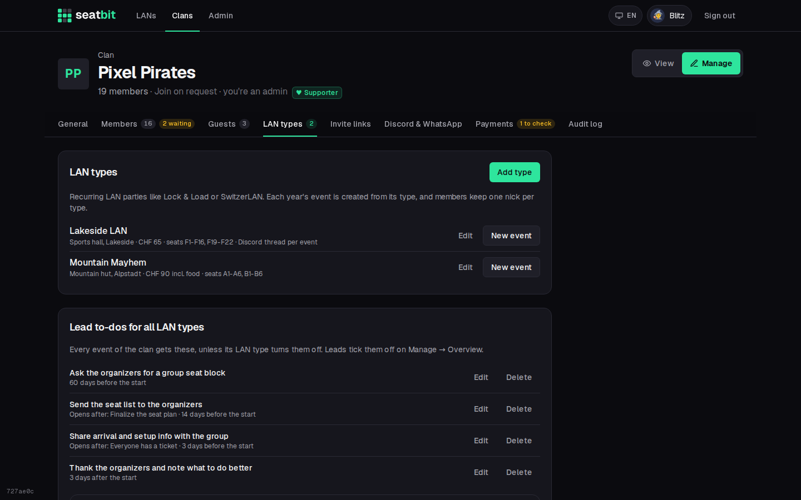
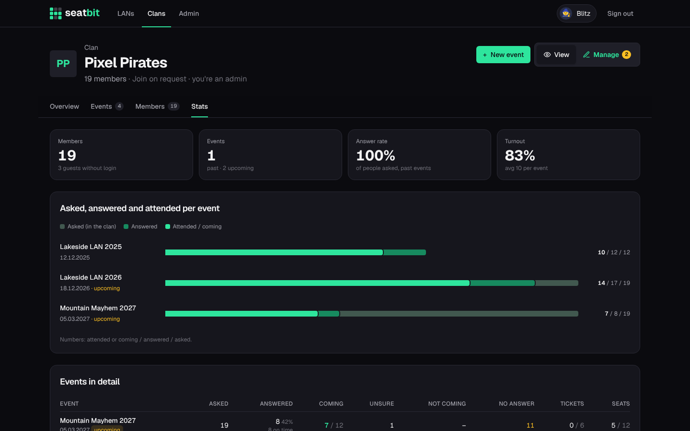

# Your clan

A **clan** is your group: its members, the LAN types you go to every year, the events, and its Discord server. A Seatbit instance can host many clans; each clan only sees its own events.

Everyone in a clan has one **clan role**:

| | Admin | Event manager | Recruiter | Member |
|---|:-:|:-:|:-:|:-:|
| Clan settings, Discord, delete the clan | ✓ | | | |
| Give and take roles | ✓ | | | |
| Approve join requests, add and remove members, guests, invite links | ✓ | | ✓ | |
| Create events, run every clan event, LAN types | ✓ | ✓ | | |
| Stats and audit log | ✓ | ✓ | ✓ | |
| Answer for events | ✓ | ✓ | ✓ | ✓ |

Recruiters only remove plain members; people with a role are removed by an admin. A clan always keeps at least one admin. Change roles under **Members** or on a member's profile (see [Members and guests](members.md#roles)).

On top of that, **orgas** are set per event. They edit that event, its attendance and seats, and any orga can add co-orgas. Any member can be an orga of a single event. Whoever creates an event and all clan admins become its orgas automatically, and admins and event managers can always manage every event.

## Create a clan

Anyone signed in can start a clan on the **Clans** page (*Start a clan*). You become its first admin.

The clan page has **View** and **Manage** (for admins, event managers and recruiters, each with the tabs their role allows), with the tabs **Overview**, **Events**, **Members** and **Stats**.

{ .shot }

## Clan settings

Open the clan and switch to **Manage**. The tabs:

- **General:** name, description, avatar, and **who can join**:
    - *Approval* (default): anyone can ask to join, an admin approves.
    - *Open*: anyone joins directly.
    - *Invite only*: only with an invite link.

    And **whether members can claim guests** themselves (see [Members and guests](members.md#members-claiming-a-guest)):
    an admin confirms each claim (default), same name or nick moves over right away, or only with the guest's own link.
- **Members:** approve join requests and guest claims, add existing Seatbit users, give roles. See [Members and guests](members.md).
- **Guests:** people without an account yet.
- **LAN types:** templates for the LANs you go to every year (see below).
- **Invite links:** links that let anyone who has them join as a member. They always work, whatever the join mode. Delete a link to stop it.
- **Discord & WhatsApp:** connect the clan's Discord server. See [Discord and WhatsApp](discord.md).

If the instance you use has Supporter payments on, **General** also has a **Support Seatbit** card. Paying is voluntary: your clan gets a Supporter badge and a thank-you, and nothing else changes. Pick yearly or monthly, pay through Stripe (card, TWINT and more), and cancel any time with **Manage or cancel**. See [Supporter payments](../self-hosting/supporters.md).

{ .shot }

## LAN types

A **LAN type** describes a LAN party you go to regularly, e.g. *Lock & Load* or *SwitzerLAN*: location, website, ticket shop, price, how many spots the group usually gets, and the seats you usually get (e.g. `F1-F20`). New events are created from a type and copy all of this. The type also sets the event's **usual length** in hours (e.g. Fri 18:00 to Sun 16:00 = 46) and how many days before the start members must **answer by** (default 30), so the dates fill themselves in.

Members set a nick and their user ID **per LAN type**, so they only enter their lal.gg name once, not every year.

{ .shot }

## Clan stats

**Stats** on the clan page shows, per event, how many people were asked, answered and came, ticket and seat numbers, and the answer rate.

{ .shot }
