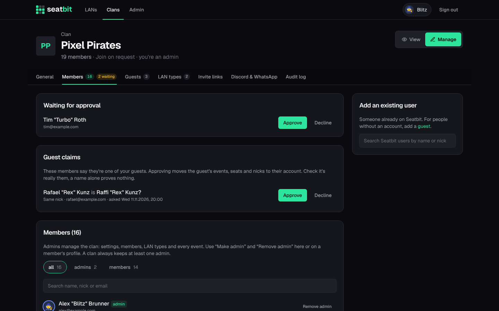
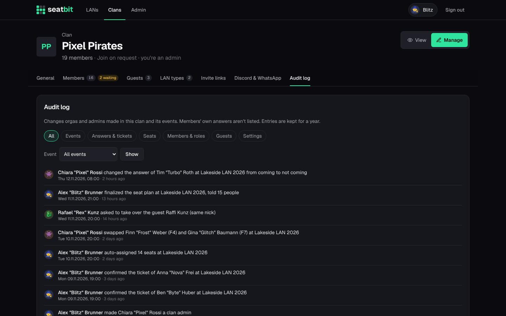
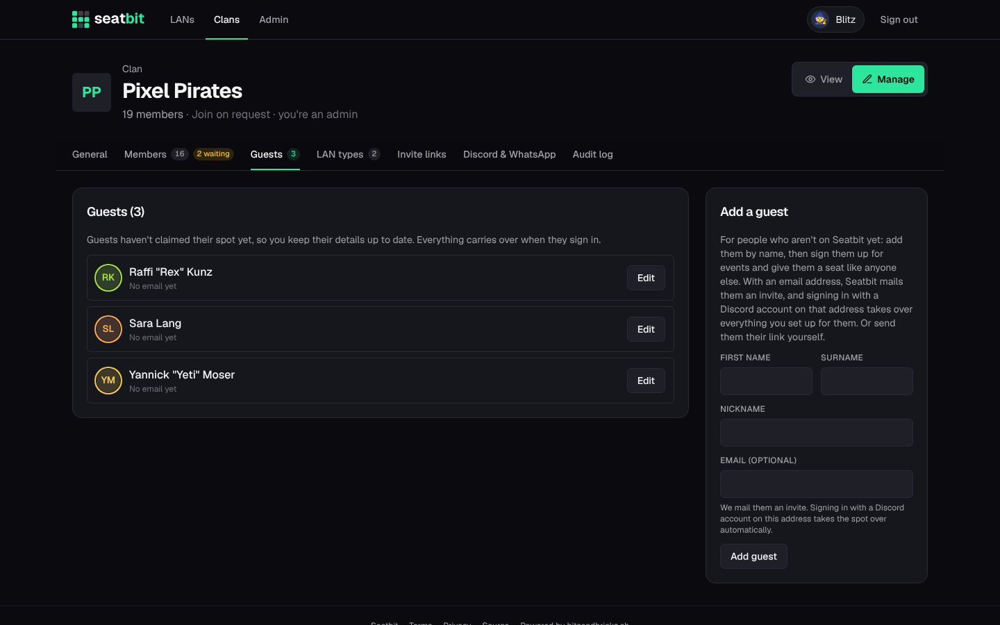
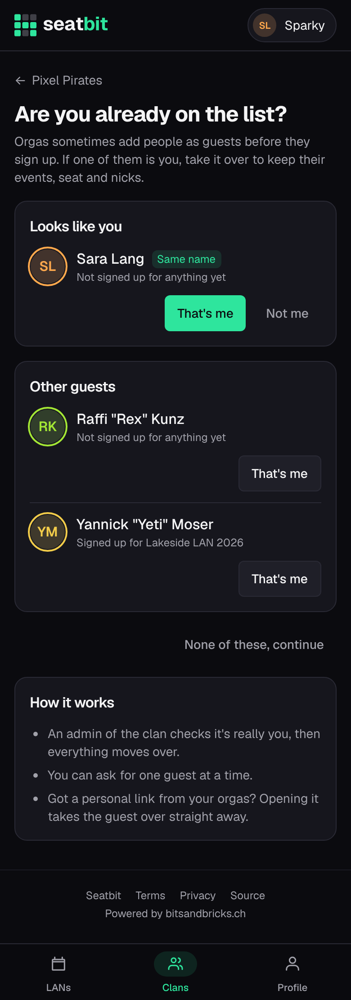

# Members and guests

Manage people under **Clan settings → Members**.

{ .shot }

- **Waiting for approval:** people who asked to join (join mode *Approval*). Approve or decline.
- **Guest claims:** members who say they're one of your guests. See [below](#members-claiming-a-guest).
- **Add an existing user:** search Seatbit users by name or nick and add them directly.
- **Make admin / Remove admin:** a clan always keeps at least one admin.
- **Remove** takes someone out of the clan.

## Audit log

**Clan settings → Audit log** lists the changes orgas and admins made in the clan and its events: seat moves, swaps, auto-assign and finalizing the plan, changed answers, confirmed tickets, orga and admin roles, join approvals, guest edits, publishing, cancelling and event edits. Filter by kind of change or by event. Members' own answers aren't listed, and entries are kept for a year. Only clan admins see it.

{ .shot }

## Guests

**Clan settings → Guests.** Guests are people who aren't on Seatbit yet, e.g. a friend who only comes once a year. Add them with first name, surname and nick, then sign them up for events and give them a seat like anyone else. You can edit their name and nick later.

{ .shot }

To hand a guest over to its owner:

- enter their **email** and click **Send invite**: Seatbit mails them a link. When they sign in with a Discord account that has the same (verified) email, everything you set up for them moves to their account automatically;
- or **copy their claim link** and send it yourself (WhatsApp, Discord, ...). Whoever opens it and signs in takes the guest over. **New link** makes the old one stop working.

### Members claiming a guest

Often you add someone as a guest, and later they sign up on their own, e.g. through the clan's invite link in your group chat. Then they don't need a personal link: when someone joins and a guest has the **same name or nick** (ignoring case and accents, so *Jörg Bäcker*, *Jorg Backer* and *Joerg Baecker* all match), Seatbit asks them *"Are you already on the list?"*. Any member can also open that page later from the clan's **Members** tab and pick a guest.

{ .shot width="300" }

What happens next depends on **Clan settings → General → Can members claim guests?**

| Setting | What happens when a member says "That's me" |
| --- | --- |
| **An admin confirms each claim** (default) | The request shows up under **Members → Guest claims**, and clan admins get a mail and Discord DM. **Approve** moves everything over; **Decline** tells them. |
| **Same name or nick moves over right away** | A guest with the same name or nick moves over at once. Picking any other guest still needs an admin. |
| **Only with the guest's own link** | Members can't claim guests. Use the email invite or the claim link above. |

Safeguards, whatever the setting:

- Only members of the clan can claim, never someone who's still waiting for approval.
- A member can ask for one guest at a time.
- A guest you gave an email address, or made a clan admin, always needs an admin's OK: the email tells you who they really are.
- A name is no proof. Before you approve, check it's really them (the request shows their email and why it was suggested).
- Declined claims and guests a member marked *Not me* aren't suggested to them again.
- Every claim, approval and decline is in the audit log.

A guest whose invite email matches the member's verified Discord email still moves over by itself when they sign in, no claim needed.
